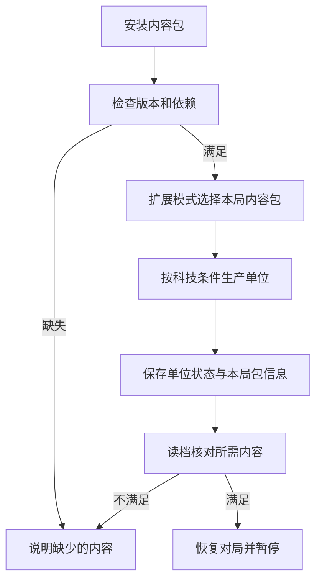

# 1. 系统概述

2026-10-23，设计草案。目标是在 Iron Tide 扩展模式中逐步加入参考 RA3、星际 1、星际 2 的兵种，形成可独立启用的 DLC。本文登记候选和开发顺序；不表示新增单位、资源或 DLC 管理功能已经实装。

保留 RA2 对照模式的既有单位和规则。跨作品单位使用扩展模式的统一经济、生产和伤害口径；逐项参考原作机制，再记录适配差异，不直接混用各游戏的价格、射程和时间单位。

当前已有铁锤、双刃、帝国、虫群等原型条目，以及部署、运输、舰载机、技能开关和对局存档基础。原型名称不代表原作机制完成；已有基础内容继续可用，新包提供经过验证的完整单位或独立变体，不把现有单位直接移走。

# 2. 服务器功能

本阶段为本地单机内容包，无服务器、付费验证或商店接入。本轮不确定 DLC 售价、销售平台和上线日期。

# 3. 客户端功能

## 3.1 内容包划分与候选单位

包名为暂定工作名，原作单位名称用于说明参考对象。下列玩法为拟保留的设计重点，具体原作版本、参数和交互仍需在实施单个单位前逐项核对。

| 内容包 | 候选参考单位 | 拟保留的玩法 | 需要补齐的能力 | 优先级 |
| --- | --- | --- | --- | --- |
| 机械战线 · RA3 方向 | 守护者坦克 | 主炮与目标标记切换，辅助队友集火 | 标记归属、增伤叠加限制、视野丢失中断 | 首批候选 |
| 机械战线 · RA3 方向 | 激流运输车 | 两栖突击、载员、登陆卸载 | 两栖运输的上下岸、卸载位置和目标类型检查 | 首批候选 |
| 机械战线 · RA3 方向 | 铁锤坦克 | 主炮与汲取武器切换 | 持续汲取、击毁后的武器获取、换武器存档 | 第二批；先核对现有原型 |
| 机械战线 · RA3 方向 | 天狗机甲 | 地面与飞行形态转换 | 转换时间、落地合法性、寻路和受击分类切换 | 后续批次 |
| 星海经典 · 星际 1 方向 | 攻城坦克 | 移动炮击与架起炮击，射程盲区和范围杀伤 | 通用架起状态、转换中指令处理、友军伤害规则 | 第一只完整单位 |
| 星海经典 · 星际 1 方向 | 潜伏者 | 钻地后直线穿刺 | 隐蔽与探测分离、钻地转换、穿刺命中去重 | 探测系统完成后 |
| 星海经典 · 星际 1 方向 | 航母 | 母舰生产、派遣并回收拦截机 | 子机建造费用、损失补充、母舰死亡和存档归属 | 舰载机基础扩展后 |
| 星海经典 · 星际 1 方向 | 金甲虫 | 携带有限弹药的重型地面爆破 | 弹药排队补充、弹体寻路、运输与弹药关系 | 后续批次 |
| 星海进化 · 星际 2 方向 | 维京战机 | 空中防空与落地对地切换 | 复用空地转换能力，单独配置武器与定位 | 天狗共用底层完成后 |
| 星海进化 · 星际 2 方向 | 追猎者 | 短距闪现、集火与撤退 | 落点合法性、失败反馈、可见范围和地形边界 | 后续批次 |
| 星海进化 · 星际 2 方向 | 不朽者 | 反重甲、护盾防护 | 独立护盾值、回复与受击规则；先选定参考版本 | 护盾系统完成后 |
| 星海进化 · 星际 2 方向 | 医疗运输机 | 运兵与治疗支持 | 生物/机械治疗对象、治疗资源、上下客与治疗互斥 | 后续批次 |

第一阶段完成攻城坦克、目标标记坦克、两栖运输车三种玩法的完整闭环，再决定扩展数量。星际 1/2 同源单位优先共享能力，确有差异时使用独立变体；不做两个只换名字、实际玩法相同的单位。

## 3.2 启用与对局规则

- 安装内容包与启用内容包是两个状态。开局选择本局允许的包；新装包不自动改变现有对局。
- RA2 对照模式不加载这些跨作品单位。扩展模式启用后，玩家与 AI 按相同包清单和科技条件使用单位。
- 第一阶段沿用资金、电力、现有独立工厂队列和科技前置；不同时引入星际的双资源、补给上限与种族生产体系。
- 每个包先提供有明确定位的单位组合，不宣称完成一个原作阵营。每包最多先增加一类必要科技设施。
- 新单位必须明确生产建筑、页签、解锁前置、目标类型、优势和弱点，不能仅靠高伤害替代原有单位。
- 固有技能不需要抽卡。沿用 Q/W/E/R 技能入口与当前单位菜单收起方式；自动施放仅用于明确适合自动化的能力，需提供开关。
- AI 必须理解部署、变形、最低射程、探测、治疗目标、子机补充等约束；不能仅按普通坦克的攻击流程使用所有单位。

## 3.3 内容独立性与存档

当前尚无通用 DLC 管理能力，现有尤复数据是专门追加载入；这些追加包不能直接当成完整 DLC 框架。

后续内容包需要独立记录身份、版本、依赖、单位、建筑、武器、技能、科技、图标、模型、特效和声音。不同包不得相互覆盖单位或资源身份；缺少必需依赖时整包不进入生产目录，给出具体原因。

对局保存本局启用的内容包、版本及规则身份。加载时核对所需内容：缺包提示所缺包名，版本不符提示版本；不得删除未知单位后勉强进入战场。没有使用新包的旧存档应保持可读，当前全目录校验方式需要先升级为能够识别本局实际内容的兼容方案。

升级前保留旧存档副本；有明确迁移规则才升级。停用一个包只影响新开局，不强行改写已经存在的对局。

## 3.4 资源准备

统一当前等距画面的比例、朝向、阴影、阵营色、选择框和武器挂点。RA3/星际 2 的模型需要适配现有显示方式，不能把模型文件放进目录就视为接入完成。

每个单位都要具备生产图标、移动/攻击/死亡表现、技能状态反馈、选中/移动/攻击语音及武器音效。临时占位资产只用于开发验证，并标明状态。

本地原作参考资源与发行候选资源分别登记来源和使用范围。面向公开发行的包优先准备原创名称、美术、语音和音乐；原作参考文件不默认进入发行包。具体发行素材清单尚未确定。

## 3.5 分阶段完成条件

1. **内容包基础**：可独立启用、完整性检查、科技与生产目录隔离、新旧存档兼容；关闭全部新包时原有模式回归通过。
2. **第一只完整单位：攻城坦克**：生产、架起/收起、禁止架起时移动、射程盲区、范围命中、AI 使用、图标/语音/特效、架起中与开火中存档全部覆盖。
3. **第一组可玩单位**：补目标标记坦克与两栖运输车；验证协同增伤、运输死亡、岸边拥堵、不能卸载反馈。玩家确认实际手感后形成首个开发预览包。
4. **第二批共用能力**：护盾、隐蔽/探测、空地转换、子单位生产。先各做一个代表单位，再复用到其它候选。
5. **DLC 发布候选**：独立安装/停用、完整资源、AI 对战、数值定位、缺包读档反馈和版本升级验证齐全。阶段结束不等于已经配置商店或付费发行。

## 3.6 参考依据与待核对项

- RA3：本机官方 SDK 的守护者坦克定义含 `TargetPainter`，铁锤定义含 `ToggleLeechBeam`；已核对 `refs/ra3-sdk/installed/SAGEXML/Allied/Units/AlliedAntiVehicleVehicleTech1.xml` 与 `Soviet/Units/SovietAntiVehicleVehicleTech1.xml`。用于机制对照，Godot 侧独立实现。
- 星际 1：[暴雪航母资料](https://classic.battle.net/scc/protoss/units/carrier.shtml)明确拦截机的生产、出击和母舰关系；[暴雪潜伏者资料](https://classic.battle.net/scc/zerg/units/lurker.shtml)明确钻地攻击和直线穿刺。二者分别作为子单位与探测系统的行为参考。
- 星际 2：[暴雪攻城坦克战术说明](https://news.blizzard.com/en-us/article/5740271/game-guide-terran-siege-tank-push)可作部署与推进玩法参考，不作为当前版本数值表。
- 其它候选、版本差异、数值及资源完整性均未完成逐项审计。实施时补充对应官方数据、编辑器定义或原作可复现行为；不把玩家攻略当作引擎源码。
- 当前不预估制作天数；先以一个单位的完整交付测量资源制作和机制验证成本，再估算各包规模。

# 4. 流程图

