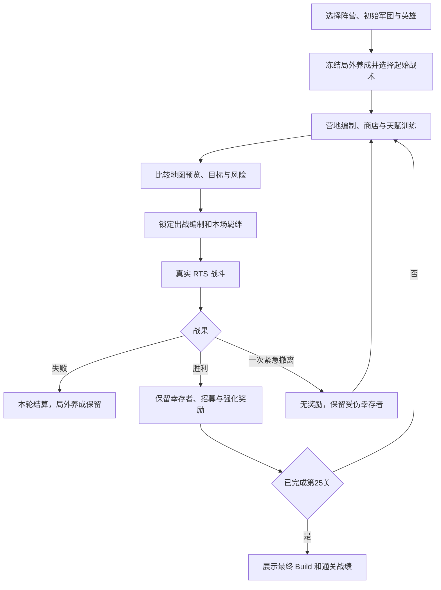

> 本文为最初策划提案，已获用户同意进入实施；当前 v0.29.0 的实际规则、首版取舍和验证边界以 [EXPEDITION.md](EXPEDITION.md) 为准。候选专精与跨阵营佣兵不代表均已实装。

# 铁潮远征 2.0：25 关军团构筑肉鸽策划案

版本：讨论稿 v1，2026-11-17。定位：完整玩法评审稿，尚未实施，以下新增数值均为首轮调试起点，不是已验证的平衡结论。

用户明确范围：补全图标和地图预览；扩展至 25 关；允许选择初始出现单位；使用已有尤复复刻地图并新增 6 张；商店支持多层羁绊与不同 Build；局内获得强化单位；强化“养成中兵种自带天赋的解禁”。最后一项不指英雄契约 W／被动，也不把它们混作同一养成轴。

本稿采用现有单机 RTS 战斗，保留手动指挥、建造和生产。自走棋借鉴的是阵容构筑、商店选择和羁绊层次，不把战斗改成自动布阵。对应界面见 [UI 设计](EXPEDITION_REDESIGN_UI.md)。现行版本事实继续保留在 [EXPEDITION.md](EXPEDITION.md)，本稿不覆盖已确认行为。

# 1. 系统概述

## 1.1 核心体验与设计目标

玩家每轮选择一支有明确作战方向的起始军团，通过五个战区的 25 场战斗，逐步形成“主力兵种＋多层羁绊＋自带天赋解禁／升级＋少量关键战术装备”的组合。每过数关，应产生一次能看见、能操作出来的打法变化，而不是只让攻击数字变大。

建议一轮目标时长 130～180 分钟，支持分多次继续；20 场普通／精英战目标平均 4～5 分钟、五场章末战平均 6～8 分钟，另计整备选择。超过 180 分钟首先削减重复建设和追残兵，不用全局倍速掩盖问题。这是体验目标，须自然游玩测定。

三条衡量标准：第 3 关看出构筑方向；第 10 关形成至少一组中层羁绊和一项自带天赋强化；第 20 关形成主副两套联动，并在最后五关展示优势和应对短板。

## 1.2 当前版本的问题：已核对源码的事实与设计判断

| 当前事实 | 对体验的影响／设计判断 | 2.0 对策 |
| --- | --- | --- |
| 18 关；营地以文字标签、按钮为主，奖励和商品未显示单位肖像或专属图标 | 玩家难以记住自己拿了什么，收获缺少辨识度 | 图像卡、编制栏、即时变化预览 |
| 远征选择的是自制地图；已有六张尤复地图未进入远征路线池 | 原版地图积累没有转化为肉鸽内容 | 原版缩略图＋真实地形路线，至少 12 张候选池 |
| 当前 24 种 Buff 中 16 种直接增强攻击、生命、防御或移速；只有三种路线支援 | 选择偏向数字大小，路线之间变化不足 | 羁绊、目标类型、原生机制强化、地图事件共同变化 |
| 美国／苏俄按固定基础许可发放初始增援，只有英雄可以选择 | 第一关阵容重复 | 预设军团＋预算自选 |
| 商店仅在固定若干关开放，主要卖许可、通用 Buff 和维修包 | 难以持续追逐或转变 Build | 每关整备，五级商店、定向槽、锁定、训练服务 |
| 第 16～18 关开放全部本轮目录兵种 | 前期取舍在终局被稀释 | 后期完整基础设施，但继续遵守已获得的兵种许可 |
| 局外自带天赋直接随出征快照带入；局内无专门解禁／升级商品 | 未养成玩家难体验原生机制；已养成玩家局内成长弱 | 解禁、升级、满级后的专精三段选择 |
| 既有测试主要验证流程和断言，未证明自然时长、胜率或登陆体验 | 不能把“18 改 25”直接视作更好玩 | 新增自然体验验收与地图可达性准入 |

补充：v0.28.3 的默认 10000 和新增资金档位修改的是遭遇战；当前远征仍显式使用前期 8000、终局 18000。2.0 要单独制定远征经济，不能假定它已随大厅更改。

## 1.3 玩法的四条成长轴

| 成长轴 | 玩家在做什么 | 不与什么混淆 |
| --- | --- | --- |
| 编制与羁绊 | 招募不同兵种、选择出战编制，补齐阈值 | 不是同兵种堆几十辆就凑满羁绊 |
| 兵种强化 | 将常用兵种升至强化 I／II／III | 不覆盖战斗获得的老兵／精英军衔 |
| 自带天赋 | 解禁养成界面中的原生机制，再升 0～3 级 | 不代替英雄契约、W 卡牌或普通被动卡 |
| 战术装备 | 用有限装备槽改变打法或补足短板 | 不再无限叠加全军百分比 Buff |

# 2. 战役功能、流程与规则

本项目为单机游戏，本章描述战役规则，没有新增联网服务器需求。

## 2.1 五章二十五关

25 关均为真实战斗；事件、商店和营地不占战斗关数。每章第四关提供普通／精英两种风险，章末固定 Boss；其余关至少两条可行路线。下面是章节任务骨架，地图和敌方编制按适配条件变化，不要求所有玩家每轮走同一条地图顺序。

| 关 | 战役定位 | 主要目标／变化 | 构筑进度与奖励侧重 |
| --- | --- | --- | --- |
| 1 | 前线接触 | 占领并维持前哨 60 秒，练习初始编队 | 第一项通用战术装备 |
| 2 | 断敌补给 | 摧毁两处指定补给设施，完成后即可撤出 | 第一次指定兵种强化 |
| 3 | 车队护送 | 三辆任务车至少两辆抵达，遭遇两轮侧翼袭击 | 自带天赋解禁自选；已有者选升级券 |
| 4 | 风险路线 | 普通清剿／精英伏击二选一 | 补齐第二条羁绊，精英额外招募 |
| 5 | 第一章：钢铁关隘 | 先破两座供能设施，再攻指挥部；可绕侧翼 | 章末核心装备；商店升二级 |
| 6 | 工业争夺 | 三个据点累计占领 180 点；每秒每点 +1 | 首次军需支援编制 |
| 7 | 桥头控制 | 修复或守住可用桥路，再摧毁桥头目标 | 工兵、机动或火炮方向 |
| 8 | 限时突袭 | 6 分钟内破坏雷达；超时增加援军但仍可过关 | 定向天赋升级／强化单位 |
| 9 | 双线战区 | 普通单线／精英两路进攻二选一 | 反空、反隐、维修补位 |
| 10 | 第二章：防空堡垒 | 地面电站、机动防空、指挥部构成可分拆防线 | 第二件核心装备；商店升三级 |
| 11 | 战俘营 | 解救至少两个小队，出关可招募其中一队 | 第一次可选跨阵营佣兵 |
| 12 | 战区争夺 | 海岸／陆地路线并列，不强迫纯陆军登陆 | 海军、空军或陆军扩展 |
| 13 | 特装实验场 | 攻占两处实验设施，守住 90 秒 | 直接获得一支强化 II 特装部队 |
| 14 | 后勤危机 | 护送维修站／精英据点防守二选一 | 修复战损、补足构筑关键牌 |
| 15 | 第三章：磁暴核心 | 两个能源节点交替供能，拆节点产生进攻窗口 | 原生天赋专精；商店升四级 |
| 16 | 闪击前线 | 两个目标任选其一，但奖励方向不同 | 固定一种主 Build，允许换副流派 |
| 17 | 制海／空地协同 | 航道控制或陆上机动，提前展示地图适配 | 海空构筑不被强制替换 |
| 18 | 战略研究所 | 有限援军下夺取装置，不必拆完整基地 | 强化 III 候选或关键天赋升满 |
| 19 | 高危猎场 | 普通据点／精英护卫队二选一 | 终局反制、跨阵营补位 |
| 20 | 第四章：机动指挥军 | 敌指挥车周期转移，摧毁补给节点减慢转移 | 第三件核心装备；商店升五级 |
| 21 | 终局备战 | 三种短战任选：补给、训练、招募 | 定向补缺，不再纯随机赌牌 |
| 22 | 复合战线 | 守点与攻点交替，目标和进度明确 | 检验持续输出和机动 |
| 23 | 突破封锁 | 多条推进路线，可破局而非全图清兵 | 固定高质量商店一次 |
| 24 | 最后整备战 | 普通守城／精英突袭二选一 | 完整修整服务、终局专精自选 |
| 25 | 第五章：终极战区 | 三阶段指挥中枢战；摧毁阶段目标后推进 | 通关展示 Build、关键联动与战绩 |

Boss 设计限制：不用长时间无敌、地图外无法处理的火力或无预警瞬杀主力制造难度；任何护盾阶段必须有可攻击的破局目标。五个 Boss 分别考验破阵、协同、窗口、机动和综合指挥，不只是同一基地血量乘五。第 25 关三阶段使用同一张地图，维持部队与状态，不能中途重置让一次性收益重复触发。

普通任务完成主要目标即胜利，不要求找遍全图剩余矿车。守点、护送等任务各自显示失败条件；没有额外计时说明时，不设隐藏倒计时。Boss 前预览敌方机制，不能临场随机生成硬克制玩家的规则。

## 2.2 关卡基础经济与难度

每章预设战场资金：10000／12000／15000／18000／22000。资金每关重置，局内采矿仍是本场续兵来源；战场余额不兑换跨关货币。每章提供匹配科技的基础生产设施，不要求每关重复从电厂开始。

首轮沿用五章对应普通、困难、凶残、凶残 1、凶残 2 作为战斗能力参考；任务军力和援军用固定预算控制，不在原 AI 开局资金倍率之上再盲目乘章数。普通路线只设一个主要敌对家族，双线精英和终局多方压力另配明确预算。敌人不会读取玩家当前羁绊后临时换成克制阵容。

不为了表现肉鸽强度擅改普通遭遇战的伤害压缩。本模式先沿用已存在的凶残高难规则并清晰展示实际收益，重点强化范围、目标数、协同和操作收益；若实测导致构筑投入普遍失效，再单独评审远征专用曲线，不能静默删除伤害规则。

## 2.3 初始部队：玩家自己选第一套打法

出征时选择美国／苏俄，再选预设军团或预算自选。英雄栏独立：可携带一名局外已解锁英雄；未解锁玩家有足额普通军团可玩，英雄在第 5 关后仍可通过本轮招募加入。每轮最多两名不同英雄，英雄不占普通编制格，但与同基础兵种只计一份羁绊种类。

预算自选：4000 部署点、最多四种基础战斗兵种；按基础造价扣点，单兵种数量上限六；第一章禁用高级科技、超武、顶级空海军和强化 II／III。部署点不是战场资金，不增加第五条货币；未花完点数不折算商店钱。基地、生产设施、一台矿车与一次任务必需的运输支持在预算外提供。

| 预设 | 示意部队 | 建议起手方向 | 说明 |
| --- | --- | --- | --- |
| 盟军阵地 | 大兵 ×5、重装大兵 ×4、灰熊 ×2 | 步兵＋固守 | 自带天赋优先卧倒／部署防护 |
| 盟军机动 | 灰熊 ×4、多功能步兵车 ×1、大兵 ×3 | 装甲＋机动 | 防空、地面推进兼顾 |
| 盟军精锐 | 海豹 ×2、大兵 ×4、多功能步兵车 ×2 | 步兵＋机动 | 海豹作为预设特许基础起手，预算权重单独审核 |
| 苏军钢铁 | 犀牛 ×3、防空履带车 ×2、动员兵 ×3 | 装甲＋火力支援 | 容易转装甲主力 |
| 苏军步兵 | 动员兵 ×6、磁暴步兵 ×5、防空步兵 ×3 | 步兵＋能量 | 磁暴步兵是预设特许，第一章补足前置 |
| 苏军破阵 | 动员兵 ×2、防空履带车 ×3、工程师 ×1、犀牛 ×2 | 机动＋支援 | 工程师是辅助编制，不能靠重复工程师凑层 |

上表六套按当前配置基础造价均为 4000 点，数量不代表等战力，仍需首章自然对战校准。第一章若允许重装大兵、海豹或磁暴步兵预设，必须同步给其本轮许可及所需前置，不能出现发到手但阵亡后无法补充。自选列表必须显示造价、数量、攻击对象和已有标签。海军起手作为后续专门入口，首版不把玩家随机送进无水地图。

## 2.4 编制、跨关存活与战损

普通出战编制格按章为 6／7／8／9／10，后备格固定 4。一个编制代表一种基础兵种及其本轮强化状态；同兵种多支实际小队共享该编制。部队数量和编制种类分开限制，不能用几十辆同型号坦克挤满羁绊。

跨关普通单位总量上限建议 24／32／40／48／60，英雄另外计；每种最多携带八名步兵或四辆载具／飞机／舰船，超出部分由玩家在结算预览中选择保留，不再无提示自动扔掉主力。运输工具按运输容量另外核准，装载乘员归原兵种，不重复计人口。战内生产仍受正常费用、时间、机场／船坞容量和本场人口上限约束。

胜利后幸存者恢复 25% 最大生命，保留军衔、强化和本轮原生天赋效果。未出战后备不提供羁绊，也不参与本场奖励条件。基础许可不会随部队阵亡消失；全灭编制可在营地补充，不能在出击时凭“空许可证”计入羁绊。

羁绊在出击时按“已部署且至少有一个真实单位的不同基础兵种”确定，本场锁定；英雄／特装与其普通型号去重，临时召唤物不计。途中死亡不立刻掉羁绊，避免损失一辆补位单位导致全军连锁崩盘；中途新生产同类享受已确定加成，不会临时改变羁绊档位。下一关重新核对。

# 3. 构筑、商店与养成

## 3.1 多层羁绊如何计数

每个基础兵种固定一个兵种类标签（辅助单位使用不提供兵种羁绊的辅助类）、最多一个战术标签、最多一个科技／作战学派标签；玩家可同时凑出例如“4 步兵＋3 固守＋2 能量”。每条羁绊具有三档效果，高档覆盖同条低档的数值，标注“新增”的机制才额外保留，不能把三档数值全相加。

阵营身份不是免费的全军伤害羁绊。不同兵种才增加计数；军衔、强化阶和英雄身份不增加计数。全局最多装备两枚转职徽章，每个编制最多一枚；徽章只补一个战术或科技标签，不改变武器攻击对象，也不让普通动员兵凭空发射电弧。

## 3.2 首发十条羁绊

以下百分比都是本轮远征增量建议；“减伤”有统一上限，不能与减伤装备相乘到接近无敌。机制效果只作用于该羁绊成员，除非明确写全军。额外命中不再触发额外命中。

| 羁绊 | 阈值 | 第一档 | 第二档 | 第三档 |
| --- | --- | --- | --- | --- |
| 步兵军团 | 2／4／6 | 步兵生命 +10% | +20%，受致命伤后 10 秒内首个己方步兵击杀提供 5% 自身回血，每单位 15 秒间隔 | +30%，战后存活步兵额外恢复 15% 最大生命 |
| 钢铁装甲 | 2／4／6 | 载具最大生命 +10% | +20%，持续行驶 2 秒后获得 10% 减伤，停下 2 秒结束 | +30%，同条件减伤 15%，首次进入战斗获得 10% 生命护盾，每单位每场一次 |
| 航空联队 | 2／3／4 | 空军生命 +10% | +20%，返航／再出动时间降低 10%，不跳过补弹 | +25%，每单位完成一次正常补弹后下一次主武器命中 +20%，不能连锁触发 |
| 海上舰队 | 2／3／4 | 舰船生命 +10% | +20%，脱战 8 秒后每秒恢复 0.5% 最大生命 | +25%，同条件恢复 1%；舰载机不额外重复继承 |
| 固守阵线 | 2／3／4 | 停稳 2 秒后减伤 8% | 减伤 12%，停稳时普通攻击 +10% | 减伤 15%，攻击 +15%；解除部署或移动结束效果，不扩大所有单位射程 |
| 机动突击 | 2／3／4 | 移速 +8% | +12%，每移动累计三格，下一次合法主武器命中 +15%，8 秒内一次 | +15%，同条件命中 +25%；传送不计路径，空军按实际水平移动计 |
| 战地支援 | 2／3／4 | 战后恢复额外 +10% 最大生命 | +15%，整备费用 -15% | +20%，整备费用 -25%，每关一张免费单编制补员券；不可出售 |
| 能量协同 | 2／3／4 | 合法能量武器直击 +8% | +12%，同一目标被两个不同编制命中后，后一个命中额外 +15%，目标间隔 4 秒 | +15%，协同额外 +25%，不生成新光束或电弧 |
| 重炮火网 | 2／3／4 | 合法炮击主命中 +8% | +12%，同一目标被标定 2 秒后，下一次炮击 +20%，每目标 6 秒间隔 | +15%，标定炮击 +30%；不强化核弹、不作用于召唤物 |
| 特种行动 | 2／3／4 | 特种单位生命 +10% | +15%，对关卡标记设施普通伤害 +20% | +20%，设施普通伤害 +30%；任务交互时间 -20%，处决不追加倍率 |

标签目录要先于数值制作。每个三档羁绊须列出足够可获得兵种，以及单阵营、佣兵与徽章三条实际成型路径；不允许做出只能看、永远凑不满的“6 层”。海军／航空采用 2／3／4，就是避免当前可用型号较少却照搬 2／4／6。

兵种标签示例（建议，不表示已经写入游戏）：大兵／重装大兵＝步兵＋固守；动员兵＝步兵＋机动；磁暴步兵＝步兵＋能量；灰熊／犀牛＝装甲＋机动；光棱坦克＝装甲＋固守＋能量；防空履带车＝装甲＋支援；攻城直升机＝航空＋固守＋重炮；无畏舰＝海军＋重炮；海豹／超时空军团兵＝步兵＋特种；工程师＝支援，属于辅助编制，不额外算步兵军团。

英雄继承基础兵种标签；战斗要塞及乘员分别按真实出战编制计种类，不能将一辆要塞中的五名同种大兵算成五种。舰载机、临时防空护卫、炮台幻象不单独计数。

## 3.3 兵种强化与直接获得强化单位

兵种强化不要求在战场把三辆坦克拖在一起合成。每次获得同型号重复招募或训练合同，增加一份该型号训练进度；首获许可算一份，累计 2／4／7 份分别达到强化 I／II／III。各阶累计生命／普通攻击增量建议为 10%／8%、20%／15%、30%／25%。战斗军衔继续独立存在。

强化 II 最早第二章，III 最早第四章；提前取得的进度可保留，达到章限制自动生效并显示原因。兵种强化作用于该型号本轮现有和新生产单位，不自动解锁其他兵种，不给英雄的独立技能再乘一次倍率。重复合同即使发放六名步兵，也只算一份进度。

“直接获得强化部队”另设特装招募：一次拿到指定数量、指定强化阶、指定已解禁自带天赋等级的单位，立即进入后备编制；不附送量产该特装版本的权限。普通工厂仍只生产普通本轮型号。特装与普通同基础型号去重计羁绊。

特装单位有独立姓名／标识，阵亡不会把其天赋永久赠给全兵种；营地可以支付一次专门补员费用恢复该特装编制每关初始人数，不能在战斗中无限重造。取得“特装量产图纸”才将特装设定升级为本轮兵种级能力，已拥有部分取高，不加倍。

示例：第三章获得“攻城直升机特装队”，包含一架强化 II、攻城校准 1 级的直升机。玩家可立即用它组成火网；但这不意味着以后所有直升机都免费获得 1 级天赋。两种商品必须写清影响范围。

## 3.4 自带天赋解禁：按用户澄清后的范围设计

范围仅为养成界面中已有的兵种自带机制强化，如大兵卧倒防护、重装大兵部署防护、攻城直升机攻城校准、辐射工兵辐射增幅、光棱坦克光束分裂等。首版以已有原生机制天赋为准，不把英雄 W、契约被动、通用卡牌或凭空新增的普通动员兵原生天赋混进商品池。

| 当前状态 | 本轮商品 | 建议补给价 | 购买后 |
| --- | --- | ---: | --- |
| 未解禁 | 指定兵种自带天赋解禁 | 100 | 仅本轮解禁为 0 级；包含本轮所需槽位与点数，不扣局外货币 |
| 已解禁 0 级 | 原生训练 I | 80 | 本轮达到 1 级 |
| 1 级 | 原生训练 II | 120 | 本轮达到 2 级，第二章起可见 |
| 2 级 | 原生训练 III | 180 | 本轮达到 3 级，第三章起可见 |
| 已达 3 级 | 天赋专精 | 200 | 两种本轮分支选一；每个天赋最多一个，第四章起可见 |

第 3 关保证提供一次“从当前主力的可用自带天赋中选一个”的机会；已有解禁者可选等值升级券，无适用天赋的初始阵容可选 100 补给或训练合同，不能出现三张都没法用的奖励。

继承规则：记录出征时玩家启用的局外自带天赋及等级；本轮有效等级取“出征快照、本轮兵种训练、该特装个体训练”的最高值，不把 3＋3 算成 6。局外已解禁的玩家不会再次支付解禁费，商品自动改为真实的下一级或专精；零养成玩家也能靠本轮商店到满级。原本在养成中关闭的天赋保持关闭，购买前明确询问是否仅在本轮启用，不能静默覆盖用户开关。

解禁作用于所标示的兵种／特装个体。已存在单位、新生产单位、跨关和读档都保持一致；本轮获得的槽位、天赋点、解禁和等级不写回局外养成。局外已支付养成不被清空或降级。

| 已有自带天赋 | 本轮专精 A（建议） | 本轮专精 B（建议） |
| --- | --- | --- |
| 大兵卧倒防护 | 卧倒持续 3 秒后生成 8% 最大生命护盾，20 秒一次 | 起身后 3 秒移速 +20%，12 秒一次 |
| 重装大兵部署防护 | 部署时前三次有效受击各减伤 15%，20 秒刷新 | 收起部署后下一次合法攻击 +20%，12 秒一次 |
| 光棱坦克光束分裂 | 同次攻击最多一个额外合法分裂目标，额外光束为主命中 20% | 不加目标数，既有分裂对被标定目标额外 +15% |
| 辐射工兵辐射增幅 | 自己造成的辐射区给敌地面步兵减速 10%，脱离后 1 秒结束 | 部署 3 秒后自身生命恢复每秒 0.5%，受击后暂停 3 秒 |
| 攻城直升机攻城校准 | 部署后前两次主炮命中 +20%，每次重新部署间隔 20 秒 | 收炮后 4 秒受伤降低 15%，15 秒一次 |
| 超时空军团兵时空稳定 | 完成传送恢复后获得 5% 最大生命护盾，15 秒一次 | 恢复后 3 秒移速 +15%，不强化擦除速度 |

这些是新设计候选，不是现有天赋自带效果。所有收益先遵守单位原攻击域和既有武器限制，不让防御天赋变成免费对空；不把“机制强度 30%”直接写成全伤害 +30%。数值必须展示实际机制变化，如恢复等待 1.0→0.875，而不是仅展示抽象强度。

## 3.5 每关可访问的军需商店

跨关货币统一为“远征补给”；不加羁绊石、觉醒晶体等新钱包。开局 160 补给；普通胜利 90、精英 130、章末 180；可选目标额外 20，一场最多一次。按 16 普通＋4 精英＋5 章末计算，含初始共 3020 补给，可选目标最高再加 500。选择普通风险路线会减少对应收益，不能把这份估算当成保底总收入。

每关战后开放商店，出征前同一店可反复查看；完成第 5／10／15／20 关升一级。六个随机商品位：两单位、一训练／天赋、一战术装备、一自适应、一自由位；维修、补员、英雄救治、指定原生天赋的首次解禁与普通训练合同为固定服务，不占随机格。天赋升级券、专精与折扣训练仍由随机商品、关卡奖励和保底提供。每店锁定最多两格，锁定商品占位并随下一店保留；购买立即售罄。

| 商品 | 参考价 | 提供的决策 |
| --- | ---: | --- |
| 普通招募 | 80／120／180，按科技与小队预算 | 新种类补羁绊／同种类训练与补兵 |
| 强化 I／II／III 特装 | 180／260／360 | 高价换马上能打的单位；不自动量产 |
| 自带天赋解禁／升级 | 见上表 | 强化兵种原生机制 |
| 通用训练合同 | 80 | 指定已持有型号增加一份训练进度 |
| 战术装备 | 120／180／260 | 替换一个装备槽，改变战斗方式 |
| 转职徽章 | 180 | 改变一项标签，帮助副羁绊成型 |
| 强化量产图纸 | 300 | 将已持有特装能力变为本轮兵种级能力，取高不重复 |
| 紧急维修包 | 40 | 战内一次恢复，保留现有 35% 规则 |

商店品质占比（普通／稀有／史诗／传说）建议为一级 70/30/0/0，二级 50/40/10/0，三级 30/45/25/0，四级 15/40/35/10，五级 0/30/45/25。品质控制候选层级，不表示相同兵种仅凭边框涨价。首版保留同队重复商品的训练用途，但不生成已满级且没有补员价值的废牌。

每店首次刷新免费，随后 10／20／30，之后每次 30；换店重置。每店首次生成至少一项当前编制可直接受益的商品；连续两店未出现玩家标记的构筑方向，第三店定向槽保证该方向的可用商品，不保证某张唯一核心牌。玩家同时标记两个目标：一个主流派、一个补位方向。候选、免费刷新次数、保底计数随本轮保存，重进游戏不重抽。

不设存款利息和连败刷钱：RTS 战斗较长，再强迫玩家憋钱会压缩前期操作乐趣。每章通关提供一次免费重构机会，可退回一件战术装备的 70% 购买补给；普通卖出返回 30%，免费奖励售出价格按其等级基础价的 20%，均不返还天赋或训练费用，避免买卖循环。

奖励统一规则：第 1～24 关胜利获得一轮三选一，候选从招募、训练、天赋和装备中组合，至少一张适用于当前出战编制；不再每关同时免费拿完整单位奖励和完整 Buff 奖励。第 3、13、18 关用表中指定奖励替换该次三选一；第 5、10、15、20 关用章末核心／专精选择替换，仍只选择一次。第 25 关只结算通关奖励。章末商店升级属于战役进度，不占奖励选择。初始战术额外免费一件，零补给也能获得基础构筑方向。

一份经济可行性样例：3020 基础补给＋十次可选目标 200＝3220；四次普通招募约 480、六份训练合同 480、两条从未解禁到满级天赋 960、三件平均 160 的装备 480、补员维修 300、刷新 180，共 2880，余 340。实际免费战后奖励还能补兵与装备；这是可达预算样例，不保证每轮同时刷齐两套满级天赋。若玩家把钱投入更多特装或频繁刷新，就应牺牲另一条长期成长。

## 3.6 战术装备与事件内容量

装备槽：一章两格、二章三格、三章起四格；无论后期获得多少奖励，都需要替换。建议首发 24 件装备，其中 12 件通用、8 件定向、4 件章末核心。当前 24 种旧 Buff 不全量删除，合并成装备／固定服务；同类普通攻击增量在远征层相加，远征额外攻速上限 +50%、移速 +30%、额外减伤上限 35%。重复同名装备只升级，最多三级，不占第二格。

装备样例：交叉火力（两个编制先后攻击同目标触发标定）、机动弹仓（行驶后首发加成）、维修无人机（战后保留量与脱战维修）、登陆保障（运输与舰岸支援）、应急阵地（部署后一次护盾）、战术回收（真实战损返少量补给，每关封顶 30）。装备不得让召唤物、复活、维修或出售形成无限钱和无限触发。

每章一次非战斗事件，不占关数。首发至少 10 种：军火拍卖、伤员转移、旧工厂、战地实验室、情报交易、失联小队、佣兵营地、过载电站、军医交换、训练教官。每件提供两种有明确代价的选择；必须提前写清扣钱、失去单位、承担下一关词条的后果，不能购买后才揭示惩罚。

跨阵营招募第二章起偶尔出现，最多两个跨阵营普通编制；一并发放其本轮补员资格，营地可补员，战场不凭空开放整个敌阵营科技树。国家特有单位必须明确写“佣兵特许”，不能把苏俄常规目录里不存在的单位当作已可直接生产。

## 3.7 四套完整 Build 示例

| Build | 起手／核心 | 中期购物路线 | 天赋与终局转化 | 弱点和补救 |
| --- | --- | --- | --- | --- |
| 阵地步兵 | 大兵、重装大兵＋防空辅助 | 4 步兵、3 固守；拿医疗与部署装备 | 解禁卧倒／部署防护，加入光棱取得能量副流派 | 怕绕后、远程火炮；补机动编制与侦察 |
| 苏军装甲突破 | 犀牛、防空履带车、步兵屏障 | 4 装甲、3 机动；优先主力强化 II | 火网装备＋重炮特装，后期天启或攻城直升机 | 怕空袭与堵桥；保留防空、支援和备用路线 |
| 能量阵地 | 磁暴步兵或光棱方向起步 | 能量 2→3→4；固守保护输出 | 光束分裂原生天赋＋分裂专精，或磁暴设备协同 | 避免全是同攻击域；反隐、对空独立补位 |
| 海空突击 | 先用通用陆军，第 6～12 关转型 | 海军 2／航空 2，后备保留陆军工具组 | 强化舰队和航空装备，攻城直升机原生天赋提供陆海双用 | 无海关不能强行部署舰船；路线预览保证可选择可用地图 |

这些是样例，不设置永久锁死职业。每轮从第一章到第四章允许换一到两次副流派；主流派长期投入仍应有价值。原生天赋满级玩家的额外成长来自特装、专精、阵容和装备，而不是再买一次已经付过钱的解禁。

# 4. 尤复地图与新增六图

## 4.1 已有六张应先进入远征

当前资产目录已有 Islands on the Land、Ice Age、Circuit Board、Deep Freeze、River Rampage、Spirit of Mojo One 六张地形与预览资源。它们在远征候选中要读取相同的实际地图，不能用同名随机地形代替。每张准入前补做战役目标摆放、基地设施空间、双向路线和运输能力核验。

地图只决定地形和战术空间，任务模板决定胜利目标；同一地图可以适配不同任务，但一轮最多出现两次，同章不重复，连续五关不得重复。十二张候选按此上限只有 24 次容纳量，因此第 25 关保留独立自制“中央要塞”终局图，或另外选一张经验证的自制图补足；不能拿十二张硬声称满足二十五关且不重复三次。

每轮确保至少八张不同地图、至少六场使用新增图（通过准入后）。地图池按阵容与目标可达性筛选，不用完全随机制造死局；海军方向每章至少一条能发挥海军的路线，纯海岛路线必须提供真实运输和落地能力，无海路线允许海军进入后备而非删除部队。

## 4.2 新增六图：候选已在本机原版安装目录确认

本轮只读核对了原图文件、地貌、尺寸和脚本条目，尚未导出或游玩；以下“战役用途”是拟议设计，不是对原图布局的未经验证描述。中文名暂作工作名，正式名称应按本机原文／汉化词条核对。

| 原图文件／工作名 | 已核实地貌、地图尺寸 | 脚本初筛 | 拟议战役用途 | 复刻工作重点 |
| --- | --- | --- | --- | --- |
| Unrepent.yro／不屈战区 | 温带，102×88 | 触发器 0 | 中后期陆地协同和第 20 关机动战候选 | 第一批；原图连接性、出入口、矿区、城市物件 |
| IrvineCa.yro／尔湾战区 | 新都市，120×82 | 触发器 8 | 城区据点、研究所争夺 | 新都市地表／建筑资源；核对脚本是否影响通行 |
| MonsterM.yro／巨兽战区 | 温带，70×82 | 触发器 11 | 精英追击／特殊威胁事件 | 原图标志性脚本与单位；不能只留地形却宣传完整怪物事件 |
| Transylv.yro／古堡战区 | 新都市，70×70 | 触发器 38 | 窄路攻坚、章末关隘候选 | 原版事件多；关键场景物件和路径验证优先 |
| HighExpR.yro／高爆战区 | 沙漠，60×87 | 触发器 42 | 易爆设施、爆破目标、风险路线 | 增补沙漠地表和资源；爆炸链与目标必须有预警和上限 |
| MoonPatr.yro／月面战区 | 月球，60×62 | 触发器 0 | 第四／五章特殊陆战候选 | 月球地貌、地图本地规则、单位适用性；无触发器不代表无额外规则 |

触发器数量只是复杂度线索，不证明内容已理解或全都需要移植。新增图先交付“真实地形＋预览＋可玩战役适配”，按每张清单说明哪些原版场景规则被保留、替换或尚不支持；没有复原标志性事件的图，名称旁标“地形复刻／远征规则”，不宣传成完整原版复刻。

顺序建议：Unrepent → IrvineCa → MonsterM → Transylv → HighExpR → MoonPatr。六张全部完成准入后计为本次新增六图；遇到硬阻塞必须重新评审替换候选，不能把已有六图再算一次，也不能只改标题就宣称完成。SinkSwim 暂不选：当前已知依赖可玩区域随脚本扩大，静态截取会遗漏地图内容。

## 4.3 每张地图的独立准入条件

真实原图预览和实际地形一致；出生点和任务目标可达；双方基地、矿场、矿车出口、必要机场／船坞能完整放下；大体型部队能通过主路；断桥后存在合理绕行或可修桥方案；AI 能实际到达目标而非永久堵路；海上目标存在可用攻击与运输方案。

每张图需记录：原图名称与来源、地貌、可玩尺寸、出生区、地面／海上通路、任务兼容列表、脚本／规则差异、最低适用章节。预览只显示任务公开情报，不直接泄露未侦察部队位置。原图复刻、任务改造和随机敌人布置三个层次分别说明。

# 5. 表现、节奏与验收

## 5.1 不再让卡片只有文字

最低表现交付包含：单位肖像、强化阶标识、原生天赋独立图标、羁绊徽记与计数、地图缩略图、目标图标、战术装备图标、章节 Boss 形象、商店品质框。能复用已有单位／技能资源的先复用；缺失图标必须列具体资源，不用通用星星图标填满整个系统。

购买前展示“现在→购买后”：增加哪种单位、哪个羁绊从 2/3 变为 3/3、自带天赋从未解禁变为 0 级、影响全兵种还是只有这支特装队。地图预览展示出生区、目标、已公开道路、海域与路线风险。进一步布局和交互见 UI 文档。

## 5.2 内容交付规模与先后次序

| 阶段 | 可评审交付 | 完成条件 |
| --- | --- | --- |
| A：验证乐趣的五关切片 | 初始军团选择、图像卡、真实地图预览、商店、四条羁绊、原生天赋解禁和一类特装 | 零养成与已有养成都能自然玩完；至少两条明显不同 Build |
| B：十关成型 | 十条羁绊、训练进度、专精雏形、两章 Boss、已有六图接入 | 高层羁绊可达，重复招募有价值，无强制死路线 |
| C：二十五关完整战役 | 五章、五 Boss、八种任务模板、二十四件装备、十个事件、六套初始军团 | 章节间有新决策，不只是数值放大；自然时长达标 |
| D：新增六图与表现完善 | 六张原图独立准入、12 图候选池、完整图标与描述、Build 结算页 | 每图来源、差异和实际可玩性均有证据 |
| E：平衡与长局验证 | 多种固定种子、两阵营、四种 Build、不同养成程度 | 保存恢复、性能、成长收益和自然体验达标 |

地图工作与玩法试验可并行推进，但最终完整交付须包含 25 关和新增六图；阶段 A/B 是降低返工的过程，不冒充需求完成。不在策划阶段给出缺少资源和人员依据的工期承诺。

## 5.3 验收清单

规则：各羁绊阈值上下边界、相同兵种去重、乘员／召唤物排除、战中锁定；天赋未解禁／0～3 级、已满级、关闭状态、特装个体与全兵种范围；训练跨章限制；商品购买、满级过滤、保底、锁定、读档不能重抽；战争货币与远征补给隔离；本轮解禁不改局外点数、槽位与核心。

流程：25 场真实目标推进，五章 Boss 阶段，胜负与撤离只结算一次；下一关设施、预览与出生一致；不同单位在桥梁、运输、登陆、机场容量中可用；全程一次非 Boss 紧急撤离可保留幸存者但跳过所有奖励，首版价格 80 补给，撤离不推进训练任务与商店保底奖励次数；失败后不可读旧检查点重复刷收益。

自然体验：至少两阵营各两种 Build 自然走完，另用零局外养成完成至少一轮；记录各章耗时、补给进出、主力阶数、羁绊形成关数、商店有效商品率、战损、胜负。样本不足不宣称最终平衡。确定性模拟证明机制正确，使用者试玩确认地图、图标、反馈和乐趣；两者分开记录。

性能：代表性后期部队、五个 Boss 阶段和新增图各自实测，限制额外弹射、持续效果和单位数。不能为了过性能验收暗减 AI 军力或取消羁绊效果。既有 33ms 优化目标与本次策划分开，不声称本案已达到性能目标。

## 5.4 本稿建议采用的裁决与待评审点

建议采用：25 场实战、五章；开局预算自选；每关商店；同兵种不重复计羁绊；局外养成按出征快照继承；原生天赋取高不相加；特装个体与兵种量产分开；后期不免费开放全部兵种；新六图按真实原图验收。

实施前重点评审四项：一轮 130～180 分钟是否合适；完整继承局外强度是否接受不同账号难度差；是否接受最多两个跨阵营佣兵编制；六张地图采用“地形复刻＋标注规则差异”的范围，哪些标志性脚本必须同时完成。以上均给出推荐方案，本轮不以未答复阻塞策划交付，也不视为已经批准实现。

# 6. 主流程

# 7. 本轮分析依据与边界

本轮只读核对现有远征目录的关数、地图池、奖励、商店、部署与继承；养成界面及自带天赋实际规则；地图目录和本机合法安装中的候选原图基础数据。未启动游戏窗口，未修改玩法、玩家存档或原版安装，未执行地图导出。

主要事实入口：[当前远征](EXPEDITION.md)、[地图边界](NATIVE_MAPS.md)、[远征目录](../iron_tide/scripts/expedition/catalog.gd)、[远征流程](../iron_tide/scripts/expedition/run.gd)、[远征界面](../iron_tide/scripts/expedition/screen.gd)、[原生天赋规则](../iron_tide/scripts/rules/skill_training.gd)、[天赋解锁](../iron_tide/scripts/rules/talent_unlock.gd)、[养成界面](../iron_tide/scripts/screens/meta_screen.gd)、[原版地图入口](../iron_tide/scripts/world/native_maps.gd)。原图来源为本机 Steam 的 Command & Conquer Red Alert II 安装目录，六张候选的完整游玩语义尚待逐图核验。
