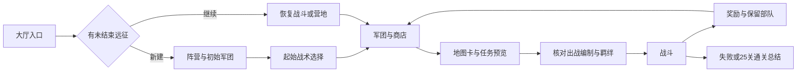

# 铁潮远征 2.0 UI 设计：让地图、部队与构筑看得懂

讨论稿 v1，2026-11-17；配套 [25 关系统策划](EXPEDITION_REDESIGN.md)。本轮仅文档，不代表界面已经制作。以下结构以桌面鼠标键盘为主，所有卡片均支持点击查看详情，不能仅依赖悬停。

# 1. UI 功能概述

入口：大厅“铁潮远征”。入口展示章节主题图、当前进度与“继续／新建”，不再仅显示一条普通文字按钮。界面沿用现有红警风格边框、单位肖像和阵营色，统一图标含义；不用颜色作为识别品质、羁绊或强化等级的唯一方式。

整轮六类页面：出征配置、战役路线、军团与羁绊、商店／训练、奖励结算、战内构筑提示。公共顶部显示章节、第几关／25、补给、维修包、已携带英雄与保存状态。战场资金只在本场预览和战斗显示，避免与补给混用。

# 2. UI 元素分解

## 2.1 出征配置：先看见会带什么，再出发

| 元素 | 功能 | 内容类型 | 交互规则 |
| --- | --- | --- | --- |
| 阵营选择 | 切换美国／苏俄 | 阵营徽记＋名称 | 切换前保留各阵营上次有效配置，不跨阵营带非法单位 |
| 预设军团 | 六套方向预览 | 主力单位大图、数量、两个起手方向 | 一次点击填入可编辑编制，不直接开战 |
| 自选单位库 | 选择初始出现单位 | 肖像、名称、部署点、可攻击对象、标签 | 加减数量；超过预算和数量上限时给出明确原因 |
| 待部署编队 | 展示实际第一关部队 | 肖像栈、数量、预算总计 | 点击查看具体单位，不把“许可”当实际已有单位 |
| 英雄栏 | 选择一名已解锁英雄或不带 | 英雄肖像、W／被动现状 | 显示英雄当前装配；不暗示所有玩家都已解锁 |
| 养成继承摘要 | 说明本轮带入什么 | 已启用自带天赋、科技与技能概览 | 查看完整清单；明确“出征时固定” |
| 初始羁绊预览 | 让起手具有方向 | 徽章＋当前计数／下一档 | 点击高亮贡献兵种与缺少候选 |
| 出征 | 检查预算与初始可用性 | 按钮＋校验说明 | 无选中部队、无合法初始路线时不允许开始；不会清空原有进度后才报错 |

起始页面可见“预算 3200/4000，未用 800 不折算资金”“实际部署 7 个单位＋1 台基础矿车”“固守 2/3、步兵 2/4”。所有数字取当前配置，不使用固定演示数字代替。

## 2.2 战役路线：每张候选卡都有真实地图预览

| 元素 | 功能 | 内容类型 | 交互规则 |
| --- | --- | --- | --- |
| 五章节导航 | 展示 25 场位置和已走路线 | 章节图、五个节点、Boss 标识 | 当前章节展开，后续显示任务主题，不暴露全部隐藏奖励 |
| 路线卡主图 | 直观比较地形 | 实际原图缩略图／对应自制地图预览 | 点击放大，可切换目标、道路、矿区覆盖层 |
| 地图信息 | 明确原图和改造范围 | 名称、地貌、“地形复刻／远征规则”标识 | 点击查看原版与远征规则差异 |
| 任务目标 | 明确如何赢 | 目标图标、计数、时间、失败条件 | 不把所有任务写成“击败敌人” |
| 阵容适配 | 提醒地形与部队关系 | 陆地／海军／运输／机场状态 | 海军不可用时显示“此关留在后备”，不能只给红色图标 |
| 威胁情报 | 展示公开危险 | 反空、隐形、远程炮、爆破等徽记 | 只显示任务公开情报，未侦察单位不露点 |
| 奖励方向 | 支持玩家按 Build 选择 | 天赋、招募、训练、补给图标 | 显示类别与保底，随机奖励不提前伪装成确定物品 |
| 出击确认 | 确认本场真实阵容 | 预览编制、羁绊档位、战场初始资金 | 只在满编超限、危险路线或需替换部队时确认；普通出击一次点击 |

放大地图显示我方出生区、已公开目标和可用通路；真实出生、设施摆放或任务目标没有完成准备时不能展示为已可开战。原图预览素材缺失必须有明确错误和回退图，不得出现空黑框仍可出发。

## 2.3 军团与多层羁绊：看得见谁在贡献

建议桌面布局：左侧为已出战编制与四格后备，中央是选中单位详情，右侧是本轮羁绊。底部放装备槽和英雄。主视图不使用一个长段落罗列全部增益。

| 元素 | 功能 | 内容类型 | 交互规则 |
| --- | --- | --- | --- |
| 编制卡 | 看清主力构成 | 肖像、人数、普通／特装、强化阶、军衔摘要 | 移入出战／后备；不允许拖拽时静默丢弃单位 |
| 羁绊条 | 展示三档阈值 | 名称、计数、三段节点 | 当前档亮起，下一档显示缺几种；点击高亮贡献单位 |
| 去重提示 | 解释为何没涨计数 | “与普通灰熊为同一基础兵种” | 英雄／特装重复时就地说明，不靠玩家猜 |
| 下一档候选 | 促进构筑决策 | 可补齐的单位和徽章 | 允许标记购物方向，不保证立刻刷出 |
| 强化轨道 | 区分军衔与局内强化 | I／II／III 三段、合同数量 | 显示下一阶实际收益和章限制 |
| 自带天赋卡 | 统一解禁与升级心智 | 沿用养成的图标、名称、未解禁／0～3 级 | 显示来源：局外／本轮／仅此特装；关闭状态明确 |
| 单位攻击对象 | 避免玩家配出无法作战的阵容 | 地面／空中／潜艇图标 | 羁绊改变不会隐藏原武器限制 |
| 补员与整备 | 恢复真实战斗能力 | 缺员数、缺血量、价格 | 扣费前展示补哪些单位；满血满员时不可购买 |

卡面同时出现的三种层次必须分开：军衔用原有军衔标记；强化阶用 I／II／III 边章；天赋用独立天赋徽章＋0～3 级。不能全部画成同一种星星。

## 2.4 军需商店：购买前看见 Build 的变化

商店主视图六张商品卡，固定服务独立横栏。右侧常驻“当前构筑”和两个追踪目标；顶部为补给与刷新费用。左键选中商品查看变化，再购买；不要在浏览详情时误扣钱。

| 元素 | 功能 | 内容类型 | 交互规则 |
| --- | --- | --- | --- |
| 单位商品卡 | 招募或训练 | 肖像、真实数量、价格、兵种标签 | 明确“首次：许可＋部队”“重复：部队＋一份训练” |
| 特装商品卡 | 直接获得已强化部队 | 独立边框、I／II／III、自带天赋等级 | 必须标“仅这支部队，不含量产” |
| 自带天赋商品 | 解禁／升一级／专精 | 养成同名同图标、前后实际参数 | 已有更高等级不出现；关闭者购买前说明仅本轮启用 |
| 变化预览 | 一眼看懂购买价值 | 当前→购买后，增亮受影响标签 | 同时显示收益和占位，例如需要换下哪一编制 |
| 锁定 | 保存想买但暂时买不起的商品 | 锁图标与两格上限 | 锁定不收费，占下次店的商品位，读档保留 |
| 刷新 | 给出另一批候选 | “本店免费 1 次／10／20／30” | 锁定格保留；付款成功才替换，失败不扣钱 |
| 定向槽 | 提高有效选择概率 | “追踪：固守／防空” | 告知保底方向与剩余商店数，不显示虚假精确掉率 |
| 已售罄 | 提供购买反馈 | 原卡变暗＋已购买 | 禁止连续点击重复扣费；记录可查看 |
| 固定训练服务 | 不完全依赖随机解禁 | 指定兵种、自带天赋、实际费用 | 固定提供首次解禁与普通训练合同；天赋升级／专精由商品、奖励提供，均检查章节限制 |

示例文案：

> 重装大兵增援 ×2｜120 补给  
> 固守 2/3 → 3/3：停稳防护提升。  
> 首次获得本轮生产许可。  
> 自带天赋「部署防护」：尚未解禁，可在训练中解禁。

> 光束分裂 · 本轮解禁｜100 补给  
> 适用：本轮普通光棱坦克。  
> 未解禁 → 0 级，实际分裂系数按当前兵种数值显示。  
> 不消耗局外天赋点，不改永久养成。

> 攻城直升机特装队 ×1｜260 补给  
> 强化 II，攻城校准 1 级。  
> 仅此队生效；普通工厂不会生产该特装版本。

## 2.5 奖励结算与本轮 Build 总览

| 元素 | 功能 | 内容类型 | 交互规则 |
| --- | --- | --- | --- |
| 战果摘要 | 告知目标与代价 | 完成目标、用时、战损、补给 | 只报真实本场数据 |
| 保留部队 | 玩家选择跨关主力 | 生存单位肖像、血量、人数、容量 | 超限时显式选留，不自动删除后才通知 |
| 奖励三选一 | 形成明确选择 | 图像卡、标签、稀有度、即刻变化 | 固定候选随本轮保存；确认后不可反复领奖 |
| 章末核心 | 制造记忆点 | 核心装备大卡、专精分支 | 显示影响范围，不能仅写“伤害大幅提高” |
| 通关 Build | 展示这轮玩出了什么 | 阵容、羁绊、原生天赋、装备、关键选择时间线 | 可保存摘要；不上传账号或个人数据 |
| 失败总结 | 支持下一轮调整 | 阵容短板、失败目标、最后商店选择 | 用事实说明，不自动武断推荐唯一最优阵容 |

奖励卡固定三类标识：许可、兵种级强化、特装个体。天赋卡不能只写“强化单位”，以免玩家误以为所有同类单位都增强。

## 2.6 战内提示与操作边界

战斗 HUD 侧边增加可收起的羁绊摘要，默认只显示生效的三至五条主羁绊；点击展开完整列表。单位详情中分别显示局外来源、本轮兵种来源、特装来源，重复来源取高后只展示实际生效值。

协同标定、卧倒护盾、机动首发等新增效果需要可识别的短提示、状态图标和必要特效；不开屏幕中心大弹窗。暂停、生产、技能键位、上边缘滚屏继续沿用当前操作；营地页面不接管战斗热键。

地图任务条显示已完成／剩余目标、护送车辆存活数、明确的阶段计时。Boss 机制提前以图示显示可破坏目标，不用小字埋在一段背景说明里。战斗失焦、弹窗和购买确认期间不得误触出击或技能。

## 2.7 资源与适配清单

| 资源 | 首发建议范围 | 复用／新增原则 |
| --- | --- | --- |
| 单位肖像 | 所有可见招募／初始／特装兵种 | 复用现有原版肖像；特装用强化边章区分，不伪造新模型 |
| 地图预览 | 已有六图＋新增六图＋自制终局 | 必须与实际地形对应，不用风景插画代替地图 |
| 羁绊徽记 | 十条，各有三档状态 | 同一符号随档位变化；配文字，支持色弱识别 |
| 自带天赋图标 | 本轮可出现的全部原生天赋 | 沿用养成图标与名称，不能换成英雄 W 图标 |
| 战术装备 | 二十四件 | 每件辨识轮廓；同类可共用底形但不可整套同图 |
| 任务图标 | 八类任务＋五章 Boss | 一致说明占点、护送、摧毁、防守等目标 |
| 货币与服务 | 补给、维修、训练、补员、救治、刷新、锁定 | 金额和作用范围始终同屏可见 |

分辨率至少验证 1280×720、1600×900、1920×1080 和超宽屏；低分辨率改为三列商品＋分页／纵向滚动，地图预览保持等比，不裁掉目标图例。字体缩放后按钮、价格和补给余额不能重叠。详情浮层不越界，长天赋说明可滚动，核心结果始终固定可见。

纯视觉交付必须由使用者在目标环境确认。静态资源检查、后台流程测试能证明资源存在与交互结果，不能代替“看得清、选得懂、打起来有反馈”的试玩验收。

# 3. 交互流程图

战斗中的继续入口直接恢复战斗，不必经过营地重新选择；流程图中的营地分支只适用于当前本就在营地的状态。
