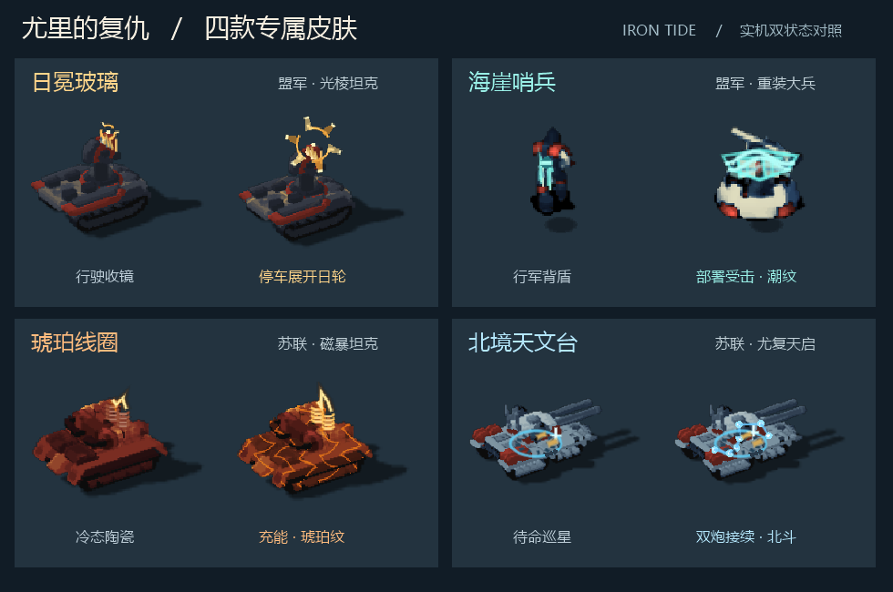
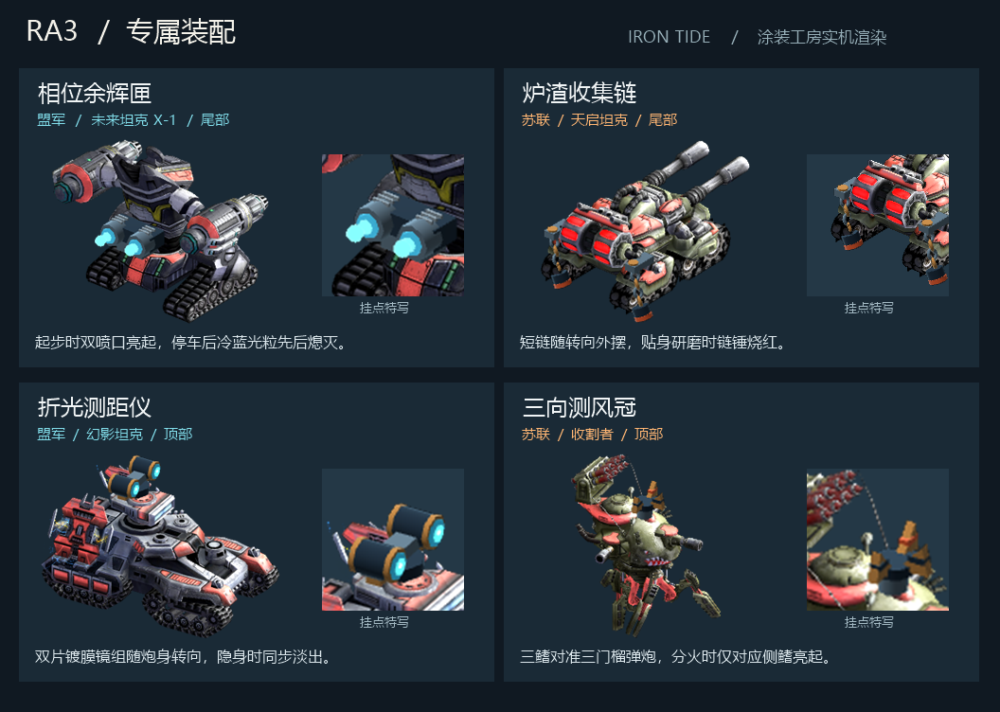

# 驻防养成与英雄首批设计 · v0.22

## 货币与首批英雄

每日按本机自然日刷新，经典及扩展的正常遭遇战共用任务。开新局 100 钻石、主动出厂 10 个单位 50 钻石、出厂一个需作战实验室或 RA3 最高许可的 T3 单位 150 钻石。任务可同时推进。每日首胜另发 1 个胜利券碎片，攒 10 个自选一张皮肤券或技能券。皮肤券可直接换一项钻石专属皮肤或武器外观，技能券抵一次抽取。已有的胜场、难度外观仍走各自条件。

300 钻石/天 × 20 天 = 6000 钻石一款专属皮肤。技能卡池每天可免费单抽一次，本地零点刷新，次数不累积。付费抽取优先用技能券，每缺一张支付 900 钻石，相当于三天日常收入；无券十连为 9000 钻石。免费与付费共用概率和碎片奖励。当前通用池共 5 张：烟幕弹、引擎超载、聚焦射击、复合装甲板、空尖弹。另有 8 张阵营专属卡。抽取先掷品质，再在同品质中等概率抽卡。普通、稀有、史诗、传说分别为 65%、25%、9%、1%。每抽保底 1 个技能兑换碎片，重复按品质再给 1、2、5、12 个。可自选未拥有的史诗或传说，分别消耗 50、200 碎片。因此无重复时 5 次十连够换史诗，有重复时会更早。胜利券碎片和抽卡碎片各自记账。

战略核心负责天赋点、开格、技能卡升级和科技研究。每张技能卡获得即为 0 级。升到 1／2／3 级的战略核心费用按稀有度配置：普通 60／150／240，稀有 70／170／270，史诗 80／190／300，传说 90／210／330，究极传说 100／230／360。费用统一读取 data/meta.json 的 card_upgrade_costs，扣费与各升级界面共用查询；已升级卡保留等级、不补扣，旧版迁移退款仍按历史费用计算。默认四档强度为基础值的 100%、115%、130%、145%。瘫痪卡按持续时间成长，其他现有卡按效果数值成长。旧十级卡按原 1、4、7、10 级映射到四档，其间已花且未计入整档的核心原额退回。已开始的战斗沿用开局倍率。天赋首次解锁消耗 1 个天赋点，每次升阶直接消耗 40 战略核心。军需券用于后勤与常规强化。旧卡池重置一次，清除抽到的 W、被动及对应装配，单位固有能力保留。

| 英雄 | 解锁和出场 | 专属外观 |
|---|---|---|
| 美国大兵「守望者」 | 本兵种累计主动出厂 50 次，从达标的那一辆起，每场扩展遭遇战首个符合条件的美国大兵满军衔出厂 | 「极夜哨兵」银蓝分层肩甲带青色导光槽，侧后装双片光学背鳍，肩下的晶坠短暂闪光 |
| 动员兵「炉火」 | 独立累计 50 次，同一场只替换一次动员兵 | 「炉前赤卫」铜红铆接肩甲配双排气炉匣、炽亮散热栅及短链炉芯吊牌 |

两人分别训练、选皮肤、结算好感。每个英雄单独训练火力和生命。火力每级 +2%，150 级达到 +300%；生命每级 +3%，第 167 级补足至 +500%。两项各自从 20 战略核心起，每级费用递增 20，单次最多 200 核心。旧版合并训练的等级同时算入两项，新局按开局时的训练生效。出场 +10 好感经验，击杀 +5、助攻 +2，出场且胜利另 +20。每 100 经验一级，200 级封顶，普通等级各发 100 军需券，每逢五级发 100 钻石。单英雄满级共得 16000 军需券和 4000 钻石。英雄养成页可按十级一页查看全部奖励及发放状态。英雄自身射程 +1 格，自带「随行护卫」。0 级带 4 名一星同型步兵；1 级带 5 名一星；2 级带 3 名二星和 2 名一星；3 级带 5 名二星。每名英雄独立强化，每级 40 战略核心，新局生效。护卫服从兵营集结命令，可独立选择，不计入生产任务。

第二天赋「战场生存」在英雄解锁时获得 0 级，两名英雄分别使用战略核心升级，每级 40 核心，新局内累积生效。0 级将犬扑、海豹与谭雅枪击的致命伤害限制为最大生命的 1/4，1 级将恐怖机器人和狙击致命伤害限制为 1/3。2 级免疫碾压，3 级生化与辐射致命伤害上限为 1/2，4 级自爆致命伤害上限为 2/3，5 级超时空擦除时长翻倍。血量低于对应上限时仍可能阵亡。

## 尤复单位专属天赋

四项均在单位改造中分配，开关及等级随新扩展对局生效。解锁天赋获得 0 级行为，之后可升到 3 级。

| 阵营与单位 | 天赋及图标 | 0 级行为 | 1 / 2 / 3 级 | 可验证的边界 |
|---|---|---|---|---|
| 盟军 · 灰熊坦克 | 掩护倒车。图标为车首与两道向后的履带箭头 | 按 E 后点选车尾方向的地面，预览倒车路线，最多后退 3 格。车首保持当前朝向，炮塔可以继续跟踪原目标。倒车速度为正常行驶速度的 55%，实际开始后退后，每秒恢复 1% 最大生命，共 3 秒，停车后继续 | 倒车速度提高到正常车速的 65% / 75% / 85%，回血总时长提高到 4 / 5 / 6 秒 | 只接受车尾可直达的落点，路线被挡时停车。新移动命令可中断；射程、射界、装填及停止开火指令照常生效 |
| 盟军 · 超时空军团兵 | 时间书签。图标为带缺口的沙漏 | 中断擦除后，目标立即解冻。该兵在 2 秒内重新锁定同一目标，可从上次进度的 50% 接续擦除。书签以半枚沙漏显示 | 重连时限提高到 3 / 4 / 5 秒 | 每人只留一个书签，仅本人可用。接续时消耗，另锁目标即清除；中断期间进度停走 |
| 苏联 · 犀牛坦克 | 破墙榴弹，图标为碎裂墙垛 | 主炮直击敌方建筑，向地基间距 1 格内最近两座敌方建筑各造成 25% 炮击伤害，副目标出现 Split 提示 | 副命中伤害提高到 40% / 55% / 70% | 按副目标装甲单独结算，不再次触发溅射，不波及单位或友军 |
| 苏联 · 辐射工兵 | 衰变采样，图标为三段衰减环 | 部署后持续照射同一载具 3 秒，目标出现采样刻度 | 此工兵的后续辐射伤害 +5/8/12% | 离开辐射区清空计时，多个工兵分别记录 |

## 尤复专属皮肤

四款已接入涂装工房，均支持试穿。每款可用 6000 钻石或 1 张皮肤券解锁。

[北境天文台 · 悬浮北斗实机大图](polar-observatory-halo.png)

[岸防导弹手 · 行军与部署朝向实机对照](coastal-missile-gunner.png)

[皮卡丘 · 雷霆机甲实机大图（替换旧图中的琥珀线圈）](pikachu-tesla.png)

| 单位 | 皮肤 | 移动、攻击与收尾 |
|---|---|---|
| 盟军光棱坦克 | 日冕玻璃 | 深烟色车体内有金色镜架，停车时镜面依次转亮，六片金箔张开成日轮，起步后收回。开炮出现三片薄棱镜，命中后碎光沿真实折射方向收拢。 |
| 盟军重装大兵 | 岸防导弹手 | 行军背负折叠测距架；部署后外展双臂、撑脚落地，向发射方向投出扇形扫线和两道测距回波。导弹出筒时尾部喷出短焰与烟环，受击时阵地脚灯闪橙。装具跟随原版八向帧及身体前后遮挡。沿用原「海崖哨兵」记录。 |
| 苏联磁暴坦克 | 皮卡丘 · 雷霆机甲 | 黄色装甲、黑尖耳形电极和红颊电容。面甲随炮塔转向，闪电尾板随车身移动。蓄电时脸颊发亮，放电时双耳间跳弧。沿用原「琥珀线圈」的购买及装配记录。 |
| 苏联天启坦克（尤复） | 北境天文台 | 把原提案的极地观测主题移到天启双炮。霜白铆接装甲配阵营色侧裙，炮塔座圈刻一圈深蓝方位标尺。对地开火时，两门炮根的黄铜刻度片随各自后坐先后滑动，第一炮点出引星，第二炮在车顶上空连出北斗七星；行驶或交火时星环展开，原地装填保持全环，停车脱战后缩回炮塔，炮塔向星环投出微光；对空发射时，侧置导弹架上的三点橙灯依次亮起，发射后熄灭。装配「熔芯双响」时仍由该武器外观绘制命中裂纹与小蘑菇云。 |

四款保留阵营色区域，普通和精英使用同款视觉。皮肤只改变模型、动作及局部特效；重装大兵沿用原部署判定，天启沿用原双炮与防空导弹的开火节奏。

## RA3 专属挂件

累计 5、8、12、16 胜依次解锁下表四款装饰。可提前在涂装工房试装。

通用顶部仅保留冰晶棱柱，取消通用尾挂；轮胎印、悬浮翼仍各有装备槽。

| 位置 | 阵营／专属单位 | 名称与动作 |
|---|---|---|
| 尾部 | 盟军 · 未来坦克 X-1 | 「相位余辉匣」安装在后甲双喷口间，起步时两束蓝白离子短焰依次从喷口伸出，焰心带压缩光纹，焰梢渐淡，停车依次收短、熄灭。 |
| 尾部 | 苏联 · 天启坦克 | 「炉渣收集链」两条锈蚀锻钢链用焊接链扣固定在后挡泥板，链锤下沿露出磨亮钢面，末端链节和链锤由地面支撑；行驶拖地、转向滞后、停车后靠摩擦停稳，磁力研磨时链锤泛红。 |
| 顶部 | 盟军 · 幻影坦克 | 「折光测距仪」位于炮塔后上方，双片玻璃随炮塔运动，隐形时一起渐隐。 |
| 顶部 | 苏联 · 收割者 | 「三向测风冠」避开发射架，三片短鳍对应榴弹炮方向，分区射击时只亮被分配的侧鳍。 |

## 扩展模式阵营技能卡

W 装在表中指定单位，被动只向列出的相似单位开放。专属主动与固有 Q、特殊 E 各自独立。以下是自创扩展卡，不改变官方基础武器。

| 阵营 | 专属 W | 多单位共用被动 | 图标 |
|---|---|---|---|
| RA3 盟军 | 幻影坦克「假象转移」（传说）。移动离开原位后留下 2 秒残影并隐身，入隐后 10 秒内，首次主炮破隐对主目标触发 Echo；满 10 秒未开炮则本次隐身和增伤一起结束 | 「相位稳流」（史诗）。幻影、未来坦克静止集火每满 3 秒加一层 Flux，最多三层，移动、失去或切换主目标清空。X-1 的中子球波及旁敌时保持原集火目标和层数，旁敌仅受基础范围伤害 | 分裂／电容 |
| RA3 苏联 | 天启「炮座齐校」（史诗）。按 W 待命，从下一轮左炮开火起计时，同轮左右炮先后命中同一目标可强化右炮。窗口、次数和伤害随卡等级成长 | 「重机限幅器」（稀有）。天启、磁暴、收割者连续行驶 3 秒获得减伤，停车结束 | 准星／行驶 |
| RA2 盟军 | 驱逐舰「搜索浮标」（稀有）。660 范围内指定水面，半径 165 内本舰及所属鱼鹰反潜 | 「接敌通报」（稀有）。驱逐舰与海豚对任意敌方单位造成伤害后标记并实时共享其视野。所属鱼鹰计入母舰，再次命中触发 Ping 并续时，不能叠层 | 侦察／信号 |
| RA2 苏联 | 犀牛坦克「斜甲迎击」（史诗）。原地最多防护 3 秒；首次起步起再防护 2 秒并加速，停车、再次起步不续时。车首左右各 60° 减伤 | 「交错弹幕」（稀有）。防空步兵、履带车、防空炮与海蝎对同一空中目标每第三击触发 Burst | 护盾／攻击 |

### 演示与等级

进入驻防基地的技能卡池，点击「四组阵营技能卡」即可逐张切换、暂停和重播。左侧显示适用单位，右侧战术图播放触发、消耗或到期过程。八张卡可在技能卡池抽取，抽到后在单位改造里装配。炮座齐校同时提升伤害、校射窗口和可强化的右炮发数。2 级第三发独立按 50% 判定，读档沿用该次施放已确定的结果。

| 卡名 | 成长参数 | 0 级 | 1 级 | 2 级 | 3 级 |
|---|---|---:|---:|---:|---:|
| 假象转移 | 基础冷却 | 30 秒 | 28 秒 | 26 秒 | 25 秒 |
| 假象转移 | 破隐首发增伤 | 8% | 9.2% | 10.4% | 11.6% |
| 相位稳流 | 每层主炮增伤（最多三层） | 5% | 10% | 15% | 19% |
| 炮座齐校 | 基础冷却 | 24 秒 | 23 秒 | 22.5 秒 | 22 秒 |
| 炮座齐校 | 天启右炮增伤 | 12% | 13.8% | 15.6% | 17.4% |
| 炮座齐校 | 窗口／右炮强化次数 | 2 秒／1 发 | 4 秒／2 发 | 5.5 秒／2 发＋50% 第三发 | 6 秒／3 发 |
| 重机限幅器 | 持续行驶减伤 | 5% | 5.75% | 6.5% | 7.25% |
| 搜索浮标 | 基础冷却 | 32 秒 | 30 秒 | 28 秒 | 25 秒 |
| 搜索浮标 | 本舰反潜侦测时长 | 4 秒 | 4.6 秒 | 5.2 秒 | 5.8 秒 |
| 接敌通报 | 标记及共享目标视野 | 3 秒 | 3.5 秒 | 4 秒 | 5 秒 |
| 接敌通报 | 首次标记至可再次标记的冷却（鱼鹰与母舰共用） | 30 秒 | 28 秒 | 25 秒 | 22 秒 |
| 接敌通报 | 标记后的命中增伤 | 5% | 5.75% | 6.5% | 7.25% |
| 斜甲迎击 | 起步后 2 秒移速加成 | 10% | 25% | 30% | 50% |
| 斜甲迎击 | 正面装甲减伤 | 18% | 20.7% | 23.4% | 26.1% |
| 交错弹幕 | 第三次命中增伤 | 8% | 9.2% | 10.4% | 11.6% |
