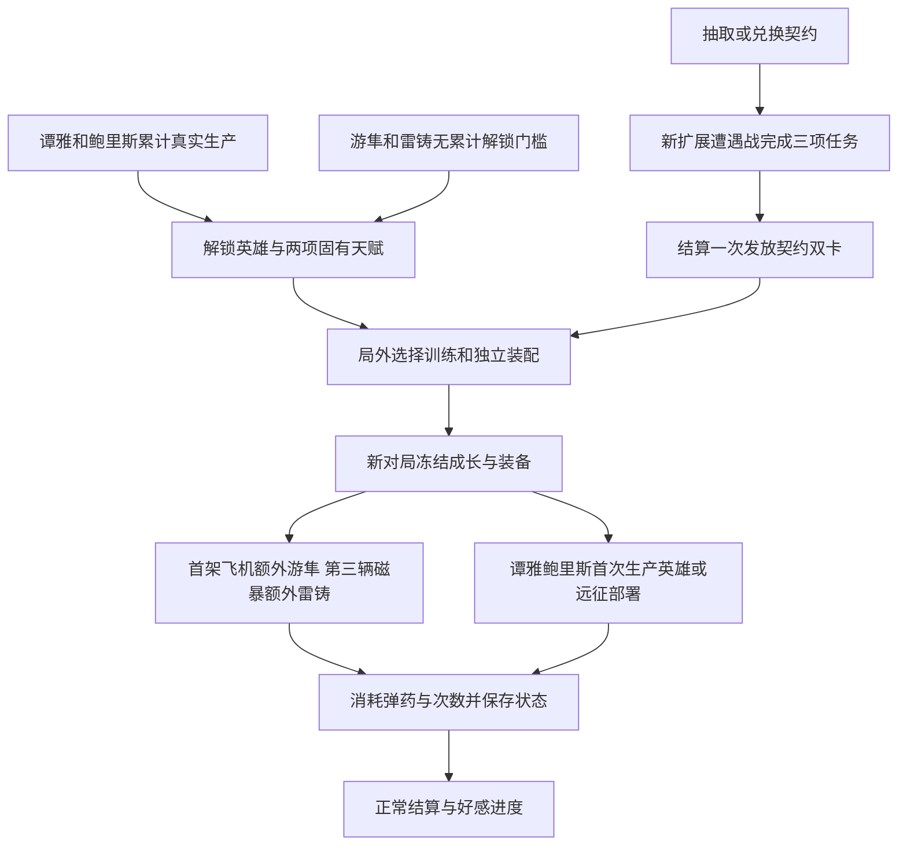

# 1. 系统概述

2026-11-17 · 第五稿修订。用户已授权设定目标并分批实现，当前进度以[六批实施记录](PROGRESSION_EXPANSION_2_ROLLOUT.md)为准；本稿不是全量已实现清单，具体数值作为首版可调参数，未经平衡或表现验收。本次将 C15 重做为海空交叉火控，明确 C16 弹着校射不可叠加；磁暴步兵两极串联调整为 C09 史诗专属被动，可与现有 W 连锁放电同装，原兵种天赋位另拟蓄电转储。按最新确认，两名新英雄改为每局达成生产条件后额外赠送；游隼迫降等待期为 180 秒、机体耐久为正常最大生命的 1000%，自动恢复后为正常生命的 100%。本稿同步修订四英雄节点、额外半支米格编队、机场附近维护及全基地供电，补齐全部演示条目和两名新英雄 AI 皮肤概念图。

## 本轮规模

以上一批[三英雄与技能卡设计](HERO_TALENTS_AND_CARD_POOL_DRAFT.md)的十二张普通池卡、八项兵种天赋为基准，“再来两倍”按**本轮新增量为上一批两倍**设计，不是把已有数值翻倍。

| 内容 | 上一批基准 | 本轮新增 |
| --- | ---: | ---: |
| 普通池技能卡 | 12 张，其中单兵种专属 8 张 | 24 张，其中单兵种专属 16 张、多兵种卡 8 张；10 W＋14 被动，武装直升机新卡改为被动 |
| 兵种被动天赋 | 8 项 | 16 项，覆盖 16 个兵种 |
| 英雄专属养成 | 本轮按明确的四单位要求另列 | 谭雅、鲍里斯＋新英雄游隼、雷铸 |
| 英雄契约卡 | 不纳入普通池翻倍数 | 每位 1 W＋1 被动，共 8 张 |
| 英雄固有天赋 | 不占普通兵种的双天赋名额 | 每位 2 条 0～5 级功能链，共 8 条；每级新增功能并累积保留 |

合计 **32 张技能卡＋24 项天赋**。四个单位是本轮覆盖数量；现有守望者、炉火、北辰、铁脊继续保留，拟将养成名册从四名扩至八名。新增英雄采用现有兵种的命名英雄变体，具有独立养成和出场身份。

## 设计方向

| 单位 | 原型 | 核心玩法 | 明确弱点 |
| --- | --- | --- | --- |
| 谭雅 · 破晓行动 | 谭雅 TANY | 投掷爆破开路，抓住击杀后的短暂撤离窗口 | 不防空，不能靠爆破技能瞬间删除建筑或重甲 |
| 鲍里斯 · 红色坐标 | 鲍里斯 BORIS | 枪战积累校射，再选择原生米格空袭或地面炮火兑现 | 需要前线接敌；炮火预警后可以撤离 |
| 游隼 · 第七航迹，新英雄 | 入侵者战机 ORCA 的独立英雄变体 | 持久悬停、自动补弹、满弹叠盾；追踪弹群必中且不可拦截，并造成范围爆炸 | 机体仍会被防空攻击；空弹需等待，机场联动仅加速补弹 |
| 雷铸 · 移动变电站，新英雄 | RA2 磁暴坦克 TTNK | 电庭持续减速并雷电跳伤，电荷满层后围绕自身范围放电 | 电极可拆、范围固定，自身放电需要接近敌人 |

全部新技能只在启用养成的扩展模式生效。经典模式保留现有基础单位。远征沿用自身英雄名额、招募和救治流程，不把遭遇战每局生产规则强行套入远征；本轮提议开放四人作为第五关起的英雄候选，游隼只需本轮可用机场，不要求空余停机位。远征不记永久契约任务，新英雄固有天赋取本轮选用的永久养成快照，不额外增加一套商店升级货币。

### 共用数值与边界

- 技能卡和普通兵种天赋的斜杠数字均为 **0／1／2／3 级**，单值表示四档相同。英雄固有天赋另按 **0～5 级**逐级列功能；0 级随英雄解锁获得，1～5 级累积新增功能，不用一组百分比代替机制成长。
- “主武器 X%”取该次攻击在护甲结算前的正常伤害基准，包含已有军衔和火力养成，不重复乘算卡牌追加收益，再按实际目标护甲及既有最终伤害限制结算。不能把秒杀、擦除、C4 必杀、寄生处决换算成百分比范围伤害。
- 本稿新设的普通爆破伤害采用：步兵 100%、轻甲 80%、重甲 65%、建筑 60%。攻击力快照已包含施放者火力养成、军衔及当时有效攻击增益，不再重复乘一次；之后走现有防御及最终伤害限制。不继承原生 C4 必杀、双枪处决和空袭秒杀属性。
- 追加伤害不再次产生追加攻击，不积累其他卡的命中次数。除条目明确说明，范围只伤可受该武器伤害的敌方对象；无友伤，不赋予对空或反潜能力。
- “己方”仅指同一所属方，不包含盟友。同名标记取较强档位，不叠加伤害倍率；刷新不补已消耗次数。减速取最强，不相加；不同来源常规减伤乘算，不能获得无敌。
- 冷却从成功施放起算；预检失败不扣冷却，已成功施放后被打断不退款。武器装填、技能冷却、效果存续分别计算。缴械、冻结、装载等限制照常适用。
- 新增状态和随机结果随当前对局保存；读档不补次数、不刷新弹药、不重抽结果。普通部队、英雄、召唤物分别计权，临时单位不产出任务进度、经验或资源。
- 每兵种最多两项兵种天赋；英雄固有天赋仅英雄生效，不能经普通生产、装载或同型兵种共享扩散。

# 2. 服务器功能

本项目本轮为本地游戏设计，不新增服务器、账号服务或联网流程。永久养成、当局状态和结算分别保存，重复结算不重复发奖。

# 3. 客户端功能

## 3.1 四单位的获取、出场和成长

### 解锁与出场

| 单位 | 永久英雄养成解锁条件 | 扩展遭遇战的英雄出场 |
| --- | --- | --- |
| 谭雅 | 累计主动生产 5 名谭雅 | 解锁后的新对局，首次主动生产的谭雅使用英雄养成；保留原科技、费用和限额 |
| 鲍里斯 | 累计主动生产 5 名鲍里斯 | 同上，保留原生步枪和米格空袭流程 |
| 游隼 | 无累计生产门槛；扩展养成名册直接开放两项 0 级天赋与训练 | 仅盟军玩家每局首架主动生产的飞机完成时，额外赠送一架游隼；苏联及 AI 不赠送；普通产品保留，游隼不占机场停机位、不额外收费 |
| 雷铸 | 无累计生产门槛；扩展养成名册直接开放两项 0 级天赋与训练 | 每局第三辆主动生产的 RA2 磁暴坦克完成时，额外赠送一辆雷铸；三辆普通产品均保留，不额外收费 |

谭雅、鲍里斯的永久解锁在下一场新对局启用。游隼、雷铸按当局生产事件额外出场，不替换现役或刚出厂单位，也不需要先完成契约。每种英雄每个所属方每局最多赠送一次；阵亡后后续生产不再赠送。游隼统计正常生产队列完成的飞机（含直升机，不含火箭飞行兵）；雷铸只统计 RA2 TTNK，RA3 磁暴坦克不计。免费赠兵、占领、召唤米格、舰载机、复制、GM 及测试生产不计次数。生产计数、赠送已用标记随本局保存，复读生产完成事件不重复赠送；出生点受阻则等待合法位置，不退款、不丢失、不二次计数。

两名新英雄满军衔出场；谭雅和鲍里斯进入英雄身份时也满军衔。四人不自动获得旧英雄的随行护卫、额外射程、坦克护盾或复活，保命能力由下列各自天赋承担；已有同型兵种天赋可正常继承。

### 成长与费用

四人分别拥有火力、生命、好感、外观、W 和被动装配档案，普通兵种与英雄装配分开。常规成长复用当前英雄训练与好感规则及费用，不引用旧设计中已经过时的“每级 20 核心起”价格，也不额外提高基础训练上限。

每位英雄解锁时获得两项固有天赋 0 级；两项各自升至 5 级，升到 1／2／3／4／5 级的费用依次为 40／120／240／400／600 战略核心，不占兵种天赋点与开格费用。每级增加不同能力，之前的能力累积保留，除明确说明外不改写低级节点数值；每局一次、每个补满周期一次等使用次数独立保存，升级不回写已开始的对局。游隼的触发统一以弹药补满周期计算，不再依赖出航和返航。

本次参照旧英雄逐级获得反潜侦察、残骸复苏、带队机动、部署射程及抗寄生／抗冻结／对空等不同功能的设计方法。当前旧代码中指挥线为 0～3 级、生存线为 0～5 级；本轮按用户对新英雄的要求，将两条均设计为 0～5 级，不顺带改旧英雄。

英雄契约双卡仍为 0～3 级究极传说，升级费用 100／230／360 核心。普通卡按现行品质费用升级，兵种天赋沿用现有解锁点数、槽位和 40／120／240 核心升阶规则。英雄固有天赋各级均能在不装契约卡时发挥作用，不以未获得的 W／被动作为唯一前置。

不新增第三种技能槽。保留固有 Q／特殊 E，契约 W 和普通 W 竞争同一个 W 槽，契约被动和普通被动竞争同一个被动槽。两张契约卡可分别装配，不要求成套才有基础用途。

## 3.2 谭雅：能冲入阵地，也要找到撤离窗口

### W「三点破门」· 究极传说

向 4 格内可见合法地面投掷三枚定时炸药，中心与左右落点沿垂直投掷方向排开，相邻 0.8 格。每隔 0.35 秒投出一枚，每枚飞行 0.4 秒，落地 1.5 秒后爆炸。爆炸半径 0.9 格，单枚伤害为**投出时谭雅当前攻击力的 60%／80%／100%／120%**；冷却 **40／37／34／30 秒**。

攻击力以当前主武器单发普通攻击的数值为基准，包含火力养成、军衔和当时有效攻击增益，只计算一次；不叠加一轮双枪的多发次数，不读取对某个目标已经结算的实际伤害，不复制双枪处决或 C4 必杀。每枚投出时分别锁定数值，落地后增益到期或谭雅死亡不改写该枚伤害。爆炸采用本稿普通爆破护甲倍率，再走目标当前防御和既有最终伤害限制。

每枚耐久为谭雅最大生命的 3%，正常视野可攻击；被毁或无合法落点时该枚不爆炸。一次最多三枚，同时只维持一组。投掷期间可以移动，被击杀、冻结或装载取消未投出的炸药，已落地的照常计时。范围内同一敌人可以被不同炸药分别命中；三枚投出时攻击力相同，整组理论伤害为攻击力的 **180%／240%／300%／360%**，实际仍按各目标护甲和防御结算。例如当前攻击力 200，满级每枚护甲结算前 240，三枚全中为 720；攻击力成长到 400，则每枚 480、整组 1440。

不要求先安装原生 C4，不缩短原生 C4 倒计时，不改变工程师拆弹；建筑原生爆破与这组三枚可攻击炸药为两种效果。单独装 W 即可完成区域破袭。

### 被动「破门节拍」· 究极传说

谭雅本人用双枪击杀敌步兵，或本人炸药／原生 C4 摧毁敌建筑后，获得 **1.5／2／2.5／3 秒**撤离节拍：移动速度 +25%，受到普通远程伤害降低 **10／15／20／25%**。触发间隔 8 秒，从获得时开始；期间再击杀不续时。移动、继续开枪均可，不强制改变命令。

不免疫碾压、心控、擦除或范围爆炸，不闪避已在途攻击。无须 W 也能靠双枪和原生 C4 触发。目标必须是真实敌作战单位或建筑，不能杀召唤物刷常驻减伤。

### 固有养成：破袭专家＋极限脱身

| 等级 | 破袭专家：渗透、分火与连锁拆点 | 极限脱身：水陆潜入与险境撤离 |
| --- | --- | --- |
| 0 | **破拆预备**：开始安装原生 C4 后获得 15% 普通减伤、持续 2 秒，间隔 12 秒；取消安装仍消耗资格 | **脱离杀线**：单次敌伤实际扣除最大生命至少 15% 且仍存活，获得最大生命 10% 护盾、持续 3 秒，间隔 30 秒 |
| 1 | **近距识破**：持续侦测 2 格内敌方隐形／伪装地面单位，不能穿实体遮挡，也不侦测潜艇 | **反猎杀训练**：犬扑、狙击和同类步兵枪击的单次致命伤害最多扣除最大生命 1/3；低血仍会死，不限制普通坦克炮击 |
| 2 | **双枪分击**：每第三轮正常双枪开火，向主目标 1 格内最近另一名可见敌步兵追加一枪，造成攻击力 40% 的普通枪伤；不继承秒杀、不递归触发 | **潜泳**：水中停火 2 秒后进入隐形，开火、安装炸药、离水或受伤立即解除；真正退出潜泳时获得最大生命 15% 护盾、持续 4 秒，护盾触发间隔 15 秒；反隐、在途弹药和范围伤害正常生效 |
| 3 | **破拆震波**：原生 C4 摧毁建筑时，对地基外 1.5 格内可见敌地面单位造成攻击力 60% 的普通爆破伤害；不伤其他建筑，不触发新震波 | **翻越履带**：免疫普通地面载具碾压；不能穿车、越墙，不免疫载具正常武器 |
| 4 | **行进双枪**，替代传动破坏：允许移动中向当前射程内的合法敌步兵进行普通双枪射击；开枪动作期间以当前移动速度的 70% 行进，正常射速、射程和双枪分击照常；装 C4 和近身反载具动作仍需停下 | **闪光脱离**：被敌伤打到 25% 血以下且仍存活，闪光使 2 格内正常可见敌步兵停止开火 1.5 秒；间隔 40 秒，恢复至阈值以上才可再次触发；不影响建筑、载具和已发弹药 |
| 5 | **连锁拆除**：原生 C4 摧毁建筑后，向地基间距 1.5 格内最近一座可见、可安装 C4 的敌建筑转移一枚链式炸药，倒计时 4 秒；工程师可拆，冷却 60 秒且每局最多 2 次 | **最后一搏**：每局一次，普通致命伤保留 1 点生命，隐形 2 秒并清除当前普通减速，期间不能攻击／施法；仍可移动，但不免疫后续范围伤害，不解除冻结、装载或心控 |

连锁拆除只由本人亲装的原生 C4 触发；实际成功附着时扣次数并开始 60 秒冷却，无合格副建筑不扣，被拆除或目标失效不返次数。链式炸药的摧毁不继续传递、不触发破拆震波，也不算原生 C4 契约进度。链式炸药附着目标在生成时固定，目标变为友方或消失立即取消，不绕过无敌／任务保护。三点破门不触发任何 C4 专属链式效果。

潜泳护盾在破隐原因处理后发放，不能倒过来挡住触发破隐的那一击，也不能救回该击已经阵亡的谭雅；只有真实进入过潜泳才有退出护盾，同源不叠加，反复上下岸不能越过 15 秒间隔。行进双枪尊重玩家移动路线，不自动追敌偏航；停火、冻结、装载等仍能阻止开枪，不能边跑边安装 C4。

最后一搏在常规护盾／减伤和反猎杀伤害限制后判断，仅伤害仍然致命时消耗；擦除、强制处决、非战斗移除不触发。受伤导致潜泳解除与最后一搏新授予的两秒隐形分别处理，不因同一击立刻清掉新隐形；之后再受伤会解除新隐形。玩法从基础破拆，逐步获得近距反隐、双目标枪战、拆点余震和连锁爆破，生存线则逐步支持水陆潜入及一次濒死脱身。

## 3.3 鲍里斯：把前线接触变成可兑现的火力坐标

### W「红色走廊」· 究极传说

指定 6 格内、至少起点可见且全部落点已探索的 4 格长地面线段，沿线三个固定点请求炮火。预警 1.2 秒后依次落下三发炮弹，间隔 0.8 秒；每发基础爆炸半径 1 格，单发伤害为**成功呼叫时鲍里斯当前攻击力的 80%／100%／120%／150%**，冷却 **55／50／45／40 秒**。

本次三发共用成功呼叫时的普通主武器单发攻击力快照，包含养成、军衔及有效攻击增益；不复制原生步枪处决和米格特殊伤害。三发全中理论合计为攻击力 240%／300%／360%／450%，再乘本次校射回执增伤，最后按普通爆破护甲和目标防御结算。鲍里斯在炮火到达前死亡不改写快照。

施放须静止呼叫 0.6 秒，移动或控制会打断；成功完成呼叫才扣冷却。此后炮火按既定坐标到达，即使鲍里斯死亡也不改点。每枚只能打地面单位和建筑，不打空军、潜艇；不额外创造米格，不占用或刷新原生空袭冷却。不同落点爆炸重叠时分别结算，可走位躲避。

### 被动「校射回执」· 究极传说

本人步枪对真实敌人造成直接生命损失，获得一枚校射章；每 2 秒最多一枚，最多三枚，脱离敌对伤害往来 12 秒后全部清空。下一次成功呼叫 W，或下一次原生米格编队实际出发时，消耗全部校射章。

每章使该次 W 炮火或该编队的原生对建筑炸弹伤害提高 **4／6／8／10%**，最多 **12／18／24／30%**。只能增强两者之一，由先成功触发者消耗；空袭目标死亡不返章，未成功出发不消耗。每个原生炸弹仅修正一次，不额外增加飞机、弹药或连锁。W、米格和其他追加伤害都不能生产校射章。

**消耗校射章还扩大本次炮火的爆炸范围。**每章增加原爆炸半径的 **10%／15%／20%／25%**，最多三章，即 +30%／45%／60%／75%。红色走廊原半径 1 格，因此满三章分别变为 **1.3／1.45／1.6／1.75 格**；不增加施法距离、走廊长度和炮弹数量。原生米格炸弹若已有范围伤害，也按同一半径倍率扩大；原本只对主目标结算的弹头不凭空新增副目标伤害。预览使用本次实际章数，成功施放／编队出发时和增伤一起锁定，不因后续攒章继续扩圈。

单装被动可为原生空袭蓄力；单装 W 可正常轰击。原生空袭的标定、改派、飞行、拦截及编队离场后补充规则保持。

### 固有养成：前线指挥＋战地电台

| 等级 | 前线指挥：侦察、压制与空地协同 | 战地电台：保护、接应与最后指令 |
| --- | --- | --- |
| 0 | **前沿观察**：本人视野 +1 格，不增加步枪和空袭标定距离 | **前线掩体**：静止 2 秒后获得 15% 普通远程减伤，移动后保留 0.5 秒 |
| 1 | **步枪压制**：连续三次步枪直击同一敌步兵或战斗地面载具，使其不能开火 1 秒；可移动，目标共用 8 秒触发间隔，不停掉已发弹药 | **防爆内衬**：爆炸类普通致命一击最多扣除最大生命 1/2；低血仍可能阵亡，不保护米格 |
| 2 | **空地接力**：本人米格第一枚炸弹实际命中后，落点 3 格内最多四名同方真实步兵各获得一次装填时长减半，资格保存 5 秒，每支编队一次 | **抗扰通讯**：眩晕／冻结控制的单次新增持续时间减半；持续维持型控制与时空擦除不因此解除，不清已有控制、不缩短己方增益 |
| 3 | **独立引导**：米格编队出发后不再要求鲍里斯继续维持标定姿态，他可移动和步枪作战；指定建筑只要保持敌对且存在，编队完成既定攻击，不向玩家持续暴露迷雾信息 | **接应补给**：原生米格至少一架实际投弹后正常离场，在鲍里斯当时位置附近合法地面留一份补给，存在 10 秒；本人接触恢复 15% 最大生命，每编队一次、同时最多一份 |
| 4 | **集火口令**：本人步枪命中敌作战单位后，给目标挂 4 秒标记，接下来最多三次同方非英雄步兵普通直击增伤 15%；间隔 12 秒；本人不消耗，不揭雾 | **电台掩护**：本人进入原生空袭标定或 W 呼叫时，给 2 格内最多两名同方非英雄步兵各加其自身最大生命 10% 护盾、持续 4 秒；间隔 20 秒，取消呼叫不返资格 |
| 5 | **双目标空袭**：原生编队照常攻击主建筑；若主目标 3 格内有另一座合法可见敌建筑，按距离选副建筑，额外增加原生编队数量的 1/2 攻击它。三星原生 4 架时为主建筑 4 架＋副建筑 2 架，总计 6 架 | **最后电令**：每局一次，本人战斗死亡时，若最后一个实际伤害来源仍是可见合法敌地面单位／建筑且距死亡点不超过 6 格，在其当时位置留下 1.5 秒预警，然后落一发攻击力 150% 的普通爆破炮弹，半径 1.5 格 |

已有兵种天赋「空袭接应」保留。额外米格数量按当次原生数量的一半向下取整，保持原生单机弹药与伤害，可被正常防空拦截；无副建筑不生成额外飞机，也不把额外火力补到主建筑。副建筑失效后只可改派到其他合法副建筑，无候选即离场。两组共用同一轮空袭、校射快照、接力／补给次数及冷却，不算两次呼叫。

**独立引导允许鲍里斯走动和开枪，但不允许同时召唤第二轮米格。**主编队与额外编队全部完成投弹并离场，或已被击落后，才按原生规则开始下一轮补充冷却；补充完成方可再次呼叫。正在接敌、投弹、改派或离场的任意存活米格均占用这一轮，取消标定、切目标、死亡或读档不能刷新。独立引导不能穿无敌或攻击已变友方建筑。

补给不可攻击、不提供视野、只供本人拾取，满血不消耗，不叠放多份；不带入下一局。最后电令不复活鲍里斯，不依赖装备红色走廊，不消耗或刷新 W 冷却；炮弹落点固定，敌人可以离开。被装载／非战斗移除不发令，所属方同时出局则取消。其攻击数值取死亡前快照，不含校射回执额外增伤。

## 3.4 新英雄游隼：持久悬停与自动补弹的空中火力点

### 基础身份

以入侵者战机为原型，英雄名「游隼」。用户确认**只改英雄，普通 ORCA 保持原飞行、返航和机场补弹规则**。游隼可以持续停在空中，停止命令即悬停，射程内可原地转向开火，不必绕圈、冲过目标或耗尽弹药后自动返航；仍可主动移动、停火和手动降落。

基础弹仓 **4 发**，普通对地导弹消耗 1 发，W 消耗 2 发。空中缺弹时逐发自动补充，射击不重置正在进行的补弹计时；补弹与武器开火间隔分别计算，满仓停止补弹且不预存下一发进度。正常补弹不要求机场或停放飞机持续存在。游隼是第一架正常生产飞机完成时额外到场的英雄，从出场、维护到迫降修复均不占机场名额；机场被毁不会让空中游隼消失或停止自补。

**补弹时间跟随「王牌航线」养成等级：0／1／2／3／4／5 级，每发分别需 8／7／6／5／4／3 秒。**每级仍有下表不同的新功能，这条时间成长作为同一天赋线的共同收益，不增加第三条英雄天赋。暂停、冻结／EMP和迫降状态暂停补弹；悬停、移动和正常攻击均可继续计时。手动停机也只走一条补弹计时，不与机场重复加弹。

**补满周期**指弹药真实从低于上限变为等于上限的一次事件。首次出场满仓只初始化一次满仓资格；在满仓停留、读档、改变指令、选择目标不重复触发。每次补满恢复本周期的首发、末弹、诱饵和抗扰额度，不累积多份。末弹须真正把弹药打到 0 才可消耗本周期资格；中途补了一发但没补满，不刷新资格。普通 ORCA／黑鹰的旧出航逻辑不套入这套英雄周期。

### W「隼群追猎」· 究极传说

手动选择一名可见、合法的敌地面单位或建筑；射程外自动飞近，进入本人正常主武器射程后消耗 2 发弹药，一次释放 **4 枚追猎导弹**，此时才开始冷却。射程内悬停释放。靠近期间目标失效或失去视野时取消，移动、停止等新指令可取消待施放，不扣弹药或冷却；途中存读档继续追随原目标。Auto W 仍只释放射程内已有目标，不自动追击。四枚先向两翼展开，再以 0.2 秒间隔追向同一主目标。每枚主目标伤害为施放时攻击力 **40%／50%／60%／75%**，爆炸半径 **1／1.2／1.4／1.6 格**，圈内其他合法敌地面单位与建筑受到该枚主伤害的 50%。冷却 **38／35／32／29 秒**。

**追猎导弹必中，且不可被防空、反导或诱饵摧毁／引走。**合法发射后，普通移动、闪避、隐形和进入迷雾不甩掉这轮锁定；不向玩家额外提供目标视野。导弹无可攻击耐久，不参与普通导弹拦截候选。必中指追踪命中，不绕过目标无敌、阵营变化、死亡、被装载移除等失效条件；目标失效则向最后有效位置落下，仍按正常爆炸规则伤害该处敌人，不自动改锁其他目标。机体仍可被正常防空打坏。

每枚对主目标只结算一次全额伤害，主目标不再吃自己的副目标半伤，四枚可先后命中同一目标；满级主目标理论合计 300% 攻击力，副目标若四枚全中为 150%，均再走普通爆破护甲和最终伤害限制。四枚成功生成时一次扣弹与冷却，本人随后死亡或被控不取消已释放弹群；施放前弹药不足、目标非法不扣费。W 不触发普通首发／末弹增伤或额外子弹药，避免一次 W 四次重复兑现普通攻击额度。

### 被动「空中整备」· 究极传说

每次弹药从未满补到满，为本人叠加一份最大生命 **4%／6%／8%／10%** 的整备护盾，总量上限为最大生命 **20%／30%／40%／50%**。护盾受伤正常消耗，再次补满在残盾基础上补加一份，不能超过上限；没有限时自然消失，也不需要攻击不同目标。初次出场满仓给予一份，后续只能由真实补满事件增加；死亡／迫降清空，读档不补盾，护盾不触发其他英雄的破盾爆炸。

**机场联动加速本人：**只要至少一个同方合法、已完成、能工作的机场有一架真实同方飞机占位停放，游隼自己的自动补弹时间缩短 **10%／15%／20%／25%**。只判断有无，不按机场或停机飞机数量叠加；不加速停放飞机本身，不包含盟友、召唤机、残骸或正在起降而尚未停稳的飞机。游隼在机场附近下降维护不占停机位，不独自满足此条件。最后一架符合条件飞机离场、机场停电或被毁时加速立即取消，已完成的补弹比例保留，不能反复起降刷时间。

例如王牌航线 5 级时基础 3 秒／发，空中整备 3 级且机场联动成立时为 **2.25 秒／发**。自动补弹是英雄基础能力，单装被动即可持续叠盾；单装 W 仍能正常悬停与补弹。

### 固有养成：王牌航线＋滞空保障

| 等级 | 王牌航线：侦察、弹药与新增攻击用途 | 滞空保障：按补满周期触发的反导、维护与救援 |
| --- | --- | --- |
| 0 | **航拍落点**：本人普通导弹命中后，揭示该命中坐标半径 1 格区域 3 秒；位置固定，不跟踪目标 | **离场余速**：弹药真实降到 0 后移速 +20%、持续 3 秒，每个补满周期一次；可与其他来源移速增益相加叠加，不要求返航或离开机场，悬停时不强迫移动 |
| 1 | **备用挂架**：真实最大对地弹药量由 4 增至 5，额外一发由自身自动补弹补入，完全不需返回机场；首次出场满弹 | **诱饵抛投**：每个补满周期一次，将最先进入本人 1 格范围且正在追踪本人的一枚可诱导防空导弹引走并失效；不拦截必中不可拦截弹、激光、子弹和范围爆炸 |
| 2 | **自卫机炮**：新增对空副武器，射程 3 格、间隔 1 秒，每发为本人当前主攻击力 20%的普通枪伤；不消耗对地弹药，可正常指令攻击合法可见空敌 | **检修签章**：每次真实补满时恢复最大生命 5%；本周期须至少有一发普通导弹／一次 W 实际命中真实敌作战目标，不用无效强攻刷治疗 |
| 3 | **低空扫描**：在空中侦测 2 格内敌方隐形／伪装地面单位；正常遮挡有效，不反潜，不增加攻击射程 | **抗扰飞控**：每个补满周期一次，抵消一次可计时 EMP／眩晕，之后进入 2 秒应急稳姿：能移动或悬停但不能开火；不抵消伤害、持续型控制或擦除 |
| 4 | **领航编队**：本人存活且未迫降时，直接给予全图同方真实 ORCA／BEAG 战机移动速度 +15%，包含游隼自身；不用靠近或命中标记，不作用临时召唤机、米格与盟友，多份同名取最强 | **停机护罩**：可在同方正常工作的机场 3 格内合法空地下降维护，不占停机位；下降完成获得最大生命 20% 护盾，最多持续 10 秒、触发间隔 30 秒；维护时每秒回复最大生命 2%，不能攻击／施法，自补弹继续 |
| 5 | **末弹分束**：每个补满周期中，真正耗尽弹药的最后一枚普通导弹命中后，在主目标两侧各 0.8 格落一枚小型子弹药，预警 0.5 秒、半径 0.6 格，各为攻击力 35%的普通爆破伤害 | **迫降返修**：每局一次，普通致命伤转为就近 4 格内合法陆地迫降；等待 180 秒期间，机体最大耐久与初始耐久均为正常最大生命的 1000%。同方工程师连续维修 5 秒可提前修复，或满 180 秒自动修复；两者都恢复正常形态及 100% 正常生命，弹药为 0 后起飞自补 |

普通武器和 W 消耗同一组真实对地弹药；W 若耗尽弹药，会用掉该周期末弹资格，但不能将普通末弹增伤或分束附加到四枚 W 导弹。自卫机炮不计补满周期的对地战果、不触发首末弹卡或检修；主副武器按正常目标命令切换，不同时发射。副爆炸、末弹分束、燃烧区域不再次触发命中追加。新增普通卡「末弹校准」和兵种天赋「满载首航」对普通 ORCA 保留其出航语义，对游隼使用上述补满周期，首末发资格都只授予普通对地导弹。

检修签章只看当轮有效命中和真实补满，原地悬停也能回血，不返机场、不占机场名额。离场余速与领航编队同时生效时，正常基础移速合计 +35%；其他合法移速增益继续按其来源加入，同名不无限叠层，冻结仍能阻止移动。

停机护罩是主动维护姿态，下降需 1 秒；维护时机体按可攻击地面单位处理，不享受空中目标筛选保护。进入维护后连续 3 秒未受敌伤才开始缓慢回血，受伤重新计时。起飞、机场失效或离开 3 格结束维护并清除该次维护盾；重新下降不绕过 30 秒护罩间隔。无合法空地不下降，满员机场仍能在外侧维护；不额外启动机场补弹或叠加第二条补弹进度。普通飞机停机联动是另一项判定。

迫降无合法陆地即正常阵亡；按 2026-11-18 使用者确认，普通致命伤触发迫降时立即建立十倍最大／当前耐久，触发伤害转为迫降，随后最多 1 秒下降期间正常承伤。例如正常最大生命 1000，触发即获得 10000/10000，后续伤害正常扣除，落地不再次放大上限或回满；下降或返修期间机体被毁则永久阵亡。倒计时从机体落地开始，暂停游戏不走时，读档恢复剩余时间及已受损耐久。工程师离开或受控打断并重置其 5 秒维修进度，不影响 180 秒自动修复倒计时，不消耗工程师。两条修复路径同刻满足只执行一次；恢复时临时十倍上限移除，生命变为正常的 1000/1000，而非保留 10000。

救起保留英雄身份、W 冷却和每局已用次数，清空护盾、弹药与当前补弹进度，不能再次迫降，也不立即恢复本周期诱饵／抗扰额度；恢复自补后下一次真实补满才开启新周期。迫降期间不能攻击、移动、补弹或提供领航编队增益；修复完成重新提供正常增益。不需机场或空余名额，原机场已毁也可重新起飞并自补，不算第二次赠送或生产。

## 3.5 新英雄雷铸：敌人可以拆掉的电磁阵地

### 基础身份

以 RA2 磁暴坦克为原型，英雄名「雷铸」。车体两侧配置可展开的铜环电极；不借用 RA3 磁暴坦克的原生范围 EMP。继承 RA2 磁暴坦克正常电击及已有「接地电容」兵种天赋，但两者的电极物件、次数和伤害独立。

### W「三极电庭」· 究极传说

在 5 格内可见合法地面选定中心，生成三个呈三角形分布的固定电极，顶点距中心 1.4 格。三处都合法才成功；各电极生命为本人最大生命 **8／10／12／15%**，存续 **8／10／12／14 秒**，冷却 **48／44／40／36 秒**。不阻挡寻路，不提供视野，可被敌人正常攻击。

三极完整时，**整个三角形内部与边缘电线自带减速和雷电持续伤害**，不要求先碰线或由本体攻击触发；电线宽 0.45 格。只剩两极时，区域缩为两极之间的电线带；不足两极立即停电。范围内敌地面单位移速降低 **20%／25%／30%／35%**，受到每秒为施放时攻击力 **20%／25%／30%／35%** 的电击伤害，每 0.5 秒结算半份。建筑可受区域电伤，但不受减速。满级持续 14 秒，始终处于完整区域且吃满 28 跳的单目标理论伤害为 490% 攻击力，之后正常结算电击护甲和防御。

每个目标对同一组电庭每个跳伤时点只结算一次，三线交点和内部重叠不重复跳伤；不同雷铸的伤害分别结算，减速取最强。进入区域立即受减速，首次伤害最早在进入满 0.5 秒后发生；离区立即停止伤害，0.5 秒后结束减速。反复进出不能额外制造首跳。电极减少、目标移动与区域结束都按真实覆盖更新。

雷铸距中心超过 7 格、阵亡或所属方出局，电庭消散，不爆炸、不返冷却。电庭不提供视野或反隐，仅对正常可见、合法的敌地面对象结算。本体不需攻击也能持续控制区域，单装 W 即可发挥完整减速与跳伤效果。

### 被动「电荷调度」· 究极传说

本人普通主电击每直接命中一次真实敌人，得到一层电荷，最多三层；最短获得间隔 1 秒，8 秒无新层全部清空。得到第三层时全部消耗，**以雷铸自身为圆心释放一圈范围电弧**，半径 **2／2.25／2.5／3 格**，对圈内每个可见合法敌地面单位和建筑各造成当前攻击力 **30%／40%／50%／60%** 的电击伤害。主目标若也在圈内，可以额外吃这次范围电弧；每个目标每次放电只命中一次，无空中／反潜能力。

不再寻找某个副目标，也不在远处主目标位置爆炸；身边没有敌人时仍放电并消耗电荷。若雷铸本人位于自己的有效电庭内部或有效电线带内，该次放电半径再增加 0.5 格，不提高伤害。电庭 DOT、接地电容、贯地追加和范围电弧都不能积累电荷，不会递归连锁。没有 W 也能正常围绕自身放电。

### 固有养成：移动变电站＋过载保险

| 等级 | 移动变电站：供能、侦测与装甲压制 | 过载保险：反寄生、分流与停堆自救 |
| --- | --- | --- |
| 0 | **高压标定**：普通主电击命中敌战斗载具后，给该目标保留 4 秒标定；本人下一次对它的普通主电击增伤 10%，消耗标定且该发不重新施标 | **线圈护套**：连续停火 4 秒获得最大生命 8% 护盾、持续 6 秒，触发间隔 18 秒；移动可积累，不触发旧坦克英雄破盾爆炸 |
| 1 | **电磁夺盾**，替代线圈供能：普通主电击打掉敌人的护盾时，将实际削减盾量的 50% 转为自身夺取盾，最多为本人最大生命 20%、持续 6 秒；每次有效夺取刷新时限，打无盾目标不产生盾 | **反寄生放电**：恐怖机器人成功寄生后开始 2 秒反制，若仍存活且未被冻结／EMP，清除并摧毁该寄生体；间隔 30 秒，等待期间正常承受寄生伤害 |
| 2 | **电磁搜迹**：本人周围 3 格侦测隐形／伪装的敌地面载具；不侦测步兵、飞机、潜艇，不通过地图全局标记追踪 | **电能回收**：受到真实敌方普通电击时，将该次实际护盾与生命损失之和的 20% 转成独立回收盾，上限最大生命 15%、持续 4 秒；不能挽救本次致命伤 |
| 3 | **传动闭锁**：每第三次普通主电击直击同一敌地面载具，使其不能移动 1 秒；转火或 4 秒未命中清计数，目标对此效果共用 8 秒间隔；仍可开火 | **绝缘缓行**：被时空冻结维持时，允许以正常速度 50% 缓行，但不能开火／施法；不清冻结来源、不免疫擦除，走出合法维持距离才按原规则解除 |
| 4 | **贯地放电**：连续停火 3 秒后，下一次主电击额外沿本人至主目标的地面线段，对最近两个其他可见敌地面单位各造成攻击力 30% 电击；间隔 12 秒 | **分流保护**：3 格内最近一辆同方非英雄战斗地面载具受到普通伤害时，将该次最终伤害的 20% 转由雷铸承受；雷铸对这份转移伤害专属减免 80%；同时只保护一辆，离距／装载／冻结时停用 |
| 5 | **应急供电**：所属基地缺电时，进入同方已完成建造场中心 8 格内的基地范围，向全基地实际供电 +100；同一雷铸只提供一份，仍可正常移动和作战，离开范围、冻结、EMP、阵亡或停堆即停止 | **紧急停堆**：每局一次，普通致命伤保留 1 点生命，立即获得最大生命 40% 的应急盾，停堆 3 秒；期间不能移动、开火、施法、供电或分流，撑过后恢复到至少 20% 最大生命 |

贯地放电不穿实际阻挡，不伤主目标第二次，不触发电荷调度或新的贯穿。电磁夺盾只转化主电击实际扣掉的敌盾，不额外扣盾，不计算过量伤害或生命伤害；电庭、贯地和范围电弧不夺盾，不能从友军或自己的盾抽取。

应急供电是真正增加全基地 100 电力，按正常电力规则影响所有用电建筑；不足以覆盖缺口时仍显示缺电。为防止“补足后立即断供”振荡，启停用排除雷铸本次供电后的基础收支判断：基础仍缺电且本人在基地范围就持续供电，基础自行恢复充足才退出。多个建造场的范围重叠不重复加电；收起／失去最后一个覆盖建造场、被移除或所属方出局立即撤销。UI 显示“英雄供电 +100”，不把它写成磁暴线圈的充电席位。

电能回收排除友军充电、自伤和转移伤害；过量伤害不产生额外盾。分流在受保护者护甲／减伤之后、护盾扣除之前计算，雷铸承接部分先应用这项专属 80% 减免，再扣自身护盾或生命，不再次套雷铸普通减伤，不触发分流、电能回收或反弹。例如原伤害 100，友军承担 80，分出的 20 经减免后雷铸承担 4；这不等于雷铸所有受伤都减免 80%。雷铸仍可能因此被击毁，紧急停堆尚可用时允许触发。停堆盾可被打穿，不能当作无敌或死后复活；时空擦除、强制处决、非战斗移除不触发停堆。停堆时清除电庭，结束后不免费补电庭或刷新任何 W 冷却。

## 3.6 四份契约

沿用已有共享契约池：所有未获得契约合计每抽 0.35%，命中后在未获得契约中等概率选择，不为四份新契约各加 0.35%。若原四份加新四份均未获得，每份为 0.04375%；已有契约不重复出现。每份仍可用 500 技能兑换碎片定向开启；可先拥有契约，再解锁英雄。普通卡稀有度权重不变。

任务只计契约开启后新开的正常扩展遭遇战；累计任务在正常胜负结算时记账，单局任务须胜利。只认本人归属、真实敌对目标，重复读档结算不重复记账。三项全部完成，一次发放该英雄两张 0 级卡。所有任务均可在没有新契约卡的情况下完成。

| 契约 | 累计任务一 | 累计任务二 | 单局任务三 |
| --- | --- | --- | --- |
| 谭雅「破晓之前」 | 本人双枪击杀 60 名敌步兵 | 本人原生 C4 摧毁 8 座敌建筑 | 普通及以上胜利，本人摧毁至少 1 座防御建筑并最终存活 |
| 鲍里斯「红色坐标」 | 本人步枪击杀 60 名敌步兵 | 本人呼叫的原生米格摧毁 10 座敌建筑 | 普通及以上胜利，本人至少完成 2 次实际投弹的原生空袭且最终存活 |
| 游隼「第七航迹」 | 本人直接击毁 20 辆敌战斗地面载具 | 本人完成 12 次有效补满：自上次补满以来，至少一次普通对地导弹实际命中真实敌作战目标，然后弹药从未满自动补至满；不要求返航 | 普通及以上胜利，本人单局命中至少 3 个不同敌作战目标并最终存活 |
| 雷铸「铜环之誓」 | 本人直接击毁 25 辆敌战斗地面载具 | 本人累计承受 6000 点敌方造成的实际生命损失 | 普通及以上胜利，本人单局击毁至少 4 辆敌战斗地面载具并最终存活 |

护盾、溢出、自伤、友伤、临时单位不计实际伤害任务。原生米格战果归属实际呼叫它的鲍里斯；不归附近同型单位。英雄尚未出场不累计英雄任务，普通同型单位不能代做。

游隼初始满仓不计有效补满任务；读档、在满仓停留、纯消耗弹药攻击空地均不计。无须契约 W、空中整备或任何停机飞机，原生对地攻击与英雄基础自动补弹即可完成任务。每个周期仅在真实补满时结算一次，战果不能跨多个周期重复使用。

## 3.7 普通卡池：十六张单兵种专属卡

以下 ★ 均只允许表中一个兵种装配；同型英雄可使用，仍占同一个 W／被动槽。新增卡不取代上一批卡，每张都有独立用途。数值按四档排列。

**每张卡的稀有度均列在名字后。**普通白、稀有蓝、史诗紫、传说黄，四英雄八张契约奖励卡统一究极传说；普通兵种天赋和英雄固有天赋不设抽卡稀有度。卡牌重做沿用本表编号，旧提案名不再作为额外候选卡计数。

| 编号／卡名／品质 | 槽位、专属兵种 | 规则与成长 | 关键边界 |
| --- | --- | --- | --- |
| C01 ★ 锚钉导弹／史诗 | W；重装大兵 GGI | 部署后按 W 立即向当前合法敌地面载具发射一枚导弹，造成一次当前主武器伤害，并减速 20／25／30／35%，持续 3 秒；CD 26 秒 | 2026-11-17 用户取消待命；无目标、对空、超射程或导弹盲区不消耗。独立技能弹不占普通装填、不计普通命中天赋；已发射后收起部署不取消在途弹 |
| C02 ★ 模块封装／稀有 | 被动；多功能步兵战斗车 FV | 乘员类型实际改变后，获得最大生命 50／70／90／120% 护盾，持续 30 秒；间隔 40 秒 | 2026-11-17 用户将各档盾量乘十、指定 30 秒持续与 40 秒间隔。同类型换人不触发，修理模式也可防护但不因此产生伤害；上下客不重置间隔、不补充现存护盾 |
| C03 ★ 棱镜十字／史诗，替代单束聚焦 | W；光棱坦克 SREF | 在正常主武器射程内选择可见地面点，预警 0.6 秒后，以选点为中心沿车体朝向及垂直方向打出两轮十字光束，间隔 0.6 秒；每条光束总长 4 格、宽 0.6 格，每轮对命中敌地面单位和建筑造成攻击力 60／75／90／110% 光束伤害；CD 32／30／28／26 秒 | 每轮交叉中心的同一目标只受一次伤，完整两轮可受两次；不消耗或取消普通攻击的原生折射，不额外触发原生分裂或其他追加攻击 |
| C04 ★ 末弹校准／稀有 | 被动；入侵者 ORCA | 普通 ORCA 满弹离场后的最后一发真实普通弹药伤害 +12／18／24／30%；游隼则在每个真实补满周期内，给实际打空弹仓的最后一发普通导弹同样增伤 | 一次完整补弹重置一次，W 不享受；W 打空弹仓会消耗本周期末弹资格，不能补一发后反复触发；正常增伤相加后走总限制 |
| C05 ★ 护航水幕／史诗 | W；驱逐舰 DEST | 本舰及 2 格内最多两艘同方战斗舰船，受到普通远程伤害降低 12／16／20／24%，持续 4 秒；CD 35 秒；余波接力共享储存实际减免伤害，上限为施法舰施放时最大生命的15／20／25／30%，结束后转成6秒护盾给原队伍中生命比例最低的存活同方舰船。同次命中只计最强水幕，同强度先施放优先；同名余波盾仅保留较强剩余值，较弱不续时 | 施放时按距离选定，不跟随补选；不含潜水单位、运输艇和鱼鹰，不提供隐形 |
| C06 ★ 潜行余量／稀有 | 被动；海豹 GHOST | 在水中连续移动 2 秒后，上岸获得 2／2.5／3／3.5 秒移速 +20%，并同时隐身 1／1.5／2／2.5 秒；两个计时分别显示 | 开火、安装 C4、装载立即解除隐身但不取消剩余加速；反隐、在途弹药和范围伤害正常生效；再次完整水中移动才能重新准备，已有隐身期间不能反复上下岸续时 |
| C07 ★ 观察哨线／稀有 | W；狙击手 SNIPE | 静止观察，视野 +1／1.5／2／2.5 格，持续 6 秒；CD 24 秒 | 移动结束效果；不加武器射程、不反隐、不反潜，可正常开火 |
| C08 ★ 伪装间隙／史诗 | 被动；幻影坦克 MGTK | 从真实原生伪装状态首次开火后，承受普通远程伤害降低 10／14／18／22%，持续 2 秒；间隔 12 秒 | 不重新隐身，不因镜像开火触发，不替代原有伪装余温 |
| C09 ★ 两极串联／史诗，替代电极投送 | 被动；磁暴步兵 SHK | 普通主电击在 3 秒内先后命中两名不同敌地面单位，且两者距离不超过 3 格，在两者间建立持续 3 秒电链；每秒各受本人攻击力 10／15／20／25% 电击伤害；生成间隔 8 秒 | 每人最多一条，两端被拉开超过 4 格或任一端死亡／变友方／被装载即断链；不打建筑、不伤途经连线的第三人。占被动卡槽，可与现有传说 W「连锁放电」同时装备；W 分支电弧不计两次普通主命中 |
| C10 ★ 高射扇幕／稀有 | W；防空履带车 HTK | 开启后持续 5 秒，期间每次正常对空直击附带半径 0.8 格防空溅射，溅射伤害为主发 20／25／30／35%；主目标也吃这一份溅射，形成一次直击＋一次范围伤害；CD 24 秒 | 主目标合计为原主发 120／125／130／135%，每份范围伤害对同一目标只结算一次；不对地扩散，载员武器不参与，追加溅射不递归触发命中卡 |
| C11 ★ 弹道留档／稀有 | 被动；V3 火箭 V3 | 原生火箭正常命中敌建筑后，本车下一发对同一建筑的火箭增伤 10／15／20／25%，资格保留 8 秒；同时将本车当前剩余武器 CD 缩短 10／15／20／25% | 每枚火箭仅直击触发一次，溅射不重复缩 CD；当前 CD 为 0 不储存减免，增伤发射即消耗，转打他人清空；被拦截不触发 |
| C12 ★ 压阵装甲／史诗 | 被动；RA2 天启 APOC | 静止交火 3 秒后，正面 120° 普通直击减伤 12／16／20／24%，持续 5 秒，移动不解除；结束后重新蓄势。正常防空齐射后，保留后续 3 轮任意武器 CD 缩短 10／15／20／25% 的额度，无时间限制 | 每轮只使用一次，优先缩短剩余开火等待，空闲时缩短本轮新装填，不重复缩两份 CD。防空一轮多枚只生成一组 3 次，不叠加；消耗额度的防空轮不再生成。减伤到期、移动、停火不清剩余次数，易主清空 |
| C13 ★ 诱导跃扑／传说 | W；恐怖机器人 DRON | 对当前可见合法敌地面载具主目标开启，移速 +20／30／40／50%，持续 3 秒；期间首次进入该主目标 2 格，获得 1／1.25／1.5／2 秒无敌；正常入侵后前 2 秒寄生伤害间隔缩短 10／15／20／25%；CD 32 秒 | 开启时已在 2 格内则立即触发一次；无敌免疫期间伤害，入侵成功即结束，不带入宿主，不解除既有控制，不赋予非法入侵资格；主目标失效／改选时取消尚未触发的无敌资格 |
| C14 ★ 深水耐压／稀有 | 被动；台风潜艇 SUB | 停火 4 秒后获得最大生命 5／7／9／12% 的护盾，持续 15 秒；间隔 20 秒（v0.30.11用户调整） | 开火不清盾但不再续盾；不改变探测、浮潜、反潜和伤害合法性 |
| C15 ★ 海空交叉火控／史诗，替代舰队截弹 | 被动；海蝎 HYD | 正常向敌机开火时，自动向本舰射程内最近一艘合法可见敌水面舰船补射一发对海炮；正常向敌水面舰船开火时，自动向射程内最近一架合法可见敌机补射一发防空炮。补射为对应武器正常单发攻击基准的 40／50／60／75%，两种补射共用 4／3.5／3／2.5 秒触发间隔 | 保留玩家当前主目标和正常开火节奏；补射只生成一发，按对应武器真实射程、射界和命中规则检查。另一领域无目标不空耗间隔；不攻击潜航目标、不截导弹、不自行获得额外射程，补射不触发新补射或其他追加攻击 |
| C16 ★ 弹着校射／史诗，替代炮位烟障 | 被动；武装直升机 SCHP 的部署炮形态 | 普通部署炮直击敌人后，在命中点形成半径 1.5 格、持续 4 秒的校射区；同方已部署武装直升机对区内目标的部署炮普通攻击及部署炮技能伤害提高 8／12／16／20%；本人每 6 秒生成一次，最多一个区 | 可和已有传说 W「震地锚」分别装配；触发首击不追溯增伤，每次伤害结算检查攻击者仍为部署炮形态及目标处于区内；同名增益不可叠加，多架直升机、多个重叠区域和不同卡阶都只取当前最高一份，每次伤害仅应用一次；区域不揭雾，起飞后不再生成且本人不享受，但已生成区按原时限结束 |

海空交叉火控只由本舰一次真实普通发射触发，同轮多枚弹只检查一次；对岸上目标开火不触发，W 和其他追加弹均不触发。补射不消耗正常武器的下一发，也不重置或推进正常装填；以补射成功发出为共用间隔起点，期间切换海空主目标不能绕过间隔。若当时冻结、缴械或对应副目标已失效，不补射、不扣间隔；成功发出的弹按普通武器处理目标失效，不享受必中。伤害基准取本次补射所用对海／防空武器，包含自身军衔与火力养成，不把防空高伤害搬到对海弹上。

弹着校射的每个区域各自维持原有 4 秒时限，重叠不合并强度、不累加时长，也不刷新其他人的区域寿命。例如 12% 和 20% 区域重叠，本次伤害只增伤 20%；强区结束而弱区仍有效时恢复为 12%。一发普通部署炮或一次震地锚伤害均只计算一份校射加成；震地锚本身仍可正常装备和施放。后续重新生成合法区域可以延续覆盖，但不叠层。

两极串联只由本人的两次真实普通主电击建立；第一次命中的敌人到第二次命中时仍须存活、合法且可见。连线伤害只打两端，不伤穿过电线的第三人，不产生新电荷／跳电；每 0.5 秒结算半份、第一次伤害在成链后 0.5 秒，两端各自正常结算护甲。伤害取成链时攻击力快照，不复制停火蓄电的一次性放大。继续开火不延长现有链，移动可保持链，普通失去视野不额外揭雾；一旦超距、死亡等断链即结束，重新接近不复原。多名磁暴步兵的链各自独立，同一对目标不得由同一人重复挂两条。

磁暴步兵保留现有专属传说 W「连锁放电」；两极串联由兵种天赋移至 C09 史诗专属被动，原拟新增 W「电极投送」取消。两张卡分别占 W 和被动槽；连锁放电期间的普通主电击仍可作为串联主命中，其分支电弧不能代替第二次主命中，串联 DOT 也不再次触发 W 分叉或其他追加攻击。

本表为 6 W＋10 被动。武装直升机保留已有传说 W「震地锚」，本轮只加可与其搭配的史诗被动，不再设计第二张竞争 W 的炮位烟障。普通池单兵种卡用星标；多兵种卡不使用星标。单张卡获得一次，即供所有适配兵种共享所有权和卡阶，英雄装配方案独立保存。

棱镜十字的位置与朝向在施放时固定，两轮各自做真实命中检测，敌人可以移出；不越过实际光束阻挡，不追踪移动目标。此 W 的两个光束交点只计一次，不能触发以“原生光束／折射”为条件的棱镜回收或余光护镜。高射扇幕的额外范围伤害明确允许再次伤到主目标，这是一发直击外加一次爆炸，不是额外耗弹的一次普通开火。

诱导跃扑的 3 秒接近窗口内必须进入选定目标范围；若直到窗口结束也未进 2 格，本次无敌资格作废。已成功触发后，新移动命令不刷新无敌时长，目标死亡也不重新选一个触发；入侵成功、无敌到期或本体被非伤害机制移除立即结束。无敌不让机器人穿墙、不让它进入无敌或不可寄生目标；宿主内仍遵守维修清除规则。

## 3.8 普通卡池：八张多兵种卡

| 编号／卡名／品质 | 槽位、明确适用对象 | 规则与成长 | 关键边界 |
| --- | --- | --- | --- |
| C17 战线换气／普通 | W；美国大兵 E1、动员兵 E2、重装大兵 GGI | 3 秒内移速 +15／20／25／30%，期间不能开火；CD 22 秒 | 不能自动收起部署，部署或冻结时不能施放；不取消已在途弹药 |
| C18 伴行维修／稀有 | 被动；灰熊 MTNK、犀牛 HTNK、多功能车 FV、防空履带车 HTK | 连续移动 3 秒且 2 格内至少一辆同方真实战斗地面载具同行，随后每秒恢复自身最大生命 0.5／0.7／0.9／1.1%，本次最多 3 秒；间隔 18 秒 | 停车、同伴离开或受敌伤终止；矿车、镜像不算同伴，不给同行者回血 |
| C19 重炮压舱／普通，替代舰艏破浪 | W；驱逐舰 DEST、海蝎 HYD、神盾巡洋舰 AEGIS | 持续 4 秒：普通武器装填时长缩短 20／25／30／35%，移动速度降低 15%，受到的普通伤害增加 5%；CD 26 秒 | 用机动与少量防护换火力；只影响本舰正常直接武器，不加速鱼鹰补充、不缩短 W 或海空交叉火控触发间隔；不解除控制 |
| C20 燃烧挂载／史诗，替代共同航路 | 被动；入侵者 ORCA、黑鹰 BEAG | 普通对地导弹每累计3／3／3／2次实际直击真实敌目标（Lv.0～3），在落点留下半径 1 格、持续 3 秒的燃烧区，每秒造成触发发攻击力 15／20／25／30%的普通爆破伤害，每 0.5 秒结算半份；本人最多一个区，新区替换旧区 | 跨出击累计，返航和补弹不清零，不要求邻机，游隼普通导弹也可累计；W 四枚追猎弹、自卫机炮、溅射和子弹药不计数、不触发；同一区每跳同目标一次，计数随当前对局保存 |
| C21 牵引弹头／史诗，替代校射窗口 | W；V3、无畏级 DRED、部署武装直升机 SCHP | 待命 6 秒，下一枚正常主炮弹／火箭携带牵引弹头：正常命中后在落点形成半径 2／2.25／2.5／3 格、持续 2 秒的牵引坑，把区内敌地面单位缓慢拉向中心；结束时对仍在坑内的敌地面单位和建筑造成攻击力 35／45／55／70% 的一次普通爆破伤害；CD 40／37／34／30 秒 | 原弹正常伤害保留，牵引只由真正落地命中触发；被拦截不生坑、不退款。每次 W 只强化一枚，无畏双弹不同时强化；不改变原生射程与装填，不额外加速导弹 |
| C22 撤离护送／稀有 | 被动；海豹 GHOST、谭雅 TANY、鲍里斯 BORIS | 生命首次降到 40% 以下且存活时，2 格内最多两个同方非英雄步兵获得 2 秒移速 +15／20／25／30%；间隔 25 秒 | 不作用本人，按最近选择，不强制移动；同名加速取强，不让低血持续每帧触发，须先回到 40% 及以上 |
| C23 过载封条／史诗，替代接地保护 | W；磁暴步兵 SHK、RA2 磁暴坦克 TTNK、RA3 磁暴坦克 R3TESLA | 对 5 格内一名可见敌战斗地面载具或有武器的敌建筑施加 4／5／6／7 秒过载封条；目标每次真正普通开火后，在其位置向周围 1.2 格产生一次电爆，目标自身及施放者的合法敌地面单位／建筑各受施放时攻击力 20／25／30／40% 电击伤害；最多三次、每秒最多一次；CD 30 秒 | 目标可停火等待封条结束，也可移出队形再开火；同一轮连发只算一次，电爆、W 和召唤攻击不产新电爆，不强迫目标开火；多份同名封条不叠加、不补已用次数 |
| C24 低空观察／普通 | 被动；火箭飞行兵 JUMPJET、夜鹰 SHAD、空中武装直升机 SCHP | 在空中保持 2 秒不攻击，视野 +0.5／1／1.5／2 格，开火后立即结束 | 不加射程、不反隐、不暴露乘员；落地结束，不为航母舰载机开放 |

本表恰为 4 W＋4 被动。两表共 10 W＋14 被动，品质合计普通 3、稀有 9、史诗 11、传说 1；沿用当前各品质抽取总权重，不因同品质数量增加而放大品质概率。英雄契约八张奖励卡不进入此普通候选表。

2026-11-17 用户追加展示要求：本轮新增普通池卡、普通天赋显示“新！”。卡在首次抽到或兑换获得后清除，天赋在实际解锁后清除；仅查看、预览演示不清除。标记跟随真实所有权，已拥有内容不会因升级、关闭效果或读档重新标新，后续新增条目遵循同一规则。

牵引坑的拉力位移为每秒 0.6 格、全程最多 1.2 格，与目标自身正常移动合成；玩家仍可下令向外撤离。服从地形、碰撞和通行限制，不瞬移、不拖过围墙／断崖／水岸，不把空军或潜艇拖到地上；建筑及明确免疫位移的目标不移动，但可承受最后爆破。目标到中心后不穿过中心来回抖动。多个坑对同一单位只采用最近中心的一份拉力，不叠加拉速；各坑的最终爆破独立。牵引弹头待命期间收起部署会清掉部署直升机的待命资格，普通移动不提前引爆在途弹；已命中生成的坑不随炮手死亡消失。玩法是把分散敌人聚到落点，让后续正常炮火更容易覆盖。

过载封条的电爆在目标完成一次真实普通发射后发生，不取消已发出的原弹；目标停火、维修、充电、准备开火但未实际发射均不计。施放后不要求施放者持续跟随或看见目标，标记本身不提供视野；目标死亡、变为友方、进入运输容器或失去作战实体时立即结束，施放者死亡不退已施加的封条。电爆只伤施放者的敌方对象，不伤施放者或其盟友；目标处于无敌期间仍可消耗一次触发，但无敌目标正常免伤。它提供的是“继续开火会炸到自己和附近队友”的战术压力，不是另一个护盾或固定增伤按钮。

## 3.9 十六项兵种天赋

全部不占技能卡槽，效果自动触发；其中跳宿猎杀默认开启自动跳宿，可用 Q 切换开关，其余仍为无需操作的被动。已核对当前基础及上一批扩展天赋；下表“已有”仅列当前兵种天赋，不把卡牌和英雄固有能力混入计数。

| 编号／兵种 | 已有 → 本轮后数量 | 新天赋与四档效果 | 保留的不变量 |
| --- | --- | --- | --- |
| T01 美国大兵 E1 | 卧倒防护，1→2 | **阵地轮值**：卧倒且停火 3 秒后，获得三发快速装填资格；接下来三轮普通开火后新开始的装填各缩短 10／15／20／25%；触发间隔 10 秒，从获得三发资格起算 | 显示 3→2→1→0；按正常射击轮次而非同轮枪口弹数计，每轮消耗一次；不追溯修改已开始的装填，不叠成六发；起身清空剩余资格，不加射程 |
| T02 重装大兵 GGI | 部署防护，1→2 | **反甲校距**：部署后连续两次主武器直击同一地面载具，接下来 4 秒对它伤害 +8／12／16／20% | 转火、起身或目标死亡清空；对空不计次数，不无限续时 |
| T03 光棱坦克 SREF | 光束分裂，1→2 | **余光护镜**：一轮原生光束实际伤到至少三个不同敌人，获得最大生命 3／4／5／6% 护盾，持续 3 秒；间隔 12 秒 | 追加卡牌伤害和 C03 棱镜十字不凑人数，仍须靠原生主光束与折射命中 |
| T04 多功能车 FV | 无，0→1 | **稳座支架**：从当前乘客真正上车的时刻开始计时，同一乘客在车内待满 4 秒后，本车当前直接武器装填时长缩短 8／11／14／17%，乘客留在车内就持续有效 | 不要求停车，车在移动和作战时都计时；下客、换人或乘客消失清空。即使换成同类型另一人也重新等 4 秒；治疗模式不缩短治疗间隔，空车无收益 |
| T05 火箭飞行兵 JUMPJET | 无，0→1 | **悬停校枪**：空中原地悬停满2秒后，普通直击伤害 +8／12／16／20%；对准目标原地持续攻击也累计，开火不重置计时 | 移动即结束，不能加视野或射程，不额外增减飞行高度 |
| T06 入侵者 ORCA | 无，0→1 | **满载首航**：完整补弹后的首次普通对地导弹攻击伤害 +8／12／16／20% | 普通 ORCA 沿用出航首发；游隼按每次真实补满重置一次首发资格，W 不享受且先用 W 会消耗本周期首发资格；读档和换目标不刷新 |
| T07 狙击手 SNIPE | 无，0→1 | **转移阵位**：本人正常狙击击杀敌步兵后，移速 +15／20／25／30%，持续 2 秒；间隔 8 秒 | 不提高原有处决伤害、射程，不对召唤物触发 |
| T08 神盾巡洋舰 AEGIS | 无，0→1 | **拦空测距**：连续三次正常对空命中同一目标，随后两次对该目标的新装填缩短 10／15／20／25% | 同轮多枚导弹最多计一次；转火清空，额度耗尽后重新累计 |
| T09 动员兵 E2 | 无，0→1 | **交替推进**（用户加强）：连续实际移动 2 秒后停下，获得持续 5 秒的强化；期间每轮普通攻击新开始的装填缩短 10／15／20／25%，攻击力同时提高 10／15／20／25%；触发间隔 10 秒，从强化开始计算 | 期间开火不消耗强化，再次移动不刷新时长，不追溯改变已经开始的装填；原地转向不触发，受控制中止移动不算正常停下；炉火护卫各自判断，召唤物不继承 |
| T10 磁暴步兵 SHK | 停火蓄电，1→2 | **蓄电转储**（补位提案）：停火蓄电强化的普通主电击直接击杀真实敌作战单位后，将该次停火蓄电额外增伤的 20／30／40／50% 永久保留给下一次普通主电击，不随时间过期；最多保留一份 | 只转储停火蓄电这项天赋的额外增伤，不复制整发攻击、W 增伤或分支伤害；转储发不能再产生转储。与自然新蓄好的停火蓄电只取较强的一份，开火时消耗，不叠成双份强化 |
| T11 防空步兵 FLAKT | 无，0→1 | **追身破片**，替代扇区交接：普通对空直击命中真实敌机即附着破片，0.8 秒后在该飞机当时位置引爆，半径 1.2 格，对主目标及附近合法敌空军各造成攻击力 25／35／45／55% 防空伤害；本人触发间隔 4 秒 | 命中即可，不要求击杀；同轮连发只挂一份，爆炸不再次挂破片，不伤地面；未爆先落地则解除，目标死亡则在死亡空中坐标爆炸，不附着残骸 |
| T12 恐怖机器人 DRON | 无，0→1 | **跳宿猎杀**，替代猎前压簧：默认开启自动跳宿，选中本人按 Q 关闭，再按 Q 开启。在当前宿主内完成三次有效寄生跳伤，且宿主生命不高于 40%、自动开关开启时，自动跳向 2／2.5／3／3.5 格内最近的另一个合法、可见、未被寄生的敌地面载具；原宿主留下持续 3 秒残留撕裂，每秒为正常寄生单跳伤害的 30／40／50／60%；换宿间隔 10 秒 | 转移的是同一只机器人，不复制、不回血、不刷新 W；接近过程可被攻击，不能继承诱导跃扑的无敌；无合法新宿主就继续原寄生，不强制跳出 |
| T13 RA2 天启 APOC | 无，0→1 | **左右分猎**，替代双炮余热：左炮按玩家主目标射击；同轮右炮优先攻击主目标周围 2／2.5／3／3.5 格内最近另一名合法敌地面单位，仍须在本车真实射程及射界内；无合法副目标则右炮照常打主目标。左右两枚普通对地炮弹命中时，各在落点半径 1 格内额外造成该发攻击力 10% 的溅射伤害，四档均为 10% | 原双炮直击伤害、总弹数、左右发射顺序及总装填不变；新增溅射包含本枚直接命中目标，每枚对同一对象只结算一次；右炮独立验目标，不因副目标失效多发一炮；不修改防空武器 |
| T14 V3 火箭 V3 | 失联预案，1→2 | **发射隔舱**：真实火箭离架后获得最大生命 4／6／8／10% 护盾，持续 3 秒；间隔 12 秒 | 装填到一半、在架被毁不触发，不保护已发射火箭 |
| T15 台风潜艇 SUB | 无，0→1 | **尾流分叉**，替代深航整流：一枚正常主鱼雷在水中实际航行至少 2 格并直接命中后，从命中点分叉出一枚副鱼雷，攻击 2／2.5／3／3.5 格内最近的另一个可见合法敌水上／潜水目标；副伤害为原主鱼雷攻击基准 30／40／50／60% | 每枚主鱼雷最多分叉一次，只找一个副目标，不能再打原目标；副鱼雷不能继续分叉、累计主攻击命中或触发其他追加，近距离未航满 2 格不触发 |
| T16 无畏级 DRED | 无，0→1 | **护航弹仓**，替代双弹分仓：每个导弹架正常补弹装填时长缩短 8／12／16／20%；每枚真实离架的原生导弹获得自身最大耐久 30／45／60／80% 的独立护盾 | 不再要求先被拦截；不缩短导弹起架／抬升动画和双弹发射间隔。拦截先扣盾，溢出继续扣导弹耐久；护盾不回复，耗尽仍可击落，不等于不可拦截 |

三组已有双天赋——超时空军团兵、辐射工兵、RA3 收割者——不新增第三项。谭雅与鲍里斯的英雄天赋仅作用英雄身份，鲍里斯现有兵种天赋「空袭接应」不删除、不重命名。

T01 剩余三发资格未耗尽时，不因再次停火或触发间隔结束补回三发；耗尽且间隔结束后，必须重新完成卧倒停火 3 秒。T02 的 4 秒结束后清空计数，必须重新命中两次。T04 稳座支架按乘客身份计算，与 C02 模块封装按乘客类型判断分别处理：换同类型的人虽不触发 C02 新护盾，仍须重新等待稳座支架 4 秒。

蓄电转储以正常击杀为前提，追加电弧、两极串联 DOT、建筑、友军和临时单位战果不触发。储存不设时限，普通主电击开火时消耗，死亡、所属方变更即清除；读档保留原有储存量，不补次数。2026-11-17 用户要求永久储存，覆盖原 5 秒窗口；不改变原停火蓄电的蓄势条件。

追身破片不把可拦截火箭当飞机；仅普通对空主命中挂载，敌机在 0.8 秒内飞向队友会把爆炸位置带过去。无友伤、正常护甲结算，同一枚破片的主目标和范围部分合并成一次伤害；不同防空步兵可以分别挂载，各自受 4 秒间隔控制。

### 恐怖机器人跳宿的具体流程

**Q：自动跳宿开／关。**拥有并启用跳宿猎杀的机器人出场默认开启；关闭后留在当前宿主继续正常寄生伤害，即使三跳、低血、距离和冷却均满足也不主动换宿。再次按 Q 恢复自动判断，只在下一次正常寄生结算后按条件触发，不把 Q 变成立即跳宿技能。Q 切换不耗冷却、不清三跳计数、不重置换宿冷却，不影响 W 诱导跃扑或普通寄生行为；已完成脱离、正在扑跃途中时关闭，只禁止之后再次自动跳宿，不瞬移返回原宿主，也不取消本次已出发的扑跃。

自动开关按每只机器人独立保存，寄生、换宿、重新选择和读档均保留当前设置；新生产机器人仍默认开启。寄生后必须保留己方机器人可选的控制入口，Q 操作其开关而非敌方宿主。多选这些机器人时，有任意一只开启则本次统一关闭，全部关闭时统一开启；未获得此天赋的机器人不显示该开关，不能提前使用跳宿。

1. 自动跳宿开关须开启，且必须已对当前宿主造成三次实际生命损失；护盾吸收、无敌零伤或残留撕裂不算。当前宿主生命不高于 40%、换宿冷却已好且存在合法新宿主时，在下一次正常寄生结算后开始跳宿；若该次伤害先杀死宿主，则走原有死亡／释放流程，不临时复活机器人来跳宿。
2. 开始时锁定最近目标、脱离原宿主并消耗 10 秒换宿冷却；以 0.35 秒沿合法短程路径扑向新目标，途中机器人保持真实生命，可被打死或控制，不穿实体地形、围墙、水域，不获得诱导跃扑无敌。
3. 抵达时再次检查目标仍可寄生且未被其他机器人占用，成功后重新从零统计新宿主的三次有效跳伤；失败则落在合法地面恢复普通单位状态，不复制、不瞬移补入另一个宿主。玩家新移动／停火命令可以取消已脱离后的追扑，但不退冷却。
4. 原宿主在机器人离开时获得残留撕裂，每秒一跳、共三跳；只扣该宿主生命，采用转移前普通寄生攻击快照并按当前护甲结算，不复制 W 的寄生加速，不产生真正寄生对象，不能触发断电追猎或继续跳宿。修理清除可清掉残留撕裂；原宿主死亡即停止。
5. 修理清除、强制销毁、时空移除优先按原规则处理，不触发跳宿逃脱。不可跳回上一个刚离开的宿主，至少先成功寄生另一辆；同一个目标同一时间仍最多容纳一只机器人。当前目标、上一宿主、剩余计数、冷却、途中位置与自动跳宿开关随对局保存。

玩法是让一只机器人沿密集车队连续换宿、留下损伤，敌方可分散车队、维修，或在转移的暴露窗口击杀。它不是无限繁殖，也不是每进一辆车刷新一次无敌。

左右分猎在左右炮各自真实发射时核验目标；右炮副目标被击毁／离开射界时，可回退至仍合法的主目标，否则按正常武器规则等待或放弃，不能补发。只有一个目标时保留正常双炮集火，两枚炮弹也各自附带 10% 溅射。新增溅射半径暂定 1 格，只伤正常对地炮可伤害的敌地面单位和建筑，不伤友军、空军或潜航目标；包含该枚直接命中对象，但单枚溅射对同一对象不重复。两枚炮弹范围重叠时可分别命中一次，左右直接目标若相距足够近，也可互相吃到另一枚的溅射。

10% 取该枚炮弹发射时正常对地武器单发攻击力，包含火力成长、军衔及当时有效增益；不取护甲结算后的直击实际伤害，不乘整轮双炮弹数。溅射按普通对地炮的护甲类别和目标防御独立结算，不复制直击附带的额外伤害，也不再触发溅射、追加攻击或普通主命中计数。原武器原有伤害按原规则保留，本项只增加这一份 10% 溅射；没有形成合法命中时不凭空爆炸。

尾流分叉的航行距离只累计主鱼雷真实水中移动，不累计潜艇本体移动或重复读档位移。副目标仍须满足本艇原有武器目标类别及所需探测资格，不能借分叉反隐／反潜超权限；主目标被命中前消失、鱼雷被毁或无合法副目标时不分叉。副鱼雷射程以命中点为起点，最大为表列分叉半径，之后目标移出可追踪距离按正常失锁处理；对局保存主鱼雷已航距离、是否已分叉及副鱼雷身份，不能读档多生成。

护航弹仓每枚导弹在真正离架时按自身当时最大耐久生成一份盾，不以母舰生命上限计算；两枚各有自己的盾，正常舰体护盾不转移给导弹。受到伤害时先扣剩余盾再扣原生耐久，没有额外无敌帧；被明确直接摧毁弹体的拦截效果仍按原规则，护盾只吸收数值伤害。导弹正常命中、移除或失效后盾一起结束，不产生破盾爆炸。装填加快只作用实际补弹时长，不压缩起架、发射动画或原生双弹顺序。

## 3.10 自动施法、状态与保存

手动操作优先。自动 W 首版仅为不抢路径、目标明确的卡提供条件触发；其余显示“手动施放”，不以随便选点代替玩家战术。

| 类型 | 拟定规则 |
| --- | --- |
| 谭雅三点破门 | 仅手动，避免自动误投到正在安装 C4 的近身区域 |
| 鲍里斯红色走廊 | 仅手动，方向与炮火区域由玩家决定 |
| 游隼隼群追猎 | 可手动；开启自动 W 时，仅在已有射程内合法可见主目标且弹药至少 2 发时释放，不自动移动追击 |
| 雷铸三极电庭 | 仅手动，电极位置决定通道控制 |
| C01 即时导弹 | 已部署、当前合法地面载具在射程内且即将普通开火时，经真实 W 入口立即发射；不改普通装填、目标和指令 |
| C10 下一发强化 | 有合法当前目标且满足姿态／武器条件才可自动待命 |
| C05 护航水幕 | 本人近 2 秒实际受到敌方伤害且仍存活时可自动使用，优先涵盖受伤同方舰船 |
| C03、C07、C13、C17、C19、C21、C23 | 首版仅手动；涉及选点、姿态、突进／撤退、火力取舍、牵引下一发落点或选择过载目标；不再将 C21 当纯增伤自动开，也不将 C23 当受击护盾 |
| C09 | 被动自动触发，由两次普通主电击与合法的双目标条件建立串联；不显示 W 按钮 |
| C15、C16、C20 | 被动自动触发，分别按普通海空开火及另一领域合法目标、部署炮直击、累计3／3／3／2次普通导弹直击执行；不显示 W 按钮 |

所有层数、资格、独立物件、目标身份、弹药消耗、契约当局增量均可保存恢复，包含新天赋每局／补满周期额度、自动补弹进度与机场联动、整备护盾、追猎弹锁定与伤害快照、校射扩域、DOT 跳伤进度、连锁炸药、主副米格编队和统一占用、补给、迫降机体十倍耐久／180 秒倒计时与维修进度、维护姿态、领航增益、生产赠送已用标记、供电启停、停堆倒计时及分流对象。卡牌还保存十字第二轮、潜行隐身、双命中标识、武器 CD 减免额度、无敌触发与时限、海空补射共用间隔及在途弹、校射区域及燃烧计数。死亡清除自身未兑现的增益；已成功落地的定时炸药、已确认的红色走廊、已释放追猎弹继续，最后电令按自身条件单独触发，电庭随主人死亡消失。成功濒死保命／迫降／停堆不重复记作生产或正常死亡奖励，游隼迫降机体最终被毁才确认死亡，满 180 秒改为自动修复。所有效果在所属方出局时统一终止，已进入正常武器结算的在途原生弹药遵守原规则。

## 3.11 评审与后续验收边界

本轮只交付设计。后续实施至少验证：卡牌／兵种天赋四档成长和实际伤害；英雄八条天赋各自 0～5 级节点、低级能力累积保留且不越级获得；三点破门与红色走廊随攻击力成长且不重复乘算；校射章数对伤害和半径的独立影响；游隼悬停、自补养成与真实补满去重、机场联动进出、普通 ORCA 不变、叠盾上限、必中不可拦截和目标失效、主副范围伤害去重；电庭连续减速及 DOT、以自身为中心的电荷放电；高射扇幕主目标二次受伤、各武器 CD 减免范围、机器人无敌入口与出口、海空交叉补射不改主目标、不递归且两方向共用间隔；弹着校射同名跨区域只取最强、每次伤害仅计一份；W／被动及固有天赋不互相锁死；每局唯一额外赠送、普通产品保留和游隼全程不占机场位；经典模式隔离；每兵种两项上限；契约不用奖励卡可完成；死亡、换目标、变形、登载与存读档以及结算幂等。

第四稿新增的保存与验收点：牵引弹头仅一枚、可被拦截、合法地形拉动及多个坑不叠拉力；过载目标普通开火事件、整轮连发去重、停火不触发和剩余三次额度；阵地轮值三次消耗、乘员身份和持续乘坐时间；两极串联两端身份／断链／跳伤及 W 分支排除；蓄电转储的击杀来源、额外增伤比例、单次消耗和不可递归；追身破片挂载与落地／死亡；同一机器人换宿途中、宿主占用竞争、维修清除优先、残留撕裂不能再寄生；Q 默认开／关闭后继续寄生／重新开启／途中关闭／多选统一切换与读档保留；左右炮分别选敌且总弹数不变、每枚 10% 溅射与直接目标去重、双落点重叠分别结算、攻击力成长和追加不可递归；主鱼雷真实航距、一次分叉及副弹不得递归；无畏导弹独立护盾及补弹时长与起架动画分离。状态读档恢复后均不能重复触发、补满次数或重置冷却。

第五稿另须验证行进双枪的射速不变、潜泳退隐护盾及防重复、连锁拆除 60 秒／每局两次、主 4 副 2 米格与整轮锁定、领航全图加速及余速叠加、机场附近维护与受伤延迟回血、180 秒自动修复和工程师提前修复竞态、临时十倍耐久退出、三击闭锁、夺盾上限、实际 +100 供电不振荡、分流 100→80＋4。

新技能视觉、状态标记与演示单列在 [UI 与表现设计](PROGRESSION_EXPANSION_2_UI.md)，全部条目的制作清单见[演示全量清单](PROGRESSION_EXPANSION_2_DEMOS.md)。机制落地后需真实战斗表现确认，不能把预览动画或数据检查当作已验收。新增持续物件严格设数量上限，未来以现有六方对局进行性能对照，不通过减少 AI 或单位量掩盖成本。

与当前内容的主要取舍：普通池新增 24 张会分摊同品质单卡概率，沿用定向兑换；四份新契约会分摊共享 0.35% 概率，沿用每份 500 碎片直兑。没有额外提议涨抽卡总价或新增付费货币。首轮试玩重点关注三枚炸药重叠、扩域炮火与原生空袭叠用、游隼自动补满和永久残盾循环、追猎弹群、DOT 密度与范围去重；这些是待实战平衡项，不是已通过结论。

### 当前依据

- [上一批设计与实施记录](HERO_TALENTS_AND_CARD_POOL_DRAFT.md)：12 普通卡、8 兵种天赋、双天赋上限和契约规则。
- [技能卡适用规范](SKILL_CARD_DESIGN.md)：单兵种星标、共享所有权、独立装配及品质配色。
- [当前养成配置](../iron_tide/data/meta.json)与[上一批扩展配置](../iron_tide/data/progression_expansion.json)：现有天赋数量和费用。
- [英雄养成规则](../iron_tide/scripts/rules/academy.gd)：当前四英雄、训练和出场规则；[英雄装配](../iron_tide/scripts/rules/hero_loadouts.gd)：独立装配。
- [鲍里斯现有战斗规则](../iron_tide/scripts/units/soviet_specials.gd)：原生米格编队、离场与补充边界。
- [远征当前说明](EXPEDITION.md)：英雄名额、机场条件、独立本轮成长与救治流程。

# 4. 流程图

