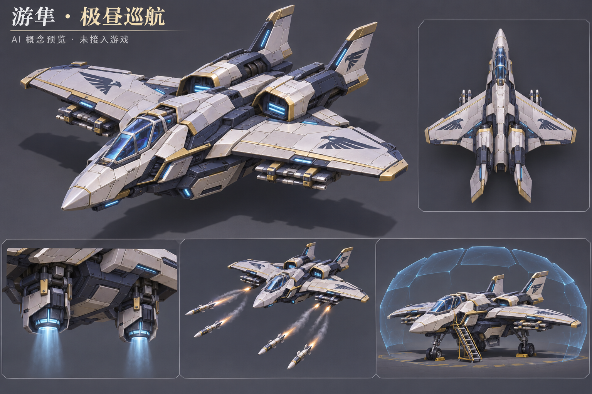
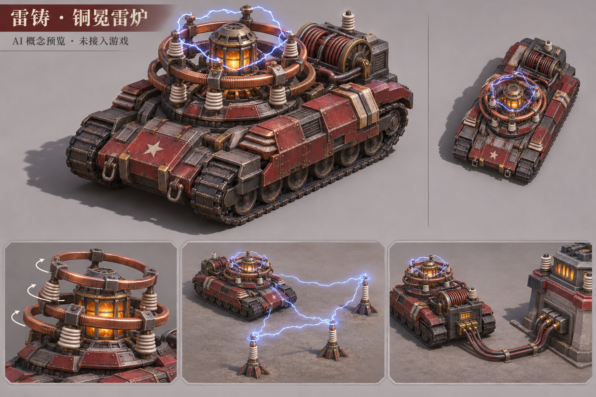
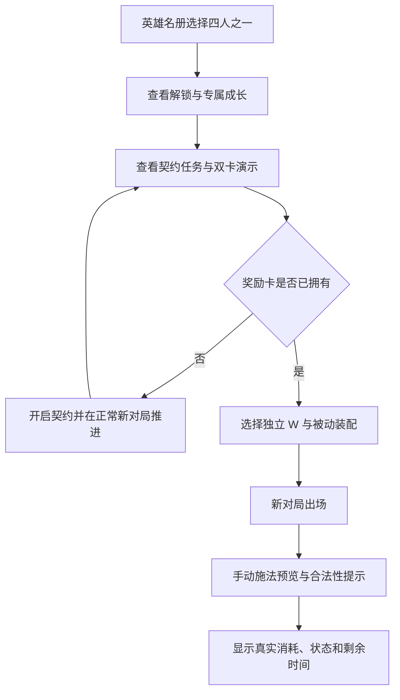

# 1. UI功能概述

当前实施补充（2026-11-18，v0.29.32）：雷铸铜冕雷炉已进入真实战斗、养成预览、天赋和契约双卡演示，见[第二十一批](PROGRESSION_EXPANSION_2_HERO_BATCH21.md)。游隼外观仍未完成；下文保留原始设计要求和概念阶段记录，不据此宣称全量交付。所有视觉观感仍待使用者确认。

2026-11-17 · 配套第五稿修订，待评审、未实施。同步每局额外英雄、完整主副米格、潜泳退隐盾、机场附近维护、180 秒迫降修复、基地 +100 电力及分流减伤；两名新英雄已有 AI 皮肤概念图，尚未接入游戏。所有 32 张卡、16 项兵种天赋与 48 个英雄节点均须制作演示，详见[演示全量清单](PROGRESSION_EXPANSION_2_DEMOS.md)。规则和全部数值见[第二批扩展设计](PROGRESSION_EXPANSION_2_DRAFT.md)。入口沿用英雄养成、单位改造、技能卡池、技能演示及战场状态详情，不新增一套独立养成大厅。

英雄名册保留原四人，新增谭雅、鲍里斯、游隼、雷铸四张卡。界面明确区分英雄解锁、契约持有、任务完成、奖励卡已获得、当前装配五种状态；未解锁英雄可以查看与开启契约，不因此立即获赠英雄。

# 2. UI 元素分解

## 英雄养成面板

| 元素名称 | 元素功能 | 内容类型 | 交互规则 |
| --- | --- | --- | --- |
| 四张新增英雄名片 | 显示阵营、原型和角色定位 | 头像、名称、生产进度 | 游隼／雷铸直接开放训练，不显示累计 20 次门槛；游隼提示“首架飞机出厂额外赠送、不占机场位”；雷铸提示“当局第 3 辆 RA2 磁暴出厂额外赠送”；谭雅／鲍里斯保留原解锁与生产限制 |
| 常规训练区 | 火力、生命、好感沿用现行体系 | 当前值、下一档效果、实际费用 | 升级前显示成本，不混入旧版本价格 |
| 两项固有天赋 | 两条功能链各显示免费 0 级及 1～5 级节点 | 每级独立名称、完整功能、解锁状态、升级费用 | 已解锁节点累积点亮，下一节点明确写“新增能力”，未解锁节点可预览；与兵种天赋分栏，提示“仅此英雄生效，不占兵种槽” |
| 独立装配区 | 单独选择英雄 W 与被动 | 已拥有且适配的卡列表 | 未拥有卡只预览；契约卡不能选给普通同型兵种；换卡不覆盖普通兵种方案 |
| 契约面板 | 三项任务和双卡奖励 | 已结算进度、本局待结算、奖励状态 | 500 碎片开启前显示固定费用；已持有不再扣费；发奖后可一键装备已拥有奖励 |
| 出场说明 | 解释英雄唯一身份 | 简短文字 | 按英雄分别显示触发条件，游隼 0/1 架、雷铸 0/3 辆当局进度，普通产品保留；赠送后显示“本局已出场”，阵亡不再赠送；远征显示本轮部署规则 |

## 卡池、单位改造与演示

| 元素名称 | 元素功能 | 内容类型 | 交互规则 |
| --- | --- | --- | --- |
| 新卡筛选 | 找到 24 普通卡及四份契约 | 阵营、兵种、W／被动、品质筛选 | 普通候选、契约、契约奖励卡分清获取路径；不把 8 奖励卡显示为普通抽取候选 |
| 单兵种星标 | 区分专属和多兵种 | 星标与准确单位名 | 只有 C01～C16 使用普通单兵种专属星标；英雄奖励另加英雄头像标 |
| 品质与场景图标 | 在各种列表识别同一卡 | 卡名旁明确写普通／稀有／史诗／传说／究极传说，并用相应颜色和场景轮廓 | 究极传说沿用现有独立边框；稀有度不能只藏在颜色里。海蝎海空交叉火控和燃烧挂载为史诗，武装直升机新卡明确“史诗·被动”，原有震地锚仍为“传说·W” |
| 兵种天赋栏 | 保留旧项并展示新增项 | 已有／新增项与等级 | 最多两项，不自动替换旧项；不出现本轮撤销旧等级或退款提示 |
| 四档演示 | 观察触发、代价、失效 | 等级切换、暂停、重播、状态变化 | 必须包含失败分支及边界，预览不写玩家资源和任务进度 |
| 英雄功能链演示 | 比较两个固有天赋各自 0～5 级的能力变化 | 两条独立等级选择、各节点演示入口 | 明确哪些能力由前级保留、哪些本级新增；可在未装契约卡时演示，不能用同一动画只改百分比 |
| 攻击力伤害预览 | 展示三点破门、红色走廊、追猎弹与电庭成长来源 | 当前攻击力、系数、护甲前伤害／每秒 DOT | 三点破门逐枚投出快照，走廊成功呼叫快照；校射增伤与半径分开，DOT 同时标每秒与单跳值；理论与护甲后的实际伤害分清 |
| 游隼补弹成长 | 显示王牌航线 0～5 级对应补弹时间 | 8／7／6／5／4／3 秒每发、当前实际时间和弹药上限 | 机场联动另列乘算，例如“3 秒 × 75% = 2.25 秒／发”；不会显示为其他停机飞机的补弹增益 |
| 手动施放提示 | 解释自动 W 的可用范围 | “仅手动”或明确自动条件 | 游隼可在已有合法目标且至少 2 弹时自动释放；地面选点的其他三个英雄 W 保持手动，不能混用说明 |

## 四英雄战场标记与表现

| 英雄 | 轮廓与状态文字 | 必须看清的动作 | 演示包含的失败情况 |
| --- | --- | --- | --- |
| 谭雅 | 红白三枚炸药图标；“炸药 3→2→1”“起爆 1.5s”“撤离节拍” | 投出、落地、亮灯、爆炸四阶段；护盾用薄白环，节拍用短靴迹 | 一枚被打掉、投掷中断、敌人离开爆炸圈；原生 C4 与 W 炸药外形不同 |
| 鲍里斯 | 地面三格红色坐标；“呼叫 0.6s”“炮火 1→2→3”；校射章 0～3、实际爆炸半径 | 预警圈随本次章数变大，伤害与范围数值分别显示；原生米格独立出现 | 呼叫中移动取消、敌人撤离、原生空袭先耗章后走廊恢复基础范围 |
| 游隼 | 白色隼翼标、“追猎弹群 4”“必中·不可拦截”、弹药 4/5、下一发补弹读秒、整备盾量 | 可原地悬停开火；四枚导弹两翼展开后追踪爆炸；补到满的一刻加盾，残盾保留；机场联动图标显示有／无有效停放飞机 | 弹药不足、目标死亡／变友方、满仓停留不重复加盾、机场飞机离开使补弹恢复基础速度；普通防空仍能打中机体 |
| 雷铸 | 三角形电场底纹、“电庭 3/3”“减速 35%”“雷电每秒 35%攻击”“电荷 2/3” | 完整三角内持续跳电；缺一极变成窄电线带，缺两极断电；三层电荷从车体向外扩出圆形电弧 | 敌人留在区域无需反复碰线也持续掉血；跨线交点不多跳；范围电弧中心跟随雷铸，身边无人也会释放 |

四个英雄都有专属识别提案，不新增必须购买的皮肤门槛。游隼和雷铸须制作独特皮肤，不只给普通兵种换色；谭雅／鲍里斯保留可辨角色轮廓。下方 AI 概念图用于美术方向评审，不能当作已接入的精灵、模型、动画或游戏截图。最终小比例可读性需实机确认。

两条固有天赋的关键功能单独表现：谭雅显示移动开枪、潜泳退出后的独立护盾、连锁炸药 4 秒拆除窗口及 60 秒／2 次额度；鲍里斯明确显示主目标 4 架＋副目标 2 架，整轮结束前空袭按钮持续占用；游隼显示首末弹／诱饵／抗扰资格、全图领航增益、维护盾和回血、迫降机体 1000% 耐久、180 秒自动修复和工程师 5 秒维修。修复瞬间将十倍耐久条切回正常 100% 生命，不能显示为十倍生命起飞。雷铸显示敌盾流入自身、三击闭锁、基地 +100 电力、分流前后 100→80＋4 以及停堆。近距反隐不通过 UI 提前暴露远处目标。

## 两名新英雄的独特皮肤

**游隼 · 极昼巡航**：白金机身、深蓝关节、冰蓝矢量喷口，宽隼翼和独立挂架形成英雄剪影。需做悬停喷口转向、四枚追猎弹两翼展开、整备盾叠加、机场旁下降维护、受损迫降和修复起飞的状态差异；满弹盾和维护盾使用不同图标，不因概念图画有护罩就永久显示无敌球。

**雷铸 · 铜冕雷炉**：低矮红黑履带车体、铜色环形线圈、琥珀炉芯和蓝白电弧。需做线圈分段转动、普通电击、敌盾能量流入、三电极展开、自身范围放电、基地供电和停堆熄光。供电电缆是概念示意，正式表现不得暗示玩家需要手动牵线或改变 8 格内自动供电规则。

两图由内置 image_gen.imagegen 生成，各一张，原始提示词保留在[生成记录](concepts/progression-expansion-2/PROMPTS.md)。当前只交付概念图；后续需按现有游戏资源规范制作方向帧、状态帧、投影与缩小比例预览，录制真实技能演示并提供必要截图。不能把静态概念图或剪辑假动画算作机制演示已完成。

## 本轮重做卡牌的演示重点

| 卡牌／品质／槽位 | 必须呈现的内容 |
| --- | --- |
| 棱镜十字／史诗／W | 选点和朝向、两轮十字光束；中心目标每轮只吃一次，普通攻击仍有原生折射 |
| 潜行余量／稀有／被动 | 上岸同时出现加速与隐身两个独立计时；开枪破隐后剩余加速继续 |
| 高射扇幕／稀有／W | 5 秒持续期内每发主目标先受直击，再与旁边空敌一起受到范围伤害；显示剩余持续时间和每发两次结算，不消耗单次资格 |
| 弹道留档／稀有／被动 | 火箭直击建筑时，同时出现同目标增伤资格和当前武器剩余 CD 缩短 |
| 压阵装甲／史诗／被动 | 正面减伤扇区与“下发任意武器 CD 减免”分开；演示防空后接主炮、防空后接防空两种消耗 |
| 诱导跃扑／传说／W | 施放选定目标、2 格触发圈、无敌明确倒计时；入侵立即取消无敌，另示未进入范围和目标失效 |
| 海空交叉火控／史诗／被动 | 保留主目标标记；对空开火时另一炮口补射敌舰，对海开火时补射敌机，补射带独立细曳光。显示两方向共用触发间隔；另一领域无目标只正常开火，切主目标不刷新间隔，补射不继续生成补射 |
| 弹着校射／史诗／被动 | 部署炮落点生成校射区，普通炮和震地锚均能获益；多个区域重叠只显示一份“校射 +最高值”，不显示叠层。演示 12%＋20% 区重叠只增伤 20%，强区结束后恢复 12%，两区剩余时间各自独立 |
| 重炮压舱／普通／W | 同时显示“装填更快、移速 -15%、承伤 +5%”，不能只显示收益 |
| 燃烧挂载／史诗／被动 | 普通导弹跨出击累计，返航／补弹不清零；Lv.0～2显示1/3、2/3，第三次命中触发；Lv.3显示1/2，第二次命中触发，均生成3秒燃烧区；W 和溅射不增加计数 |
| 牵引弹头／史诗／W | 待命只标下一枚真实弹，命中形成内旋地纹，敌人被沿合法地面缓慢拉向中心，2 秒后爆破；另示火箭被拦截不生成坑、墙后不穿墙拖入 |
| 过载封条／史诗／W | 敌目标有可见封条、三格剩余触发数和到期读秒；每次普通开火后电爆，停火等待时只倒计时、不自动掉血；标记不揭雾 |

两极串联调整为史诗专属被动卡：技能装配界面同时展示 W「连锁放电」与被动「两极串联」，兵种天赋栏不再出现同名节点。普通主电击先命中 A 再命中 B 才建立电链，W 一次主命中附带的分叉不能直接凑成两个串联目标。

| 新调整卡牌／品质／槽位 | 必须呈现的内容 |
| --- | --- |
| 两极串联／史诗／被动 | 主电击先命中 A 再命中 B，两者间连线并各自跳伤；拉开超四格或一端死亡断链，路过第三人不受伤；与连锁放电同时装备，W 分支不累计串联主命中 |

## 本轮兵种天赋演示

兵种天赋不标抽卡稀有度，仍展示 0～3 级数值、是否已解锁／启用及当前真实状态。

| 天赋 | 状态与实际动作 | 必须展示的边界 |
| --- | --- | --- |
| 阵地轮值 | 卧倒停火蓄势，然后显示“快速装填 3→2→1→0”，三个普通射击轮次依次消耗 | 一轮多枚枪弹不能一次扣光；中途再次停火不补回次数，起身清空 |
| 稳座支架 | 乘客进入时显示“乘员适配 4.0 秒”，车行驶中计时照常；完成后显示装填收益 | 同类型换人也重新计时，空车无加成，不能把“稳座”画成车辆必须静止 |
| 蓄电转储 | 停火蓄电强化主击击杀后，显示永久储存至下一发的资格与保留的额外增伤，不显示过期倒计时 | W 增伤／分支击杀不转储，转储发不再次转储；自然新蓄电只取较强一份，不叠加 |
| 追身破片 | 普通对空命中即在飞机上附着小破片环，0.8 秒后随飞机当前位置空爆 | 不要求击杀；飞机飞入机群会波及邻机，落地解除；不可把导弹当作挂载飞机 |
| 跳宿猎杀 | 显示“Q 自动跳宿：开／关”，出场默认开；寄生后仍可通过己方机器人控制入口切换。宿主显示有效跳伤 1/3、2/3、3/3，自动开启且满足条件后显示扑跃与残留撕裂 | 关闭后达条件也继续当前寄生；重新开启不清计数、不重置 CD；途中关闭不取消已出发扑跃。多选有任意开启则统一关闭，否则统一开启；换宿和读档保留开关 |
| 左右分猎 | 左右炮口分别用①②标出本轮目标；两枚炮弹各在落点出现 1 格小爆炸圈，单独显示额外 10% 攻击力溅射，直击与溅射数值分清 | 单目标双炮集火也各触发一次溅射；两圈重叠可各伤一次，本枚直接目标同样受溅射；副目标离开射程不隔空补炮，不增加弹数、不递归爆炸 |
| 尾流分叉 | 主鱼雷显示尾流蓄成，水中航满 2 格后亮起分叉标；命中后只有一枚副鱼雷弯向另一目标 | 近距离命中不分叉；副鱼雷再次命中不继续分叉；不让主目标吃回头二次鱼雷 |
| 护航弹仓 | 两个实际导弹架分别显示缩短后的补弹时间，真实离架后每枚导弹有独立细护盾条 | 实测动画仍按正常抬升与发射节奏；拦截先破盾再扣耐久，可最终击落，不使用“不可拦截”图标 |

## 通用战场状态

| 元素名称 | 元素功能 | 内容类型 | 交互规则 |
| --- | --- | --- | --- |
| W 冷却角标 | 告知何时能再次施放 | 剩余秒数 | 与效果持续时间分开显示；成功施放后即使被打断仍显示剩余 CD |
| 下一发待命 | 显示强化是否尚未消耗 | “扇幕·直击＋溅射”“下发武器 CD 减免”等 | 真正发射或命中时按规则消耗，未触发到期明确灰掉；锚钉已改按 W 即时发射，不显示待命状态；棱镜十字使用范围预览，不再显示放弃折射 |
| 护盾和减伤 | 区分真实护盾与伤害比例 | 独立护盾条、减伤百分比、时限 | 护盾碎裂与自然消散不同表现，不用同一爆炸暗示都触发破盾收益 |
| 层数和目标绑定 | 展示积累与转火损失 | 计数、绑定目标标记、有效期 | 选择本单位可查看；目标失效即清理，不显示幽灵目标 |
| 物件数量与范围 | 表达炸药、电极和水幕 | 数量、可攻击血条、倒计时、选中范围 | 己方显示完整信息；敌方仅在正常可见时显示公开预警和可攻击物件 |
| 天赋触发文字 | 告知被动是否真实生效 | 如“满载首发”“导弹护盾”“轮值 3 发”“乘员适配”“跳宿准备” | 获得、消耗、失效短暂显示，不逐帧刷字；细节放选中状态栏 |
| 不可用原因 | 解释失败而非静默无响应 | “需要部署”“需要 2 发弹药”“电极落点受阻”“需选定可寄生目标”等 | 失败不先播放完整成功效果，不误扣冷却 |

信息不靠颜色单独区分：增益配向上箭头／护盾，减益配锁链／减速线，待命配空心弹标，已消耗明确熄灭。迷雾外不显示敌方内部层数、契约、剩余冷却或选中连线。预警只对正常有视野的敌方可见，不新开全图揭雾。

# 3. 交互流程图

