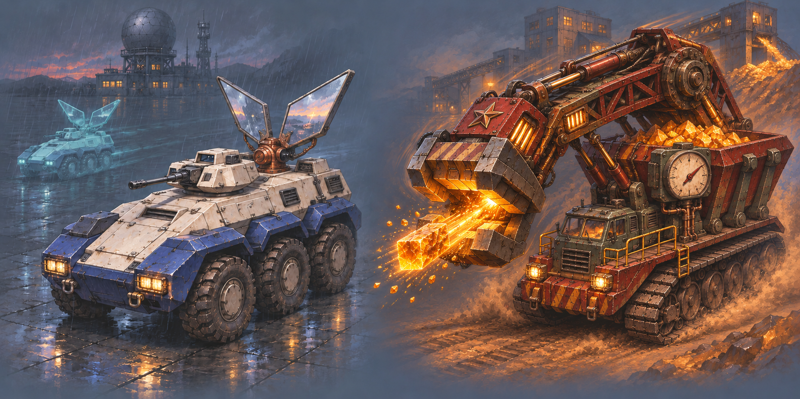

# 铁潮英雄设计稿 · 引片与老秤

2026-11-24，以 v0.31.20 的英雄养成结构为基础。每位英雄有一项出场任务、两条六阶段固有天赋、一张专属 W、一张专属被动、一份三课目契约和一款专属皮肤。以下数值供首轮试玩使用。

## 盟军 · 引片

**多功能步兵车 FV，车队领航员。** 战前她给巡回放映队开车，习惯先走一遍夜路，再回头接落在后面的卡车。她的口令是“看我的尾灯。拐弯的地方，我再放一遍。”

**主动 W「点将上车」　纯手动。按 W 打开本方当前可生产、可乘 FV 的普通步兵名单，点中一个兵种，该乘员直接进车并切换真实炮塔。所有英雄单位均排除。四档冷却建议 40／36／32／28 秒，从入座成功起算。**

**乘员来源提案：W 直接提供一名本车专用的临时乘员，成本由冷却承担。名单按当下阵营、科技和生产许可过滤，确认时复核。原有实体步兵在合法相邻位置下车，保留经验；W 临时乘员被换下时撤回。原乘员无法安全落地时保留原状态与冷却。可取消选择；重复选择已在座的同兵种不产生入座事件。W 乘员在车内照常获得经验，但卸下后不留作免费野战步兵。**

**被动「双机联映」　引片亲自完成三次有效基础攻击或维修后，双镜自动在身旁最近的合法空地投出当前模式的固定副炮塔六秒。可以一直用同一个乘员触发。副炮塔沿用生成时模式的射程、目标类别和装填，攻击或维修量为原模式的 50／60／70／80%，可被摧毁，耐久为本车最大生命的 20%。成功投影时清计数并开始十八秒冷却，冷却期间暂停计数；连射按一轮，投影不为自己计数。仅投影具有基础伤害或维修的模式。**

皮肤「雨幕放映师」在 W 点选时亮起对应兵种图章，乘员坐定后合镜。触发被动时双镜向车侧展开，地面出现副炮塔。试玩可先用工程师连续修车打出维修投影，再手动点选武装乘员；原维修投影继续至自然到期。

## 苏联 · 老秤

**武装采矿车 HARV，近线攻坚。** 老秤在矿区干了三十年。一碰上封路的装甲车，他就把第一块矿记在对方账上。“这块不用过磅了。送他们。”

**主动 W「磅重锤」**　点选五格内可见的敌方地面车辆或建筑。老秤停稳压锤 0.6 秒，向锁定时的位置抛出一枚方形压块。压块打中飞行线上遇到的第一辆敌车或第一座敌方建筑，造成相当于自身原生主武器两秒基础输出的伤害，再按目标护甲结算。近处的敌车可以挡在建筑前面，横向开走也能让压块落空。四档冷却为 32／30／28／26 秒。

- **带矿开火**　货量达到原仓的 25% 时，按钮显示「热锭」，落锤当刻消耗原仓容量 25% 的货物，普通矿和宝石按装载比例扣除。热锭伤害加倍，命中第一辆车后可再向前飞一格，对第二个合法目标造成该发一半的伤害；碰到建筑即停。货量不足时显示「冷锭」，发射普通压块，消耗为零。手动点选前即可看到当前弹种和代价。出膛前移动车辆或目标失效会取消，不扣货也不进冷却；出膛后即使落空也照常结账。
- **矿渣封路**　发射热锭同时沿弹道撒出一条一格宽的矿渣带，从车头前第一格延伸至瞄准点，最远五格，遇实体建筑或不可达地形在其近侧截断。每个带内敌方地面目标受一次热锭首击基础伤害 30% 的溅射；原有直击和穿透照常，单个目标最多再吃一次溅射。沿线各格从矿渣落下起封路五秒，双方地面单位均须绕行，空军照常飞越。已站在线上的单位可向外撤离，离开后不能折返穿越。五秒到期重新寻路，重叠格取最晚到期时间。冷锭继续提供空仓攻击，封路消耗的就是热锭原本的四分之一原仓货。
- **被动「越打越准」**　原生主武器实弹射击使炮管升温。首发从零开始，此后持续射击满两秒升二档，满四秒升三档，热量封顶四秒。三档射速分别为原生的 1／1.3／1.6 倍，单发伤害照常。一个完整连续攻击周期按实际射击与原生装填时间升温；追击、仅锁定、空等不升温。停火后保留当前热量 1／1.5／2／2.5 秒（卡 Lv.0～3），再按每秒消退一秒热量逐档回落。换目标继承车上余热，普通移动也只按停火计时。W 不产热，已有余热按同一时钟保存。HUD 以三段热尺、转速声和炮口亮度显示档位。参考本工程尤里盖特坦克 YTNK 的三档与升降速配置；上述秒数和倍率为老秤的首测值。
- **Auto W**　默认关闭。开启后，冷锭沿用当前合法敌方目标。热锭要求预览带内至少两个合法敌方目标，且带内无己方地面单位（施法者除外）。手动可决定是否封住自己的退路。采矿或手动卸货途中不自动另找目标。

- **皮肤「第九地磅」**　默认型将压头收在矿斗前沿，出击时才抬起。专属版用一座红褐色门架跨过矿斗，把方口压钳送到驾驶室前方。起手时上颚合拢，秤针随扣货猛退四分之一圈，钳口吐出一枚亮橙方锭，随即后坐、回收。冷锭是暗灰铁块，秤针静止，钳口只闪一次白光。侧裙留阵营色，秤盘、开口矿斗和低驾驶室让玩家在远景也能认出矿车；命中反馈集中在压块和落点。

**试玩片段**　老秤用机枪打头车升到三档。后车赶到时对车列按 W：热锭打穿头车，碎矿扫过整条线，封住路口五秒。转打路侧的敌人时，机枪从尚存的热量继续。若原地等完整个封路时间，热量已经开始回落。

## 进入对局与制作验收

### 老秤的命令与货仓

老秤首先是一辆作战单位。默认启用空闲采矿；出生或上一个命令结束后，连续空闲 2 秒，才会找三格内最近的可达矿点。它只在这一小片区域取矿。攻击、移动、巡逻、护卫、施放 W、显式驻守的优先级都更高。玩家下达新命令时立即交还控制，仅真正完成的采集动作才入仓。主动攻击与自动迎敌期间都暂停采矿；受控、装载时同样暂停。若矿点耗尽，只在本次空闲起点三格内重选，选不到就待命。关闭空闲采矿可让它一直留在原地。

**满仓原地待命，货只由玩家下令卸。** 路过矿场、贴着入口、存读档、重启 Auto W 都不触发进厂。玩家点己方可用精炼厂并选择「卸货」时，才前往交仓；点地板只是移动。显式卸货遭打断时只结算已交部分，其余留车上。完成交仓后在厂外待命，下一次空闲才重新判断近旁矿点。HUD 并列显示「矿量 75%」「可发热锭 3 枚」和当前命令。普通 HARV 继续用自身采矿往返规则。

**双斗取样同时提升铲量和仓容。以原矿车仓容 C 为固定刻度，学会后每铲 ×2，最多装 2C。热锭门槛和每发消耗始终是 0.25C，满仓可打八发。HUD 按原仓显示 0～200%，其它“半仓／四分之一仓”的技能与任务也沿用原刻度。** 例如 C=100，仓内 195，基础每铲 5，矿点余量充足时本铲只取 5；200 装满后首发热锭打完剩 175。矿石和宝石按实际装载比例消耗。

### 四条英雄天赋

参照[游隼「王牌航线／滞空保障」与雷铸「移动变电站／过载保险」](../PROGRESSION_EXPANSION_2_DRAFT.md)。每位两条固有天赋，各有六个独立效果。Lv.0 随英雄解锁，Lv.1～5 按顺序累积获得。每个节点只读战场上的基础事件，单独启用该节点、空置专属技能槽也能触发。每条升至 Lv.1～5 依次消耗 40／120／240／400／600 战略核心。

下表整格加粗表示本轮重写或调整，普通字为沿用。未指定的数值为试玩提案。

| 等级 | 引片 · 领航胶卷 | 引片 · 末车守则 |
| --- | --- | --- |
| 0 | 勘路镜。实驶两格，视野增加两格，持续四秒。 | 靠边检修。停车脱战四秒，每秒自修 1%，最多修到半血。 |
| 1 | **搭顺风车。步兵普通登车、首次登车晋升或 W 选人成功入座，均触发三秒 15% 加速。同一次入座只算一次，共用十五秒冷却。** | **同车授勋（原接应伤员）。乘员每实际获得 1 点战斗经验，引片同步得到 1 点。保留乘员原经验；同一事件引片已直接获得的那一份去重，共享经验不再回传。** |
| 2 | **弯道灯。两秒内实驶一格并转向超过 60°，在弯心生成独立地面 token。半径四格、持续六秒，进入范围的每个己方地面单位均获三秒 15% 加速，每个 token 对每人一次。独立编号、范围圈和倒计时，触发间隔十二秒。** | **安全下车。实体步兵成功下车即获两秒无敌，期间所受伤害为零。每名步兵间隔二十秒。** |
| 3 | **战地除虫（原会车道）。每八秒一次维修脉冲，优先清除三格内一辆己方车上的敌方恐怖机器人，含引片自身；范围内没有寄生时，可改为给一台受损的己方恐怖机器人恢复 20% 最大生命。有效治疗或清除后才进冷却。** | **急救力场（原维修接力）。自身或三格内己方地面单位低于 50% 生命时展开四格力场，持续五秒。每秒为圈内低于半血的友军各恢复最大生命的 4%，单次场最多五跳，三十秒冷却，从展开时起算。** |
| 4 | **高位观察。实际地速连续三秒不高于本车常规全速的 50% 即展开探测，发现三格内隐形敌方地面车辆。停车与慢行都计时，重新高速行驶立即收镜并重置。** | **镜幕断锁（原车侧掩护）。三格内其他己方地面友军被敌方制导弹锁定后，引片放出一枚镜像诱饵，引走最早将要命中的一枚可拦截制导弹。攻击落到诱饵位置并按原弹头结算，间隔十八秒。** |
| 5 | **集中放行。引片被敌方攻击命中时获得十秒减伤，触发这一击即享 90%，随后按对数曲线衰减至零。触发起三十秒冷却，期间受击不刷新。建议减伤率 R(t)=90% × [1−ln(1+0.3t)/ln(4)]，t 为经过秒数，0／1／5／10 秒约为 90%／73%／31%／0%。** | 紧急拖救。每局首次有两格内其他己方地面车辆被敌方从 20% 生命以上打到 20% 或以下且存活，授予其 15% 最大生命护盾六秒。 |

| 等级 | 老秤 · 战地采办 | 老秤 · 压机炮班 |
| --- | --- | --- |
| 0 | 矿区哨位。停在未采空矿点一格内，视野增加两格。 | **架稳。车体停下即可取得对敌地面车辆与建筑的普攻增伤 10%。停车期间持续生效，实际移动时结束。** |
| 1 | **双斗取样。每铲双倍，仓容提升到原来的 200%。热锭始终每发消耗原仓的 25%，满仓八发。** | **第三发分火（原转火校准）。每三轮原生普攻，第三轮额外向主目标两格内另一个合法射程内敌人开一发，按原生单发 100% 结算。自动选最近副目标，无副目标则该轮只打主目标；副弹不推进轮数。** |
| 2 | **废钢回炉（原料斗记位）。亲自击毁敌方地面战车时，回收等于原仓 5% 的普通矿料进入货仓，余位封顶。由此获得的是战利品，不计入采矿任务。** | 盯履带。连续三次普攻命中同一敌车，使其减速 15% 两秒，每目标间隔十二秒。 |
| 3 | 带料起步。载货至少原仓四分之一，起步时获得两秒 15% 移速，间隔十二秒。 | **压线。初始体积值 100%，本人每击毁一个敌人 +20 个百分点，最高 500%。达 200% 可碾卧倒步兵；300% 追加天启碾压档；500% 再追加盟军战斗要塞碾压档。各档累积。按击杀身份只记一次，本车本局保存，5／10／20 次击杀分别达档。** |
| 4 | **矿斗配重。用矿吸收最多一半即将扣到车体生命的敌方伤害。每消耗原仓 1% 可免去最大生命 1% 的损失，可按小数换算。例：最大生命 1000，即将扣 200，花 10% 原仓矿后实扣 100；只余 3% 矿则实扣 170。护盾已吸收部分不耗矿。** | **拆工事。连续三次普攻命中同一敌建筑后，第四击在命中点追加一次半径 1.5 格的攻城溅射。范围内敌方地面单位和建筑各受原生单发 20% 的伤害，主建筑可吃一次溅射，随后清零。** |
| 5 | **流动抢修站（原手留一斗）。老秤停车时，三格内其他己方战车低于半血，可从车上拨出 10% 原仓矿，放出一台抢修机，六秒内每秒修复该车 4% 最大生命。自动优先最低血比，间隔三十秒；车主仍能随时带余矿离开。** | **压轴一发。老秤亲自摧毁敌方已部署基地（建造场）、维修厂或作战实验室，在该建筑原址释放一次 10% 威力的游戏核弹。爆炸伤害=该位置标准核弹爆炸伤害 × 发射时本方核弹科技树倍率 × 10%，沿用爆炸范围和衰减，仅产生瞬时爆炸。每座被毁建筑一次，奖励爆炸不连锁触发本天赋。** |

**待审细节。** 体积目前按 100% 起的战斗数值提案，模型缩放与寻路占格另行调校。300% 暂取工程里的 RA3 天启行驶碾压：持续接触符合条件的目标 1.5 秒，可压普通地面单位及围墙。500% 追加尤复战斗要塞对可重碾地面单位的行进接触判定，沿用重碾抗性；同一目标按先成立的一档只结算一次。工程另有尤复天启 APOC，原始表标记为普通 Crusher。这里的“天启”具体型号待审。候选核弹按命中处瞬时爆炸算，辐射区、后续辐射跳伤均为零。核弹科技树若提供 2 倍，则小核弹瞬时伤害为未强化标准核弹的 20%。

### 出场任务和契约奖励

在正常扩展遭遇战中用普通载具完成下列动作，即刻记录永久出场资格。两项均可在任意难度完成，达成后与本局胜负、车辆后续存活无关。引片每局由第一辆实际接到己方步兵的普通 FV 原地晋升；首次达成同时永久解锁。老秤沿用上稿方案，首次达成记录资格，后续局首辆付费生产的 HARV 晋升。两位英雄出场时均有两条 Lv.0 天赋。

| 英雄出场任务 | 玩家看到的任务文字 | 达成时刻 |
| --- | --- | --- |
| 引片「接末班车」 | 让一名己方步兵登上普通多功能步兵车。 | 步兵坐进乘员位的同一刻，这辆 FV 原地变成引片，乘员和当前炮塔保留。保留当前生命、订单、编队与选中状态。每方每局一次，重复上下车和读档均不再晋升。 |
| 老秤「矿道清障」 | 用普通武装矿车打伤一个敌人，然后用这辆车采一次矿。 | 矿车首次对敌方目标造成实际伤害后，下一次从矿点采得任意正数货量并装入车斗时完成。矿石、宝石均可，采前已有货物也可。 |

远征沿用招募和负伤流程。契约累计课目在正常扩展遭遇战胜负结算时入账，契约单局课目要求普通或更高难度获胜。同一对局重复结算仅记一次。训练场、演示及 GM 局不记永久进度。

契约可以先持有，任务从持约后新开的遭遇战计起。每份有两项累计任务和一项单局任务，三项可同步推进。全部完成时一次领取对应 W、被动两张 Lv.0 卡和本案专属皮肤。下表课目只使用基础炮塔、普攻或货仓，均可空技能槽完成。

| 契约课目 | 引片「末班放映」 | 老秤「第九磅单」 |
| --- | --- | --- |
| W 课目 · 累计 | **双工位**。引片用任意武装模式有效攻击一次，再用工程师模式实际修复一次友车。两项可跨局累计，各一次。 | **带料上阵**。持有至少四分之一仓货时，用原生武器有效攻击敌人十二次。 |
| 被动课目 · 累计 | **同机连映（配合新版被动）。引片用同一炮塔模式累计完成三轮有效攻击或三次有效维修，完成三组。基础攻击和工程师维修都能推进。** | **接着打**。老秤用普攻先后打伤两个不同敌人，两次间隔至多三秒。累计三组，每次命中只归一组。 |
| 联合课目 · 单局 | **一车两用（已确认）。一场胜局内，引片用两种不同武装乘员模式各打伤一个敌人。普通登车切换即可完成。** | **打完再交班**。在一场胜局中带货打伤两辆不同敌车，再由玩家手动交回至少四分之一仓。老秤在胜利时存活。 |

契约课目中的有效攻击须使敌方损失生命，友伤、打空、攻击残骸不计。出场任务使用普通载具，技能任务只认英雄本体。跨局累计按对局标识区分单位，任务页显示当局进度和待结算成果。两项出场任务无需先有契约。

### 游戏图标交付

英雄卡面与单位图标沿用上一轮。评审中的三枚新技能图标列出构图方向，旧合图归入上稿。

| 用途 | 引片 | 老秤 |
| --- | --- | --- |
| 英雄养成头像，300×240 | [蓝白六轮车、双镜与「引片」黑底名牌](hero-convoy-icons/yinpian-hero.png) | [履带矿车、压钳与「老秤」黑底名牌](hero-convoy-icons/laocheng-hero.png) |
| 局内选中与编队，方形 | [双镜六轮车，强调 V 形车顶](hero-convoy-icons/yinpian-unit.png) | [门架矿车，强调压头与敞口矿斗](hero-convoy-icons/laocheng-unit.png) |
| 专属 W | 开启的乘员舱旁亮起点将名单（新构图待审） | [压钳吐出炽亮方锭](hero-convoy-icons/laocheng-w.png) |
| 专属被动 | 双镜分出两座炮塔（新构图待审） | 三段发亮的炮管热尺（新构图待审） |

头像参照现有北辰卡面，车体占画面上部，底部留黑条白字。局内单位图标使用单独构图，数量、血条、老兵等级由界面叠加。W 与被动各读自己的资源。英雄专属资源按英雄身份选择，普通 FV 和 HARV 使用现有单位图标。

### 模式与制作验收

- **出场提案**　扩展遭遇战中，取得对应英雄出场资格后，引片由本局首辆接到步兵的普通 FV 原地晋升，老秤由后续局首辆付费生产的 HARV 晋升，保留原单位、订单与队列计数。这样选老秤不会在开局凭空多出一辆采矿车。远征从第五关起加入本阵营现有招募候选，沿用持有与负伤规则。契约沿用现有未持有池，专属 W 和被动占英雄原有装配槽；完成契约赠对应皮肤，工房可提前试穿。皮肤只改变外观。
- **立项依据**　当前英雄目录在 `iron_tide/scripts/rules/academy.gd`。FV 的乘员换装与维修入口在 `scripts/units/allied_abilities.gd`，HARV 的货量、宝石与货值在 `scripts/units/unit.gd`，以下脚本路径均相对 Godot 工程。制作时沿用 FV 的卸员、换炮塔与 HARV 的采集入仓、精炼结算；老秤单独采用上文的空闲采矿与手动卸货命令。
- **演示**　英雄页能分别打开 W、被动和等级切换。引片演示手动点将、科技过滤、原乘员下车及同乘员连续工作生成投影；老秤分别演示冷热锭、直线溅射与五秒封路、升档及停火转目标。四条天赋各设独立六档演示，可切 Lv.0～5，逐级演示本级独立效果。制作验证时另以空技能槽、只启用本级节点复现触发，再检查整条线累积生效。老秤演示须含近矿待命、半途接敌、满仓经过厂门、手动交仓四幕，Lv.0／1 在同一矿点对比每铲入仓量。引片 W 仅演示手动选择与取消，老秤 W 同时演示手动及 Auto W 条件。无矿战场老秤可用原生武器及冷锭，W 同时显示升为热锭还差多少货。
- **保存与表现验收**　引片在登车晋升、W 完成入座、投影与地面 token 存续时分别保存，恢复时核对乘员身份、技能冷却、token 编号与余时。老秤另验证仓量上限、体积档位、耗矿减伤与核弹单次归属。老秤在满热、余热衰减、压锤前摇和封路中途分别存读档，核对热尺、矿量、伤害与道路剩余时长。热锭出膛只扣一次矿，剩余矿物按实际成分回厂结账。两款皮肤制作时逐一检查体素 32 向、阵营色、炮口、矿斗和地面锚点，并在默认战斗倍率与工房近景复核动作。此图为美术概念稿，以上为制作与试玩验收条件。
