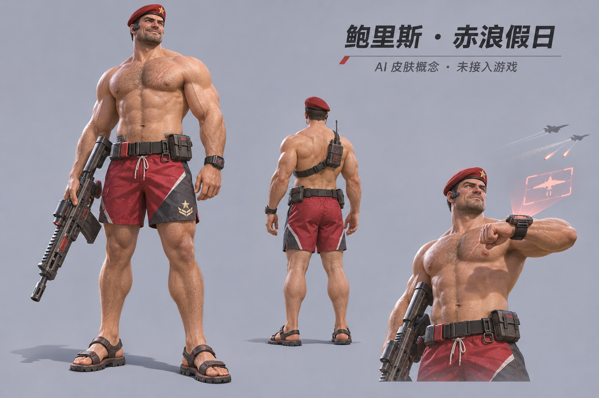
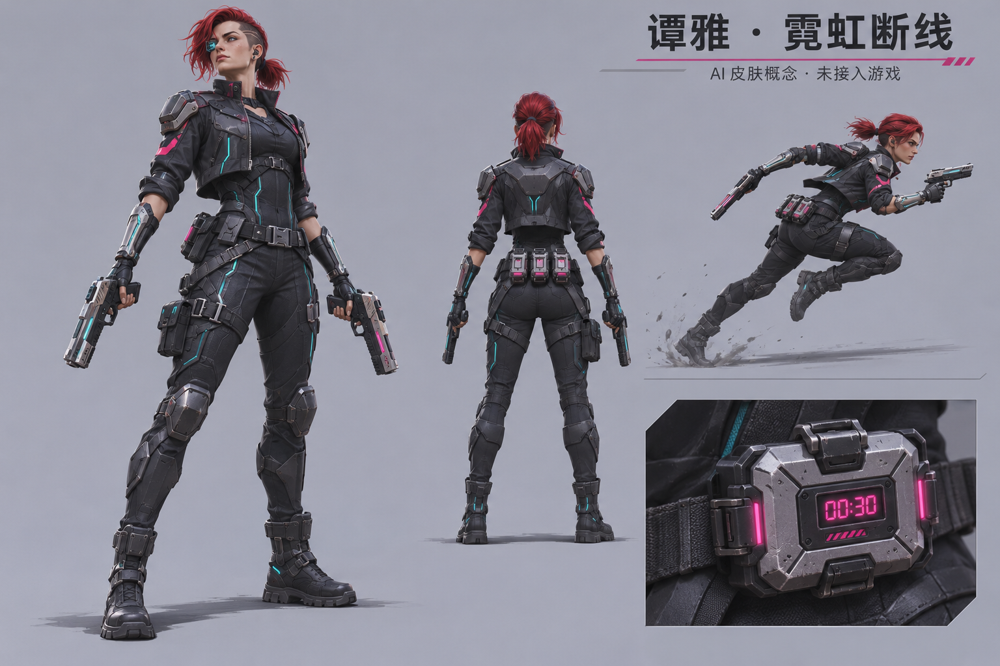
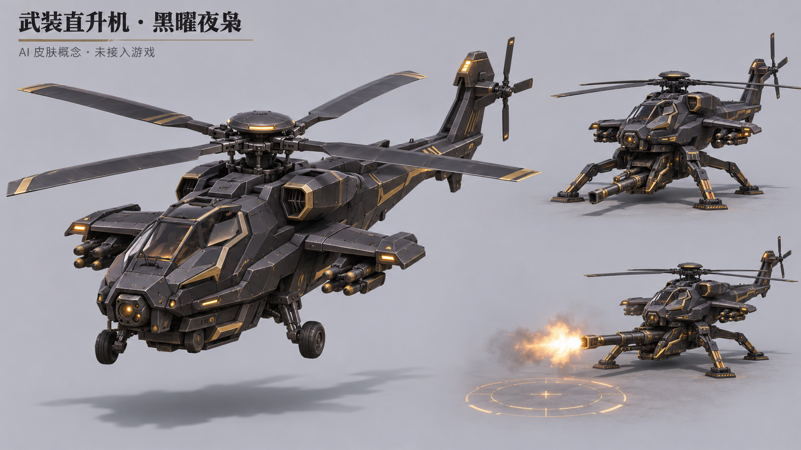
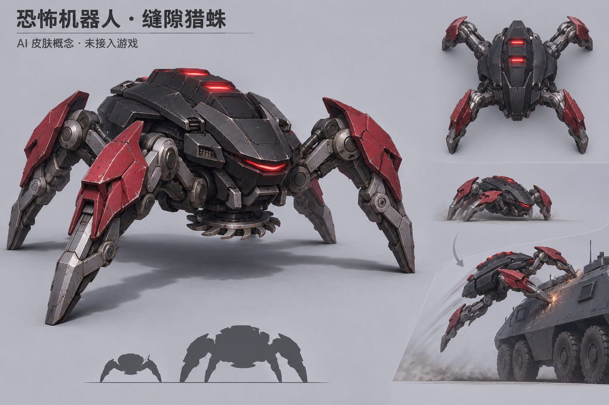

# 第二组四款皮肤 AI 概念

2026-11-17。按本轮用户修订：鲍里斯泳装、谭雅赛博朋克、武装直升机替代天启皮肤、恐怖机器人放大。使用内置 image_gen.imagegen，每款独立生成一张，无参考图。四张生成时均为概念预览；夜枭与猎蛛后续已派生直接 32 向游戏图集，见 [制作记录](direct32/README.md) 与 [实现状态](../../PROGRESSION_EXPANSION_2_BATCH1.md)。鲍里斯与谭雅仍为概念。

已查看四张结果：泳装与赛博朋克主题可辨，直升机同时呈现飞行与部署炮形态，恐怖机器人显示更大体型及轮廓对比。机器人图中的比例是概念示意，不是已测量的游戏尺寸；放大不在本轮自动改变碰撞或寻路。谭雅炸药显示屏数字仅为图案示意，不作为技能倒计时配置。

## 鲍里斯 · 赤浪假日（泳装）



最终生成提示词：

```text
Use case: stylized-concept. Create one polished landscape concept sheet for a playable unit skin in Iron Tide, a military science-fiction real-time strategy game. Cohesive premium hard-surface game concept art, realistic materials with slightly stylized readable forms, crisp details, neutral pale slate studio background, soft shadows. A dominant complete three-quarter view occupies most of the sheet, with two or three smaller clearly separated supporting views. Keep the subject fully in frame, generous margins, readable silhouette at RTS scale. Restrained professional concept-sheet typography. Only the specified Chinese title and the subtitle 'AI 皮肤概念 · 未接入游戏', no invented stats, logos or watermarks. This is conceptual art, not a game screenshot.
Title: '鲍里斯 · 赤浪假日'. The user specifically wants BORIS in SWIMWEAR. Depict an unmistakably adult, rugged broad-shouldered Soviet male commando, about 40, short dark hair, strong jaw, short stubble, confident relaxed expression. Bare torso, practical red and charcoal mid-thigh swimming trunks with a small military insignia, waterproof utility belt and beach sandals. A red beret and a modest waterproof radio/earpiece preserve his commando identity. Carry his recognizable heavy assault rifle safely angled down in a relaxed full-body standing pose. This should clearly read as an amusing heroic summer swim skin, not a man still wearing full combat armor, not an erotic pin-up. Show a smaller back view emphasizing the waterproof radio rig and trunks, plus a small action pose raising his wrist targeting terminal to call an airstrike. Clean heroic anatomy, naturally proportioned hands, no nudity or underwear framing. Summer warmth in the lighting while retaining the shared slate concept-sheet background.
```

## 谭雅 · 霓虹断线（赛博朋克）



最终生成提示词：

```text
Use case: stylized-concept. Create one polished landscape concept sheet for a playable unit skin in Iron Tide, a military science-fiction real-time strategy game. Cohesive premium hard-surface game concept art, realistic materials with slightly stylized readable forms, crisp details, neutral pale slate studio background, soft shadows. A dominant complete three-quarter view occupies most of the sheet, with two or three smaller clearly separated supporting views. Keep the subject fully in frame, generous margins, readable silhouette at RTS scale. Restrained professional concept-sheet typography. Only the specified Chinese title and the subtitle 'AI 皮肤概念 · 未接入游戏', no invented stats, logos or watermarks. This is conceptual art, not a game screenshot.
Title: '谭雅 · 霓虹断线'. The user specifically wants TANYA as a CYBERPUNK commando. Depict an adult athletic woman about 30, recognizable vivid red hair in a swept undercut and short ponytail, confident determined expression. Practical black technical bodysuit fully covered by selective dark graphite armor, cropped armored jacket, cyan circuitry and sparse magenta neon accents, slim cybernetic forearm bracers, one small optical targeting implant, sturdy tactical boots. Two distinct silver-black pistols in a composed ready stance, not aiming at viewer. Three compact flat breaching charges attached to the rear belt/back harness, visibly readable. Strong agile silhouette, grounded military cyberpunk rather than fantasy or sexualized clothing. Smaller back view showing the three charges and short jacket, an action vignette of running sideways with dual pistols, and a close-up of a neon segmented timer on a breaching charge. Glowing accents must not obscure her face or silhouette. No wings, swords, heels, or giant ornamental armor.
```

## 武装直升机 · 黑曜夜枭



最终生成提示词：

```text
Use case: stylized-concept. Create one polished landscape concept sheet for a playable unit skin in Iron Tide, a military science-fiction real-time strategy game. Cohesive premium hard-surface game concept art, realistic materials with slightly stylized readable forms, crisp details, neutral pale slate studio background, soft shadows. A dominant complete three-quarter view occupies most of the sheet, with two or three smaller clearly separated supporting views. Keep the subject fully in frame, generous margins, readable silhouette at RTS scale. Restrained professional concept-sheet typography. Only the specified Chinese title and the subtitle 'AI 皮肤概念 · 未接入游戏', no invented stats, logos or watermarks. This is conceptual art, not a game screenshot.
Title: '武装直升机 · 黑曜夜枭'. The user has REPLACED the Apocalypse tank skin with an ARMED SIEGE HELICOPTER skin. The subject must be a recognizable military helicopter with a large main rotor, compact armored cockpit, tail boom and tail rotor, short weapon stub wings and sturdy landing gear. Matte obsidian-black armored panels, restrained brass-gold edge trim, warm amber sensor lights. Main view: the complete helicopter hovering in a three-quarter elevated RTS perspective, rotor readable and fully contained in frame. Distinctive armored nose and heavy deployable artillery module stowed compactly under the fuselage. Supporting view: the SAME helicopter landed in siege-artillery deployment, rotor stopped, landing outriggers braced outward and the artillery cannon deployed forward; this must remain a helicopter with its tail and rotor, not turn into a tracked tank. Third inset: deployed cannon muzzle flash and one subtle ground targeting ring, illustrating artillery calibration. Industrial mechanics, coherent transformation, no tank chassis or tracks, no spaceship, no jet-only silhouette. Show both flight and ground artillery modes clearly.
```

## 恐怖机器人 · 缝隙猎蛛（大型）



最终生成提示词：

```text
Use case: stylized-concept. Create one polished landscape concept sheet for a playable unit skin in Iron Tide, a military science-fiction real-time strategy game. Cohesive premium hard-surface game concept art, realistic materials with slightly stylized readable forms, crisp details, neutral pale slate studio background, soft shadows. A dominant complete three-quarter view occupies most of the sheet, with two or three smaller clearly separated supporting views. Keep the subject fully in frame, generous margins, readable silhouette at RTS scale. Restrained professional concept-sheet typography. Only the specified Chinese title and the subtitle 'AI 皮肤概念 · 未接入游戏', no invented stats, logos or watermarks. This is conceptual art, not a game screenshot.
Title: '恐怖机器人 · 缝隙猎蛛'. The user wants this terror robot to be visibly BIGGER. Make a large low-slung armored quadruped parasite hunter, roughly 1.5 times the body length and spread of a standard small terror drone, heavier and more imposing yet still agile and capable of jumping onto vehicles. Black central armored core, four articulated silver-gray blade-like mechanical legs with deep-red protective plates, a single narrow red optical slit, underside rotary cutter, three segmented red status lights on its back. One central body and exactly four weight-bearing articulated legs; this is a machine, no organic body or gore. Dominant three-quarter full-body view with a broad planted stance and a large armored abdomen. Smaller top view clearly showing enlarged footprint and all four legs; a second small action vignette with legs compressed then leaping toward the side of a plain armored vehicle, sparks at metal contact without damage to people. Include a restrained simple unlabeled silhouette-size comparison along the bottom, standard small drone silhouette beside this 1.5x larger hero skin silhouette, to communicate scale. Do not make a building-sized kaiju or add extra legs. Keep the full limbs in frame.
```
