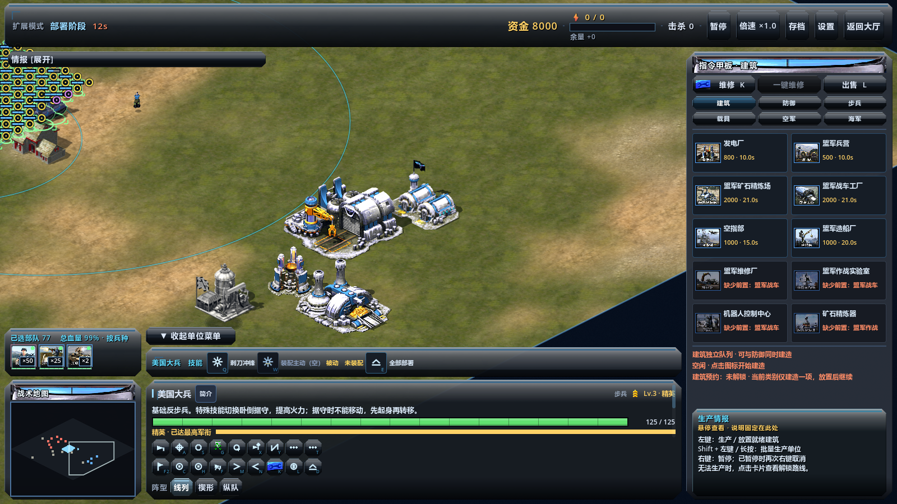

# v0.25.26 · 大编队按兵种合并

2026-11-05。用户确认：选中 16 个以内逐个显示，超过 16 个按兵种合并。按新增需求递增第三段版本号。

## 结果与操作

- 17 个起，每种兵种一张原有头像，保留边框，右下显示数量框（包含 ×1）；数量框按文字宽度适配，避免三位数挤出固定圆圈。
- 例如 50 名美国大兵、25 名重装大兵、2 辆光棱坦克：77 个头像变为 3 个兵种框。没有修改实际选中数量或战斗指令。
- 左键兵种框：只保留当前所选队伍里的该兵种，不选择队伍外或屏幕外的新单位。右键：从当前选择移出该兵种。移出最后一种时清空面板。
- 总人数仍显示实际人数；兵种血条按该组当前血量／最大血量合计计算，标题总血量按整组选中部队合计计算。
- 军衔混合时图标显示该组最低军衔，提示明确说明混合，避免用一名精英代表整组。单位死亡后实时更新数量，代表单位死亡不会留下失效图标。
- 减少到 16 个以内恢复逐个头像；原有单击聚焦、双击同类选取、建筑头像行为保留。
- 大队伍头像停用逐帧动画，并继续按真实单位总数执行 0.1 秒兜底刷新；不会因为只剩几个兵种框而误恢复高频轮询。未改动部署、攻击、移动或兵种技能。

## RA3 对照与边界

原始依据：[EA《Red Alert 3》官方手册，Steam 提供 PDF](https://store.steampowered.com/manual/17480)，第 2 页记录兵种子组循环以及选择窗右键取消单位。当地 SDK 的 SAGEXML/UI/Mouse/Settings.xml（UIMouseTacticalSelectionRefinementTab）与 Schemas/xsd/UI/Mouse/Tactical/SelectionRefinement/Tab.xsd 定义选择细分入口；SAGEXML/AptUI/TacticalHUDSelectionRefinementPage.xml 指向未附带的 aptbuildxml 输出，不能由此声称已获得原版完整 UI 代码或原版合并阈值。

映射：原版兵种子组／选择细分 → 本工程超过阈值后的按 unit_id 合并与当前选择筛选 → hud.gd 的 grouped strip → 真实 GUI 事件回归与隔离桌面渲染。16 个阈值由本次用户确认，数量框外观继续使用本工程 RA2 头像与边框。右键合并框移出整兵种是本次分组交互适配，不声称与 RA3 每个修饰键完全一致。

## 验证

- large_roster_regression：34 项通过，双模式覆盖 16／17 边界、77→3、节点复用、总血量、混合军衔、代表死亡、左键筛选、右键移除、返回单个头像及建筑／空选择切换。
- hud_identity_regression：636 项通过，保留单体身份图标、真实输入和 720p／900p 面板边界验证；原有超过阈值仍要求逐个头像的断言按本次确认规则调整。
- veterancy_regression：116 项通过，单体军衔图标不受影响。
- 上述 headless 合计 786 项，脚本错误为零。真实图形后端在独立 Win32 桌面再跑 large_roster 34 项通过，已检查两模式截图；没有切换或打开用户桌面上的窗口。

首次分组测试发现 Godot 进入场景树时会重新启用 _process；已在入树后明确关闭分组图标的动画回调，最终回归通过。图形工具首次调用的场景名以及隔离副本缺少 icon.svg 均已更正，最后完整运行日志无错误。

补充 gi_group_selection_regression 独立桌面图形回归：6 项通过。96 名美国大兵框选后合并为一个计数框，按 E 全体部署、再次按 E 全体起立，实际选中成员与指令范围保持完整。

实际观感待用户确认（pending_user_visual_confirmation）。不把固定阈值称为 RA3 原版数值，不宣称已测出帧率提升。

证据：C:/Users/admin/Temp/iron-roster-group-final-20261105。真实运行源文件与测试副本哈希一致；用户存档及运行中游戏未改动。没有服务器、网络协议或数据库依赖。本轮未打包、提交或推送。
