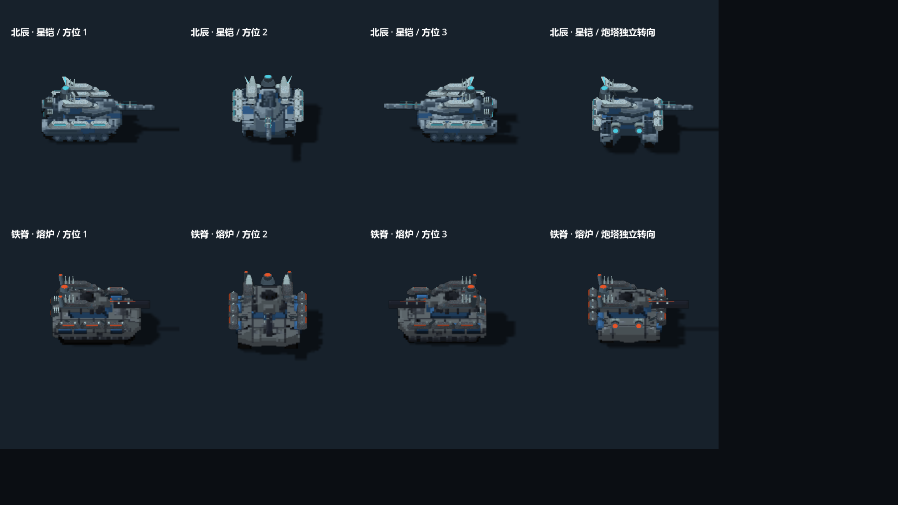

# v0.25.38 · 灰熊／犀牛英雄与机甲专属皮肤

2026-11-05。扩展遭遇战新增灰熊英雄「北辰」、犀牛英雄「铁脊」。各自累计生产 20 辆解锁；对应阵营战车工厂就绪后，每场各赠送一辆，不占队列、不收费、不增加生产累计。继承满军衔、额外一格射程、独立英雄训练与好感度。

## 战术中枢（0～3 级，累计生效）

|等级|效果|
|---|---|
|0|自身射程内反潜；首次出场侦察敌方基地一次，临时视野 5 秒后按现有迷雾回落规则处理。|
|1|死亡留下 5 倍最大生命的可摧毁残骸；15 秒后按残骸剩余血量百分比复活。120 秒冷却从复活时开始。残骸不能开火、移动、放技能或治疗，被摧毁不复活。|
|2|射程内友军的基础行驶速度至少达到英雄速度。保留部署／冻结等行动限制；多个英雄不会循环抬升速度。|
|3|射程内已部署友军射程 +2 格，不包含自身，不叠加。包括步兵部署武器、辐射区域和收割者部署炮台的独立武器射界。|

## 重装生存（1～5 级，累计生效）

1. 恐怖机器人寄生不使车体侧翻，**仅寄生伤害降低 90%**，其他攻击照常结算。
2. 额外视野 +3 格。
3. 免疫碾压，生化／辐射伤害降低 30%。
4. 冻结改为移动与开火速度降低 50%；超时空军团兵不能擦除，解除后恢复。
5. 可碾压已部署步兵；爆炸致命一击最多扣除最大生命的 2/3，低血量仍可能阵亡。

## 专属皮肤

- 北辰「星铠」：银白薄层陶瓷斜甲、后掠冰蓝发光鳍、外露液压杆、炮管灯轨和车尾核心。
- 铁脊「熔炉」：深钢分段履带护甲、肩部液压杆、双炉排气结构、熔红灯轨和车尾核心。
- 英雄养成页独立试穿／装配，保留阵营色；移动、选中或交战时灯轨呼吸，开炮叠加对应颜色的短暂辉光。
- AI 金属材质与程序化斜切网格，在各自原版 VXL/HVA 坐标制作，不复用坦克杀手挂点。车体、炮塔各有独立 32 方位和宿主深度遮挡。运行时绘制预烘焙贴图，不逐顶点生成网格。
- 保留尤复像素质感，补充 RA3 式机械结构；不是完整替换为 RA3 骨骼单位。复苏残骸停用完好的外装与呼吸灯。

## 旧档与验证

- 使用既有 JSON 养成档、战斗 special/allied_state；不改变存档格式。旧档缺少 MTNK／HTNK 英雄生产累计时，从逐阵营生产统计一次补入，已存在的累计与步兵记录保留。
- 存读档保留残骸剩余时间、血量比例、复活冷却与英雄属性；皮肤装配单独保存。
- 英雄专项 79 项、原有养成 738 项、反潜 70 项、收割者独立武器冷却 242 项通过。
- 使用独立存档和无窗口检查；图形检查在私有 Windows 桌面进行，未切换用户桌面。检查多朝向及独立转塔实际 Godot 渲染，不把逻辑通过当作玩家视觉认可。
- 养成／预览测试退出仍有 Font/CanvasItem/ObjectDB 清理警告；养成写盘失败警告来自原有故障注入。无窗口齐射场景跳过图形部分，未计作图形或性能通过。

主要入口：`tank_hero.gd`、`tank_hero_skin.gd`、`academy.gd`、`hero_progression.gd`、`hero_talent_demo.gd`。烘焙：`node ra2pipe/hero_tank_armor.mjs "<尤复安装目录>"`；素材哈希、原模型哈希与遮挡采样见 `assets/cosmetics/skins/tank_hero_armor.json`。

