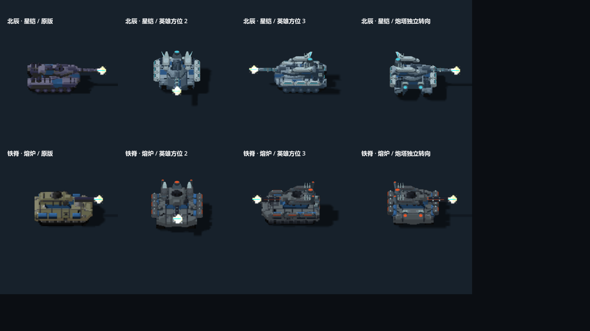

# v0.25.40.1 · 灰熊与犀牛炮口修复

2026-11-05。覆盖 MTNK 灰熊、HTNK 犀牛的原版与英雄机甲皮肤。

## 修复

- 犀牛缺少 `unitweapon/HTNK.json`，此前退回车体中心加水平距离的估算，丢失炮管高度。现在从原版 HTNK VXL/HVA 的炮管前端生成 32 方位炮口。
- 灰熊已有挂点：按当前精细化炮管重新核算，最大变化仅 0.241 个原生像素。主要修复是单炮发射点原先不跟随受击摇晃，现与本体、炮塔使用同一姿态变换。
- 火光与实际炮弹继续共用 `_weapon_muzzle()`，以炮塔朝向采样；车身转向不覆盖炮塔朝向。
- 两套英雄外装改用当前表面渲染图集原点，移除旧 renderVxl 画布原点造成的约 1～1.5 像素偏移；后续重烘从炮口描述读取同一原点。
- 价格、伤害、射程、装填与存档规则不变。

## 来源与重建

`ra2pipe/tank_muzzles.mjs` 从已安装尤复的 GTNK／HTNK 本体、炮塔、炮管 VXL/HVA 读取模型，并记录输入 SHA256。灰熊复用 `detailGrizzly`，与当前细节模型一致；使用当前 surface 图集包围盒，尺寸或方位不匹配时拒绝生成。

```powershell
node ra2pipe/tank_muzzles.mjs "<尤复安装目录>"
```

输出两份 `iron_tide/assets/ra2/unitweapon/` 描述，不改原版模型图片。英雄外装生成器为 `ra2pipe/hero_tank_armor.mjs`。

## 验证

- `tank_muzzle_regression`：**836 项通过，0 失败**。两车型 × 原版／英雄 × 32 方位 × 正常／受击摇晃；车体与炮塔错开 90 度，校验独立模型投影、实际开火生成的 Projectile 与原版 Ra2Fx 起点一致。见 [结果](tank-muzzle-results.json)。
- 两个 Node 生成器通过语法检查。
- 真正的隔离 Windows 桌面进行图形渲染，没有切换用户桌面；固定原版火光首帧与青色炮口校验短线，检查原版、英雄和独立炮塔转向。见下图。截图验证的是渲染挂点，实际开火链路由上述回归验证，尚不等于玩家完整战斗观感验收。
- 额外运行旧 `unit_muzzle_regression`：60 项中 10 项失败。8 项是 MGTK／TNKD 普通移动不应开火的既有断言；2 项需要图形渲染，不能在 headless 中验收。在隔离副本恢复本次修改前的摇晃条件重跑，失败集合完全一致，未增加失败。见 [当前结果](shared-muzzles-results.json) 与 [修改前条件对照](shared-muzzles-baseline.json)。这些旧问题不包含在本次修复中。


