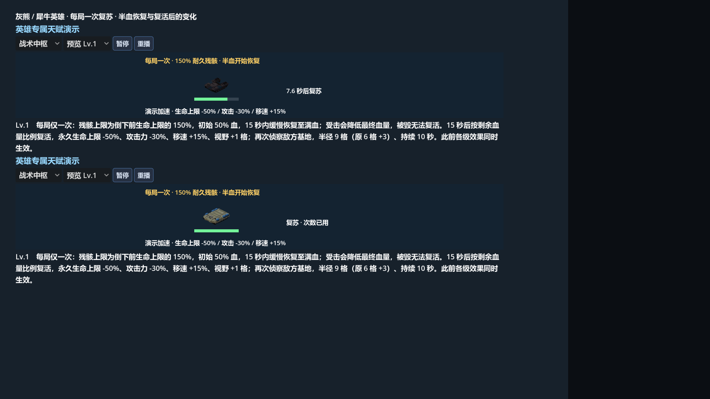

# v0.25.41 · 灰熊／犀牛英雄一次性复苏

2026-11-05。调整两名坦克英雄战术中枢 1 级的复活机制，后续等级继续包含该效果。

## 战斗规则

| 阶段 | 新规则 |
| --- | --- |
| 触发 | 每局、每方、每种英雄仅一次；形成残骸即消耗次数，残骸被毁不会返还 |
| 残骸上限 | 倒下前英雄最大生命的 150%（原为 500%） |
| 初始耐久 | 残骸上限的 50% |
| 等待和回血 | 等待 15 秒；每秒恢复残骸上限的 1/30，共恢复 50%，无伤可回满。外部维修无效 |
| 残骸受击 | 扣除实际血量，回血不会覆盖受伤；摧毁则无法复活 |
| 复活血量 | 继承残骸剩余血量比例，乘以复活后的新生命上限 |
| 复活后永久变化 | 生命上限 ×0.5、攻击力 ×0.7、移动速度 ×1.15、视野 +1 格 |
| 基地侦察 | 再次照亮现存敌方基地，半径从出场时的 6 格增加到 9 格，持续 10 秒，之后按常规迷雾淡出 |

例如原英雄最大生命 1000：残骸上限 1500，初始耐久 750；若复活时残骸剩余 80%，英雄新的上限为 500，实际以 400 生命复活。

说明、演示及战场名称同步更新：残骸显示恢复百分比与剩余秒数，复活后标明「本局已用」。没有 120 秒冷却或再次复活。

## 存档兼容

继续使用现有战斗快照 JSON 和 `actor.special`／`world.allied_state` 字典，不新增存档格式或外部存储。基础生命、攻击、速度、视野已有快照字段；复活修改一次并持久化，重算属性、重新授予军衔和读档不重复乘算。

- 新规则残骸：读档保留倒计时、当前血量、已用次数。
- 旧规则残骸：换成 150% 上限，保留血量比例与剩余时间，仅在剩余等待期获得回血，不重置为半血或重新等待 15 秒。
- 旧档已经复活过（包含冷却为零的旧状态）：转换为次数已用，永久属性变化只应用一次；迁移本身不会再赠一次基地侦察。
- 战场同时记录该方／该英雄类型的已用次数，重建同款英雄不能绕过一次限制。

## 验证

- [专项 32 项全通过](revival-results.json)：两种英雄半血残骸、按时间回血、受击与末帧预算、前后读档、永久属性、实际 9 格／10 秒侦察、超过 120 秒仍不可再复活、同局重建防绕过、旧档幂等转换。
- [英雄完整流程 79 项全通过](hero-results.json)：原解锁、生成、反潜、防护、光环、残骸被毁、皮肤、养成界面等继续通过。该旧套件退出仍报告字体／CanvasItem／ObjectDB 资源释放警告，未将其作为无警告通过；专项及隔离图形验证无引擎错误。
- 图形验证使用不可见的独立 Windows 桌面，不切换用户桌面；核对半血恢复、复活阶段及长说明排版。下图为演示静帧，不替代玩家战斗观感确认。

