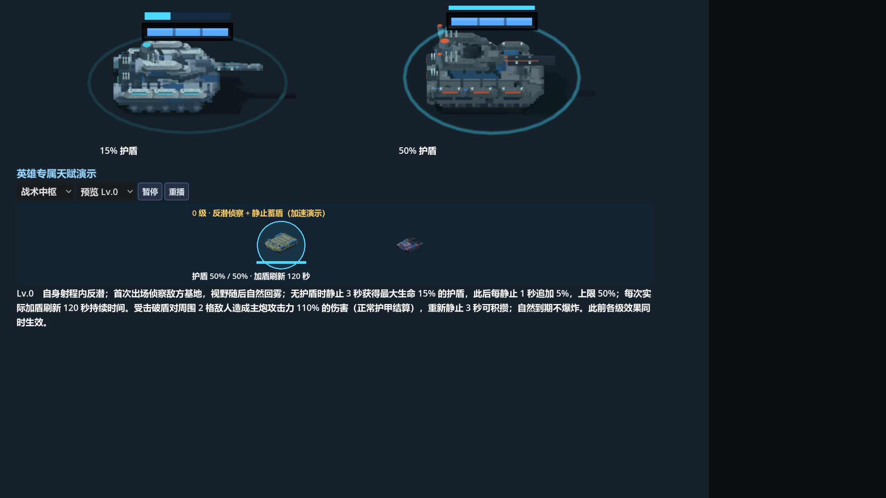

# v0.25.45 · 坦克英雄 0 级静止蓄盾

2026-11-05。灰熊「北辰」与犀牛「铁脊」战术中枢 0 级追加效果，后续等级继承；普通坦克与步兵英雄不受影响。

## 规则

- 无盾时连续静止 3 秒获得当前最大生命 15% 的护盾；之后每静止 1 秒追加 5%，上限 50%。无伤时从开始静止到满盾共 10 秒。
- 移动中保留已有护盾，但中断积攒。无盾重新等 3 秒；有盾停止移动后每满 1 秒加 5%。停着开火不打断积攒。
- 每次实际加盾刷新 120 秒寿命，满盾没有实际增加就不会刷新。自然到期移除，不造成爆炸；随后按无盾规则重新积攒。
- 受击完成原有护甲、防御计算后先扣盾，余量再扣生命。护盾被伤害打破时，对周围 2 格敌方单位／建筑各造成一次主炮攻击力 110% 的伤害，沿用该武器弹头护甲倍率及普通防御结算，不是无视装甲的真实伤害；不伤友军、中立或运输中的乘员。建筑按轮廓最近点计算范围。
- 破盾先清空盾量与积攒计时，再延后到当前受击处理结束释放冲击，避免嵌套伤害重复触发。致命余量形成残骸也不丢失本次破盾伤害；残骸不积攒护盾，复活后按降低的新生命上限重新计算。
- 加上青蓝护盾轮廓、血条上方的独立护盾条、获得／破裂提示和冲击波；演示包含等待、增长、满盾和破盾。护盾条满幅代表 50% 最大生命。

## 保存与开销

沿用现有 JSON 战斗快照，在 `actor.special.hero_stationary_shield` 保存盾量、剩余时间、积攒进度及上次位置。不改存档格式，不引入新存储或编码器；旧存档没有该字段时从无盾开始。读档不补满护盾、不刷新寿命。

只有两种英雄更新蓄盾计时；仅破盾时遍历伤害目标。护盾轮廓为固定 32 段，盾量变化才请求额外重绘，不增加逐帧寻敌或粒子发射器。

## 验证

- [护盾专项 44 项通过](shield-results.json)：两个英雄等待／移动中断、每秒增长、上限／刷新、真实受击吸收与余量、110% 范围伤害、敌我过滤、存读档、自然到期、残骸与复活状态。
- [复活专项 36 项通过](revival-results.json)；[英雄完整流程 79 项通过](hero-results.json)。合计 159 项。旧英雄 UI 套件退出时仍报告字体、CanvasItem、ObjectDB 资源释放警告，详见日志；护盾专项无引擎错误。
- 私有 Windows 桌面完成模型与演示图形检查，没有切换用户桌面。展示图是受控静帧，不替代玩家对完整战斗观感的确认。

