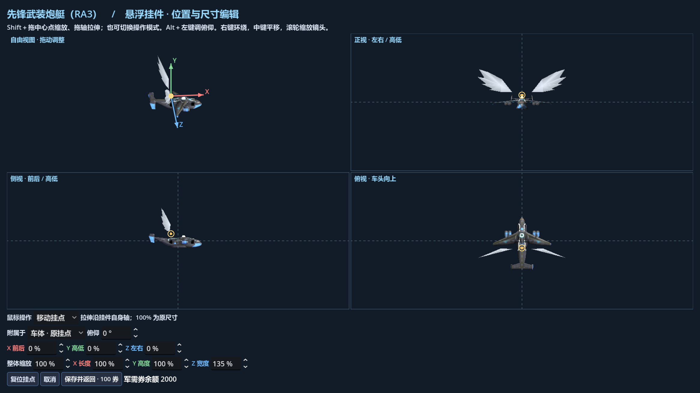

# v0.25.75 · 挂件尺寸编辑

## 使用

- 顶部装饰、悬浮挂件、尾部挂件的「位置／尺寸」打开统一编辑页。
- Shift + 左键拖中心点：整体缩放；Shift + 左键拖彩色轴：对应轴拉伸。无需切换工具。
- 也可选择移动／整体缩放／分轴拉伸工具，或直接输入整体、X 长度、Y 高度、Z 宽度百分比；每项 25%～200%，100% 为原值，整体与各轴相乘。
- 整体和拉伸不改变挂点位置，不改变单位本体大小或战斗数值。轴向尺寸在俯仰前应用，骨骼跟随不覆盖尺寸。
- 滚轮仍是镜头缩放，Alt 左拖为俯仰，右键环绕、中键平移。较大的挂件会扩大取景范围。
- 保存位置、俯仰、尺寸合计收取一次 100 军需券；无修改免费，取消不保存不收费。复位同时恢复原位置、俯仰、尺寸。

## 存档与运行

`attachment_positions[unit][slot]` 新增 `size` 和 `stretch`（三个百分比）。旧数组和旧位姿字典默认 100%，不迁移、不收费。读取防御非法尺寸，保存拒绝零值、负值和越界值。保存失败回滚尺寸和钱包；单独修改位置保留尺寸。

`cosmetic_anchor.gd` 在骨骼位姿之后应用局部尺寸；工房和战场通过同一安装入口读取。拖地链条的段长及地面间隙同步尺寸，保持地面约束。

## 验证

- `mount_size_regression`：36 项断言全部通过。覆盖 Shift 中心与轴拖动、普通移动、显式工具、镜头滚轮、骨骼同步、取消、扣费、故障回滚、读档、重开、复位、各槽隔离、战场安装以及链条碰撞尺度。
- 运行于独立测试项目、独立用户目录、Windows 私有桌面，从未切换到该桌面；不弹出用户可见窗口。
- 保存失败测试主动阻塞临时存档路径，预期出现一次写入警告；无脚本错误。
- 天启恶魔翼、先锋炮艇天使翼四视图截图检查完成。未宣称所有挂件、极限尺寸和骨骼动画组合均经过玩家视觉验收。
- 本次未打包、未提交或推送。

