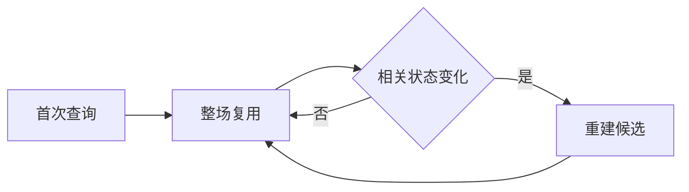

# 整场邻居候选缓存（2026-11-26）

已合入主工程，未提交、未推送、未打包。当前Git基线a4a6a4fe1dcef7b4f687f8bf19a6a07d0b3fa5b2，既有工作区修改保留。此记录替代两帧候选的待办，旧候选与失败样本仍保留。

用户明确确认“整场复用、变化失效”；之后允许与其他Godot测试并行，要求看函数级工作减少。因此不再等待独占P95，改以行为正确性、查询工作量和带限制的函数计时交付，**不宣称整帧或总CPU已经变快**。

## 实现

只改local_traffic、vehicle_steering、battle_neighborhood三个生产脚本。取消时间及逻辑帧TTL，也不新增Battle.logic_step或改变物理优先级。原圆形查询及候选顺序保留。出生/移除/跨格使用局部桶版本，空桶参与快照、单调序号防ABA；watch检测原先被圆/碰撞层排除的单位同格进入及原地层恢复。自身位移>24像素、查询范围越界、半径增长、查询域变化提前重建。单位位置、生命、阵营、登载和碰撞层实时读取。

拥堵、转向统一检查，卡住重规划强制刷新。少于96单位的物理查询兜底仍每调用重查，未伪称该分支有整场缓存。候选随单位/战场释放，不进入存档；读档重建，原三个yield字段保持。

## 验证

专项2079条通过。两种规则模式各2048实际物理帧保持单次构建；各倍率4096次调用、大delta、暂停及全部变化失效边界通过。原两帧到期断言按用户新契约改为不因帧数失效，旧证据没有覆盖或删除。

| 用例 | 检查数 | 失败 |
|---|---:|---:|
| delivery-traffic_frame_cache_regression | 106 | 0 |
| delivery-passing_traffic_regression | 872 | 0 |
| delivery-six_traffic_regression | 108 | 0 |
| delivery-unit_neighborhood_regression | 121 | 0 |
| delivery-vehicle_turn_regression | 418 | 0 |
| delivery-timed_congestion_regression | 54 | 0 |
| delivery-friendly_infantry_traffic_regression | 400 | 0 |
| delivery-logic15_bridge_regression | 104 | 8 |
| integration-baseline-bridge | 104 | 8 |

桥梁本轮基线与候选104条checks完全相同，保留原有8条失败，不标为全通过。所有专项独立user://，源码前后稳定、无脚本错误；维护入口tests/run-navigation-building.ps1已登记相关套件。此次通过run_suite.py复用维护runner已有隔离工程，不在玩家工程运行测试。

## 函数级诊断

同存档1（yr_isleland、381单位、207建筑、5AI）、完整图形Release1600×900、3×/15Hz、各30秒、私有桌面不激活。两组插桩分别观察449/452个逻辑步，按逻辑步归一化。允许其他测试并发，不将渲染帧数差异或P95用于因果判断。

| 指标 | 原时间缓存 | 整场缓存 |
|---|---:|---:|
| 候选重建/逻辑步 | 71.094 | 30.785 |
| eligible请求命中率 | 0.00% | 74.14% |
| 重建总次数 | 31921 | 13915 |
| 期限触发刷新 | 31757 | 0 |
| 重建inclusive采样ms/逻辑步 | 1.0765 | 0.7920 |
| 全部nearby调用/逻辑步 | 157.209 | 118.381 |

查询重建工作减少56.70%。candidate失效原因：位移/显式reset 7462、区域5428、watch进入659、强制171、首次164、半径31。reason_displacement包含reset后INF原点，不可全部当作真实移动。

**计时限制与额外成本：** 两份诊断插桩深度不同且允许背景并发。交通消费者apply+tick_congestion+stalled_blockers+open_corridor的inclusive采样和约2.479→3.987ms/逻辑步，未观察到总链耗时下降；新增ensure/region/watch检查与其计数插桩会增加成本。只能确认查询工作减少，不能把重建函数减少的0.285ms直接当作净帧收益。下一轮若继续优化，应先压低失效检查成本，并用相同插桩或干净样本确认；本轮未扩到爆炸、AI和贴图优化。

请求/命中/重建/刷新原因/实际查询逐帧闭合通过；完整数字在function-comparison.json和profile-*/traffic-analysis.json。正式无插桩P95四场未运行，启动门禁曾被其他time_shift测试阻止，此后按用户新口径切换。诊断P95不充当正式性能数据。

## 交付

函数诊断之后，另一任务更新了building_art_warmup、shp_detail、battle_screen、unit、house_ai。已保留这些修改形成integration_baseline/delivery，并在最终合并版本重跑上述全部专项；函数数字仍绑定先前采样快照，不冒充合并后整局性能。本项三个生产脚本在采样与最终合并版字节相同。

收尾又出现三处变化：building_art_warmup仅SHP预热队列（headless回归不创建该节点），shp_detail仅纹理命中后的淘汰次序，time_shift_events仅yr_time_shift剧情路线（Battle按mission id门控，当前回归是遭遇战/桥梁）。已逐项审查其不改变本次缓存或交通断言的状态，保存精确哈希与依据于unrelated-drift-review.json，并经真实autoload上下文加载通过。首次独立--check-only因缺GameData/GM上下文失败，原日志保留；不是产品失败，未删断言。

目标脚本和测试逐字节与通过验证的delivery一致，delivery-audit.json留存哈希和上述排除范围。没有覆写其他任务修改，也不把旧计时写成最新全工程性能。源码、诊断及行为原始证据保留于 `.validation/traffic-battle-cache-20261126/`。

[本轮报告](../../.validation/traffic-battle-cache-20261126/report.md)
