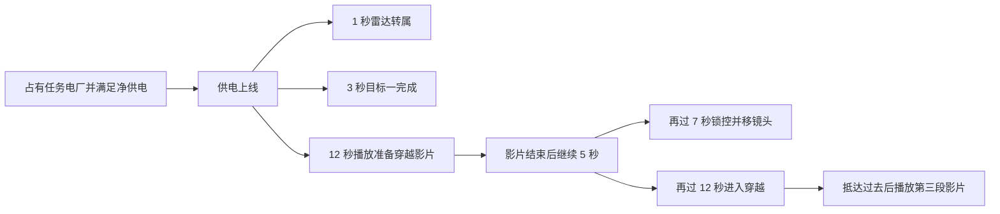

# 盟军首关《时间流逝》供电、穿越与毁机

IronTide 0.32，Godot 4.7.2，当前工作区。原图为 Steam 尤复 mapsmd03.mix 内的 ALL01UMD.MAP，SHA-256 为 dee38769f2247a85908705486c175ef14a4cf90437899defe7c8b4c0d1c51fb0。本批重建首关通用驱动表，84 → 95 项。其余 239 项尚未导入，部分环节沿用关卡专用实现。逐 ID 对照保留原图事件、动作顺序、标签和难度，并标注按组回归的范围。[334 项逐条表](ALL01UMD_SCRIPT_RECHECK.tsv)

## 玩家行为和原图对应

- 新增八条 Player_Has_Plant 行，以及 Obj01_Complete_Text、Center_On_TimeMachine 和 Time_Machine_Boom2。实体所属阵营对应 402–409 的八座任务电厂，事件 13 的 5 秒从各行启用开始计，事件 32 检查此时是否持有对应建筑。变量 49 置位后，Power_Online 还要满足电网条件。工程师在 BG 从既有增援入口出发。动作 16 揭开地形，普通单位的战斗视野继续按侦察计算。雷达行、完成提示和启动计时各自运行。一个大步推进跨越多个定时点时，按到期顺序执行。
- 工程里把原图时间字段映射到模拟秒。两段串行延迟 12、5 之后，7 秒镜头与 12 秒穿越并行。累计有效供电 29 模拟秒抵达穿越，另计暂停影片的墙钟时长。断电保留进度并允许玩家恢复指挥。过去场景及第三段影片仍经现有关卡专用换场入口。开场原图 Final_Camera_Set 目前用交还操控代理。首关仍启用开局所有电厂的通用标记。
- ra2md.mix / localmd.mix 的 artmd.ini 影片顺序、原图开场动作 100 的参数 2 与随后 A01_p01 原声，以及各正片对白交叉核对。原参数 3 对应 A01_P02E，117 播放准备穿越正片并暂停；原参数 4 对应 A01_P03E，抵达后告知指挥官穿越成功并让谭雅游向恶魔岛。P03 从 movmd03.mix 提取，原片 SHA-256 为 c6a7e06da391e1006ea40721141c01f426044cb366a970a24d41eb6eda376d31。使用现有 FFmpeg 转码，按本地原声转写制作中文字幕，收藏画面取正片第 4 秒。旧存档若已处于旧版待播放通讯，按存档原有选择收尾。
- 物理毁坏按零售结构 1028558 的 CATIME01 记录时代。穿越前动作 68 先播报，随后三秒失败和失去控制后可恢复仍属项目规则。过去时代、附着机确已毁坏、场上无谭雅三项同时满足才走 08707A2C 的失败动作。谭雅放出后关闭该检查。正常换场移除建筑不产生物理死亡。由于关卡在正常换场移除这台机器，晚线正例用保留原有带标签机器的夹具验证，尚未取得自然可达证据。
- 电厂配对的重复标签会再次启用 Group_Done 及 Check_PP。修复先前只执行第一轮检查的问题；依次验证 87、43、18 三个显露和雷达点。覆盖一厂被夺回、先毁后占与旧档待接启停。当前电厂进入仍用转属代理，显露半径仍是工程值。

## 实现与复跑

正式入口为 scripts/world/allied_first.gd、allied_first_power.gd 和 allied_retail_script.gd。建筑真实死亡入口标记附着对象，战场输入读取镜头锁。导出器 tools/export_allied_script_slice.mjs 和原图索引重建 data/ra2/allied_script_slice.json。重新导出命令为 `node tools/export_allied_script_slice.mjs .validation/allied-ends-20261126/audit data/ra2/allied_script_slice.json`。重新核对 95 行导出后的事件、动作字段顺序与逐条表、原图索引全部一致。

用 Godot 控制台隐藏窗口运行 `--headless --path <iron_tide> res://tests/allied_first_playable.tscn -- <参数>`。每组独立 APPDATA；保存与同组另一进程冷读共享该隔离目录。原有 slot2 测试副本 SHA-256 为 57213705ce674eebc6de9f8d77e10402e856d8f767abd4bd3ea5bd543f442e0b。日志在 .validation/allied01-power-20261127/。

| 实测入口 | 断言 |
|---|---|
| --power-sequence → --cold-power-sequence | 39/39、5/5。影片暂停，雷达转属，断电冻结；独立进程续到镜头、穿越和换场 |
| --plant-pairs；--save-pairs54 → --cold-pairs54 | 30/30、23/23、4/4。54 条版本为合成结构夹具，直接计数航点 87 的雷达信号 |
| --power-loss，普通加 --save-plant-driver → --cold-plant-driver，简单加 --easy，困难加 --hard | 普通 26/26、冷读 3/3，简单及困难各 25/25 |
| --machine-loss；--late-machine；--late-machine --released-tanya | 25/25、24/24、24/24。穿越前播报、晚线条件和取消分别覆盖 |
| --save-legacy-charge → --cold-legacy-charge | 30/30、4/4。旧充能末段剩四秒，无重复播放，恢复镜头锁，按剩余期限穿越 |
| --new-sequence-mainline --carriers；另进程 --cold-crossing；--reported-slot2 --carriers | 62/62、7/7、39/39。新菜单出击经两段正片到胜利；旧档从供电续到胜利。占领、计时、清除装甲、毁控制器使用夹具 |
| allied_retail_script.tscn -- --first-only；cg_collection.tscn -- --allied-first-replay | 56/56、4/4。收藏用实际战役挣得的存档，从菜单打开 P03 并双向拖动查字幕 |

上述首关专项均正常退出，stderr 为空。较早尝试用驱动全局命令序号数雷达、从分支起点多推 0.2 秒的夹具均已校准。综合首末关切片另有终关四项断言未通过（132/136）；本批终关仍导出 43 项。收藏通用场景补上隔离路径后 27 和 73 项断言通过，前者故意制造存档写失败，后者从百合子手记返回时 restore_scroll 报错；首关正片回看专项无该错误。未打开游戏窗口，未打包发布。

下批从 Timer_Done 的两个外部链接 Evict_AJAK_Gar（089AE11C，疏散驻军）及 Rebuild_Nuke（0930470C，变量 48 与 NA 重建）接续，并追踪 Really_Play_Movie（05E9106C）的实际启用源。开场镜头、过去时代整条换场和全局 AI 分别核验。
