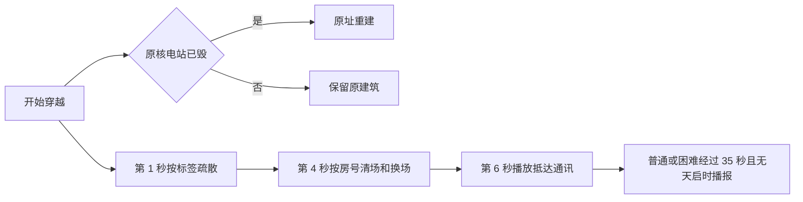

# 盟军首关《时间流逝》驻军疏散、核电站重建与抵达通讯

Iron Tide 0.32 工作区，Godot 4.7.2。首关使用 Steam 尤复 ALL01UMD.MAP，SHA-256 为 `dee38769f2247a85908705486c175ef14a4cf90437899defe7c8b4c0d1c51fb0`。按地图原始触发器 ID 去重。[334 条记录](ALL01UMD_SCRIPT_RECHECK.tsv)

| 批次 | 新增 | 累计入表 | 剩余未入表 |
|---|---:|---:|---:|
| 三栋疏散、通用疏散、核电站两条、清场及抵达通讯 | 13 | 108/334 | 226 |
| 抵达通讯启用的基洛夫报告 | 1 | 109/334 | 225 |

## 原图与当前战场

| 原图对象 | 正式战场与验证 |
|---|---|
| AJAK、UT、ZAI | 原图实例 1028381 加油站、1028400 和 1028434 住宅。开局血量为 128/256、128/256、256/256。每栋可用玩家命令进驻 10 名美国大兵，额外 1 名被拒。穿越第 1 秒按指定标签撤出，三栋恢复中立，30 名步兵全部存活，回到地基外。 |
| Evict_All | 共享标签 0d86a04c 在可玩图内有 82 个位置。动作按已装配且有驻军的实体执行。三栋专用建筑以外的位置尚未逐栋驻军实测。 |
| Nuke_Plant_Gone、Rebuild_Nuke | 记录原反应堆 1028460 在换场前的实际毁坏，原图局部变量 48 控制重建。表中 NA 为航点 364，结合地基得出建筑中心，与原实例位置一致。完好时保留原对象。跨断点读档后仍只有一座反应堆。 |
| 两条 Kill_Units、四条 Kill_Triggers | 按原房号执行全部对象、建筑、地面或海军清除，保留玩家部队，恢复 BridgeHouse。清场顺序和主要房号已按组验收。部分被启停的外部 ID 还只有状态记录，Fix_Buildings 仍交给现有关卡代码，后续须逐原图记录接入。 |
| Really_Play_Movie、Kirov_Reporting | 换场后两秒播放 A01_P03E，触发器启用后续报告。普通、困难在计满 35 秒并清空场上 APOC 后实际播放 KirovCreated 对应的 vkirsea.wav。简单难度不启用报告。 |

## 后台回归

从 `tests/allied_first_playable.tscn` 打开正式战役菜单、出击并操作战场。专项摆放美国大兵、注入核电站伤害、补齐电厂归属并推进任务时钟。截图 0 张。存档与运行日志在 `.validation/allied01-transition-20261127/` 的独立用户目录。

| 用例 | 断言 | 证据 |
|---|---:|---|
| 普通，玩家可下令时满驻军，原核电站被毁，抵达报告及航母替代线 | 82/82 | player-normal.out |
| 简单、困难，完好原核电站和基洛夫难度分支 | 各 69/69 | final-easy.out、verified-hard.out |
| 本批存档在穿越前半程和已换场时分别冷读 | 各 9/9 | player-cold-before.out、player-cold-after.out |
| 上批 95 条驱动时的两个断点分别冷读 | 各 9/9 | prior-before.out、prior-after.out |
| 更早的真实存档 2，充能续玩、毁厂与航母替代线 | 42/42 | prior-real.out |
| 通用驱动首关专项，含计时最后一秒快照恢复、一次播报及动作顺序 | 115/115 | verified-driver.out |

导出命令为 `node tools/export_allied_script_slice.mjs .validation/allied-ends-20261126/audit data/ra2/allied_script_slice.json`。普通用例参数为 `--new-sequence-mainline --retail-transition --reactor-loss --kirov --carriers`，冷读使用同一测试用户目录的 `--cold-crossing` 与 `--cold-crossing --after-midpoint`。地图 AI 另行统计。此次证据覆盖上述分支与断点，整关自然游玩和有头画面仍待验。
