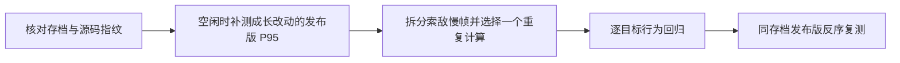

# Iron Tide 性能优化交接 · 2026-11-27

**接手后的第一件事是补测成长优化的整局 P95。** 两个成长热点已写入本地工程，函数收益已验证，发布版还缺干净的候选样本。补测之后优先拆 `Unit._refresh_target`。历史目标为存档 1 六家全画质战场 16 ms，最近测量仍为数百毫秒。



## 接手位置与已完成的工作

工程版本 0.32，本机 Git 根目录为 `C:\Users\admin\IronTide`，Godot 工程在其下的 `iron_tide`。交接时分支为 `codex/ra2-independent`，HEAD 为 `7ec72c62320feaa4cd71fd2cd2f6e7d841c5d0e0`。以下改动在含有其他并行改动的工作区内，单独检出此提交会缺少这些改动。跨机器接手时应带上相应源码快照和本地验收资料，两个实测输入文件在本文下方。

| 工作 | 已验证 | 接手时注意 |
| --- | --- | --- |
| 静止重绘与重复读取 | 扫描 649 个脚本、6,865 个函数，193 个脚本直接请求重绘。连续静止 16 帧，移动指令层、空技能场地层和重复相同电量的电力表，各由 16 次重绘降至 0 次。图形回归 287/287。 | 预览结束必须清掉最后一帧。保留受击白闪、低血与低电脉冲、镜头旋转和镜像后的遮挡排序。三类属性读取的无效回退各由 1,000 次降到 0 次。[详情与函数索引](SESSION_2026-11-27_IDLE_RENDER_AND_REGRESSIONS.md) |
| 远征、遭遇战与凶残成长 | 原 187 个失败断言及追加的 40 个已处理。对应快照上，30 关远征 13,029/13,029、遭遇战作战 468/468、凶残成长 518/518、尤里脚本 1,192/1,192。 | 远征营地由玩家手动出售，暂停护送车应保持原位。继续优化 AI 时覆盖凶残 1、凶残 2、普通遭遇战和肉鸽。[回归明细](../../../.validation/20261127-redraw-187/suites.json) |
| 成长资格与渗透更新 | 无状态单位跳过渗透、护送检查，24 种兵种的资格改用常量表查询。同进程交错 10 轮，每轮 2 万次，中位耗时分别从 118.58 降至 17.05 ms、从 38.88 降至约 29.85 ms。 | 其他步兵可能收到护送加速；换卡后仍可能有计时状态。新旧资格与状态对照 488/488，渗透护送 199/199，阵营 108/108。代码入口为 [渗透更新](../../scripts/units/expansion_2_infiltration.gd)和[成长资格](../../scripts/units/progression_expansion_2.gd)。[两文件补丁](../../../.validation/20261127-growth-hotspots/source.patch) |
| 已知的独立失败 | 成长总回归在改前、改后均为 1,035/1,036，逐个断言结果相同。唯一失败是 `two talent limit V3`。 | 当前 V3 配置有空爆子母弹、失联预案、发射隔舱三个天赋，旧断言要求最多两个。单列这项可以直接识别新增回归。[基线结果](../../../.validation/20261127-growth-hotspots/qa/baseline-growth.json) |

## 两轮 P95 各自说明了什么

- **静止重绘等整组改动**在当时最新快照的两轮有效对照中，平均 P95 从 397.626 降到 322.115 ms（−19.0%）。计入同一快照全部三个有效基线，降幅为 14.1%。另一时段的整组样本曾上升 18.2%。[各轮对照](../../../.validation/20261127-redraw-187/p95-comparisons.json)
- **其后新增的两个成长改动**只有基线 410.683 ms 通过进程核验。候选 462.233、499.194 ms 以及另一场基线 539.726 ms 均有其他引擎并发。局部函数改善已经确认，整局收益尚待补测。[采样及并发记录](../../../.validation/20261127-growth-hotspots/summary.json)

## 复现存档 1 的 3× 测量

固定场景为 `yr_isleland`，开局 381 个单位、207 栋建筑、5 个 AI，保留玩家席位，1600×900 全画质，每场测 30 秒墙钟。已在仓库根目录的本地验收目录保留精确输入。早期同名存档在重建内容标识后，外层文件哈希发生变化，战局载荷经逐字节验证相同。跨机器复现请复制下面两份文件。

| 输入 | SHA-256 |
| --- | --- |
| [slot1.itsave](../../../.validation/20261127-growth-hotspots/inputs/slot1.itsave) | `af7bc933debd5c75551d5430d95cbf159f881135a579a1cb237eab82fc7c392a` |
| [iron_tide_meta.json](../../../.validation/20261127-growth-hotspots/inputs/iron_tide_meta.json) | `fb6f88faa11fd8782759603df0af833710f1f97f0cb278d9c6e17b9341a8a51f` |

以下 PowerShell 从 Git 根目录运行。本机归档的 `environment.json` 含当时的调试引擎、发布引擎、基线和候选快照路径。原快照位于临时目录。换机或目录被清理后，在**隔离副本**里用交付源码作为 B，用同一份源码反向应用上方的两文件补丁得到 A，保留 Godot 导入缓存和资源。若源码已有后续修改，以新冻结快照重新测基线。两组都须在测试副本的 `battle_autosave.gd` 与 `expedition/runtime.gd` 的计时累加前启用相同的 `IRON_OUT` 测试跳过条件，避免定时保存进入采样。原快照已具备这两处条件。

```powershell
$repo = (Get-Location).Path
$evidence = Join-Path $repo '.validation/20261127-growth-hotspots'
$a = Get-Content "$evidence/run-hotnov-base-1-frame/environment.json" -Raw | ConvertFrom-Json
$b = Get-Content "$evidence/run-hotnov-opt-1-frame/environment.json" -Raw | ConvertFrom-Json
$d = Get-Content "$evidence/hotnov-prof2/environment.json" -Raw | ConvertFrom-Json
$save = "$evidence/inputs/slot1.itsave"
$meta = "$evidence/inputs/iron_tide_meta.json"
if ((Get-FileHash $save).Hash -ne $a.save_sha256 -or (Get-FileHash $meta).Hash -ne $a.meta_sha256) { throw '实测输入与原报告不同' }
$base = $a.source
$candidate = $b.source
$release = $a.godot
$debugEngine = $d.godot
$python = "$env:USERPROFILE/.cache/codex-runtimes/codex-primary-runtime/dependencies/python/python.exe"
if (!(Test-Path $python)) { $python = (Get-Command python -ErrorAction Stop).Source }
$out = Join-Path $env:TEMP ('irontide-p95-' + (Get-Date -Format yyyyMMdd-HHmmss))
$common = @('--isolated-desktop','--host-cpu','--preserve-player','--seconds','30','--speed','3','--render-size','1600x900','--expect-map','yr_isleland','--save',$save,'--meta',$meta)
$runner = Join-Path $repo 'tools/performance_soak.py'
foreach ($src in @($base,$candidate)) {
    foreach ($file in @('scripts/save/battle_autosave.gd','scripts/expedition/runtime.gd')) {
        if (!(Select-String -Quiet -SimpleMatch 'if OS.get_environment("IRON_OUT") != "": return' -Path (Join-Path $src $file))) { throw "请核对隔离快照中的自动存档条件 $src/$file" }
    }
}
# A1 → B1 → B2 → A2；各场输出必须为新目录
foreach ($run in @(@('A1',$base),@('B1',$candidate),@('B2',$candidate),@('A2',$base))) {
    & $python -B $runner --source $run[1] --godot $release --release-template --frame-only @common --output (Join-Path $out $run[0])
    if ($LASTEXITCODE -ne 0) { throw "帧测失败 $($run[0])" }
}
# 单独采函数热点。debugEngine 使用 Godot 图形引擎本体，私有桌面始终不激活。
& $python -B $runner --source $candidate --godot $debugEngine --native-profile @common --output (Join-Path $out 'functions')
```

取每场 `result.json → frame_stats.p95_ms`，同时检查初始兵力、`completed`、帧数、墙钟与模拟时长。有效场次要求无脚本错误、`source-audit.json → changed_during_run` 为空、`host-cpu.json → engine_process_audit.measurement_requires_review` 为 false。两版比对 `source-sha256.json`；本轮 1,640 项里仅两个成长脚本不同。保留每场原值、外部 CPU 和剔除原因。负收益的有效样本也计入结果。

## 下一刀从索敌开始

基线全函数采样覆盖 2,382 个实际执行的玩法函数。`Unit._refresh_target` 调用 57,980 次，自身累计 431 ms，含子调用 3,226 ms。先从候选枚举向下拆分，把成本归到具体判断。优先记录每次扫描的候选数、粗筛后数量、实际解析武器和乘员射程次数、最终目标 ID。下一优先级可看桥层移动 `_slide_across_bridge_layers`，35,889 次，自身 381 ms、含子调用 899 ms。父子函数的含调用耗时有重叠。[完整 Top 10 与调用数](../../../.validation/20261127-growth-hotspots/hotnov-prof2/functions.md) · [索敌实现](../../scripts/units/unit.gd)

选择有重复工作证据的一处改动，先跑 [逐目标扫描对照](../../tests/target_scan_reuse_regression.gd)、[反击等价](../../tests/counterfire_equivalence_regression.gd)和[遭遇战作战](../../tests/skirmish_operations_regression.gd)。逐步比较同分目标、已指定的攻击目标、巡逻或攻击移动中的反击与恢复、空地混编与防空优先、载具乘员换枪、目标死亡或易主、迷雾遮挡和读档后的第一次扫描。凶残与远征规则另外回归。上一轮按地图格缓存索敌、静止时跳过清障的候选尚未通过，不应当作基线。每个优化点对照本机尤里复原工程和网页红警实现，记录所借用的部分；原版玩法、Iron Tide 防空及扩展规则分别验证。[前序 AI、交通与桥梁交接](SESSION_2026-11-26_P95_OPTIMIZATION_HANDOFF.md)

交付下一轮时请同时给出行为差异、函数自身及含调用耗时与调用量、发布版 P95 各场原值。现有回归、测量输入和两个版本的函数索引足够让下一位从这一步接着做。
