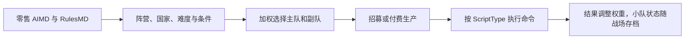

# 尤复全局遭遇战 AI 与远征

2026-11-27，Iron Tide 0.32。单挑 SkirmishAI 和多人 HouseAI 共用全局选队器。远征中经营基地的盟军、苏军和尤里电脑席位走相同入口。关卡触发、目标单位、护送队、已有编队和虫群孵化有各自的控制器。

## 从零售文件到战场命令

原始依据为本机 Steam 版的 aimd.ini、rulesmd.ini 和随游戏的 FinalAlert 2 源码。运行 `node iron_tide/tools/export_retail_skirmish.mjs <游戏安装目录> <输出文件>` 可重新提取。交付表与重新导出的文件逐字节一致，SHA-256 为 `97e9f84f6ccc673049177fd53aaa7c550f9accb95118dab544090dc890c44ca4e`。所有原始 ID、队伍组成、主副队引用和逐步参数可查 [retail_skirmish.json](../../data/ra2/retail_skirmish.json)。

165 条 AITriggerType 按阵营分为盟军 68、苏军 52、尤里 45。158 条至少开放一个难度，7 条保留原版全难度关闭。165 条引用 157 种 TeamType、119 个 TaskForce、83 个 ScriptType。49 条有副队，其中 7 条的主副队相同且类型上限为 1。选队检查本方和可见敌方、可见中立资产、对手资金，以及铁幕或超时空充能。使用零售难度延迟、队伍数和防守队上限、成功失败增减权重。引擎保存当前成员、脚本位置、随机数状态和目标，取消被俘、死亡和改派为关卡目标的成员。

| 动作 | 游戏中执行的行为 |
| --- | --- |
| 0、46、47、58 | 按目标类别攻击、攻击指定建筑、接近敌方或己方指定建筑。建筑参数区分威胁与距离偏好，按视野和移动域选择。工程师占领、间谍渗透和爆破交给现有单位操作。 |
| 5、6、11、21、49、53、54 | 定时警戒、跳转、区域守卫、分散、标记成功、敌我基地外围集结。巡逻可以在站点间循环，猎矿队击毁矿车后继续按脚本索敌。 |
| 8、9、14、43 | 实际卸载、展开、上车、等待搭乘。按原参数移出运输单位，在指定回程的队伍中送回集结点。 |
| 55、57、61、62、63 | 请求充能铁幕和超时空攻击，进入坦克碉堡、生化反应炉和战斗碉堡。调用现有施放、可用落点和驻军容量检查。 |

## 建造与 Iron Tide 规则

三阵营共用原表建筑类别、基础防御列表、电力余量和建筑配额。遭遇战继续通过原有生产队列、建筑落点、矿工和供电预算付款。工厂、兵营和矿场根据基地规模申请扩张，有飞机占满停机位后可追加机场。可见基洛夫触发的固定和机动防空优先于普通队伍补员。凶残 1、凶残 2 的属性、收入、补员和扩展效果继续由原难度系统结算。零售小队会避开护送、油井、肉鸽指挥车和现场车队。

原版动作由 Godot 的连续地图、雾区、路径服务和战斗单位执行。未发现目标时使用可达、未探索的位置探路，建筑周围的威胁由可见接敌情况估算。等待或长期无进展的任务会让出单位。首批猎矿、紧急防空和巡逻允许先于全局抽队响应，保留 Iron Tide 的反应速度。零售“苏军困难轰炸”编成直接引用 3 枚 `V3ROCKET`，在招募时绑定 3 辆真实 V3 发射车，导入数据和触发条件仍使用原 ID。零售引擎内部寻路、威胁评分与调度时序的逐帧一致性尚无对照。

## 验证和已知缺口

Godot 4.7.2 隔离用户目录，无头验证。新入口 [retail_house_regression.tscn](../../tests/retail_house_regression.tscn) 通过 1192 项。覆盖每条触发器的三个难度、所有主副队和权重边界，真实尤里选队及读档、上下车、驻军、防空让行、击毁矿车后的转攻、实际铁幕和超时空位移。30 个远征关卡均独立从出击入口建立任务和运行阵营 AI。场景测试使用指定部队、位置和充能条件。各规则在自然对局的触发频率及所有队伍自然完成全脚本的结果尚未逐条实测。

另通过首批小队 30 项、凶残 1 后勤 282 项、凶残 2 共 94 项、进攻编组 83 项、供电 120 项、战术 62 项、命令派发 29 项、远征防守 35 项。原有 30 关连续目标与结算回归运行至第 30 关。其 159 条失败、遭遇战作战大回归的 22 条失败、成长大回归的 6 条失败，在接入前冻结副本与交付行为中逐名对照一致。其中包括远征小地图与结果文案、飞机起降、苏军建筑时序和 ORCA 成长效果。保留原断言及失败状态。

存档 1 以校验通过、原载荷一致的隔离夹具运行，381 个单位、207 栋建筑、5 个电脑阵营。3×、1600×900、全画质、独立桌面，每场观测 30 秒，测量进程关闭通常自动存档和远征定时检查点。接入前两场整帧 P95 为 1089.322 / 1440.484 ms，交付两场为 641.502 / 523.161 ms。主机并发审计（按上述四场顺序）为 需复核、需复核、需复核、需复核。并发样本无法用于认定性能增减。完整隔离输出在本次验证目录 `iron-retail-full-acd5c30f`。

首批移植的范围和历史验证见 [首批记录](SESSION_2026-11-27_RETAIL_SKIRMISH_AI.md)。其中“仅首批队伍、全局权重和尤里尚待接入”的描述为此前版本；当前覆盖以上述数据与验收为准。
